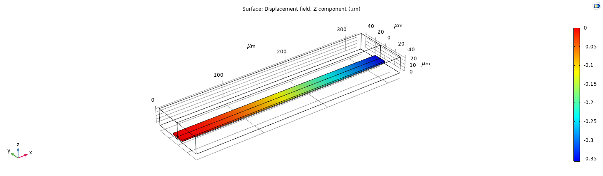
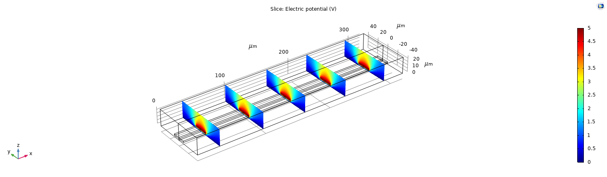
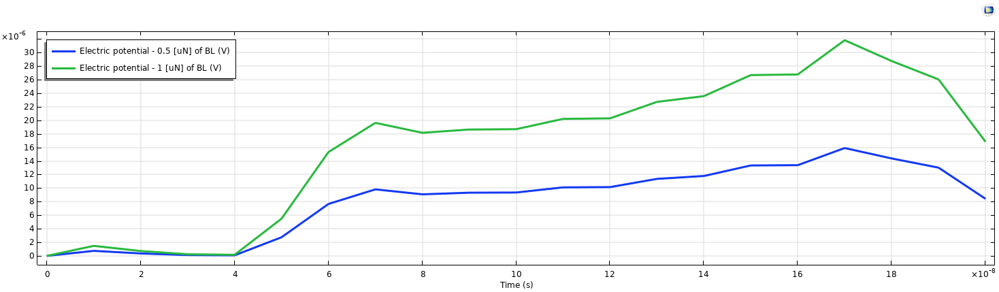
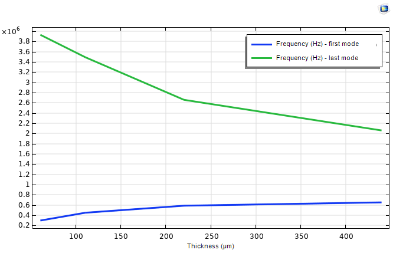

## Objective

Many small sensors and actuators work by converting between electrical and mechanical energy. These
three short exercises in COMSOL looked at the main mechanisms: electrostatic actuation, the
piezoelectric effect, and the vibration modes that matter when a device is used at resonance.

## Electrostatic actuation of a cantilever

A voltage is applied between a micro-cantilever, about 350 µm long, and a ground plane, with air around
it. The electric field attracts the two surfaces, and the beam bends. This couples the electrostatics of
the air to the solid mechanics of the beam, with the root of the beam fixed.

*Vertical displacement. The free end moves down by about 0.35 µm, and the fixed end does not move.*

*Electric potential on slices along the beam, from 5 V at the terminal to 0 V at the ground plane.*

The potential varies continuously through the surrounding air, so the field acts over a region
around the beam and not only at its surface.

## Voltage generated by a piezoelectric structure

The reverse effect was then studied, with a sinusoidal force applied to a PVDF structure. Doubling the
force at the same frequency exactly doubled the maximum voltage:

| Applied force | Maximum voltage |
|---|---|
| 0.5 µN | 15.91 µV |
| 1 µN | 31.82 µV |

*Maximum electric potential over time for the two forces.*

The two curves have the same shape, as the model is linear. This proportionality is what makes
piezoelectric materials useful as sensors, since the voltage gives a predictable measure of the force.

## Vibration modes of a PVDF transducer

An eigenfrequency study calculated the vibration modes of a PVDF transducer with thicknesses of 60, 110,
220 and 440 µm, recording the first and last calculated modes for each.

*Frequency of the first and last calculated modes for each thickness.*

| Thickness | First mode | Last calculated mode |
|---|---|---|
| 60 µm | 296 kHz | 3.93 MHz |
| 440 µm | 651 kHz | 2.06 MHz |

- **First mode:** the frequency rises with thickness, because a thicker structure is stiffer. It rises
  only 2.2 times for a thickness 7.3 times greater, less than the direct proportion expected of pure
  bending, so the mode is probably not simple bending throughout this range.
- **Last calculated mode:** the frequency falls with thickness. This value needs caution, because
  it depends on how many modes were requested, and on which types of mode fall within that number.

Thickness is therefore a useful design variable for setting the operating frequency of a transducer.

## How a piezoelectric mass sensor works

These results connect to a common application. The resonant frequency of a structure depends on its
stiffness $$k$$ and mass $$m$$:

$$
f = \frac{1}{2\pi}\sqrt{\frac{k}{m}}
$$

A mass deposited on the sensor lowers this frequency. For a small added mass, the change is

$$
\frac{\Delta f}{f} \approx -\frac{\Delta m}{2m}
$$

The piezoelectric material both drives the vibration and reads it, so tracking the resonant frequency
gives a very sensitive measurement of the added mass.

## Limitations

- **Short exercises:** these are guided studies, without mesh studies or experimental comparison.
- **Few thicknesses:** only four were simulated, so the trends between them are approximate.
- **Coarse time sampling:** the voltage curves have only about 20 time points, so they show the overall
  response better than the waveform.

## What I learned

- How to set up electromechanical and piezoelectric couplings in COMSOL.
- How to extract derived values, and use parametric and eigenfrequency studies.
- How geometry sets the resonant frequencies of a device, which is key to designing sensors.
