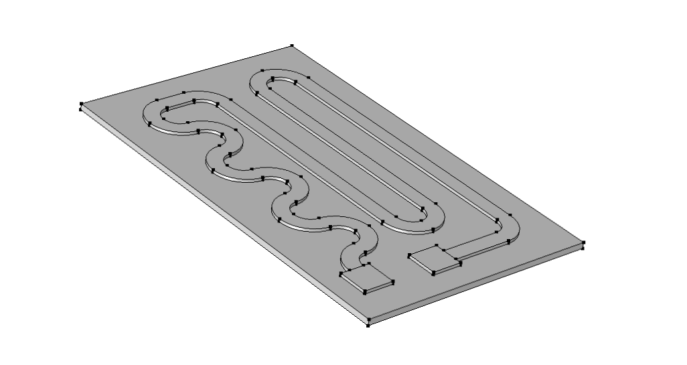
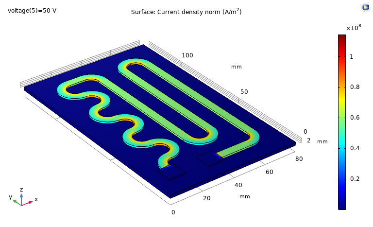
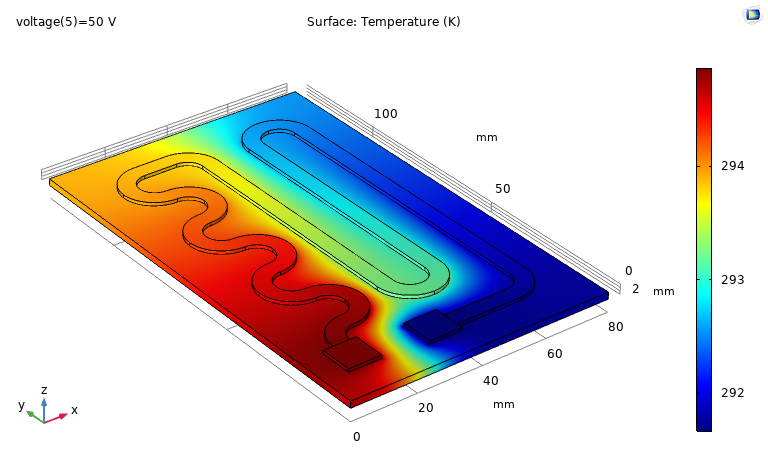
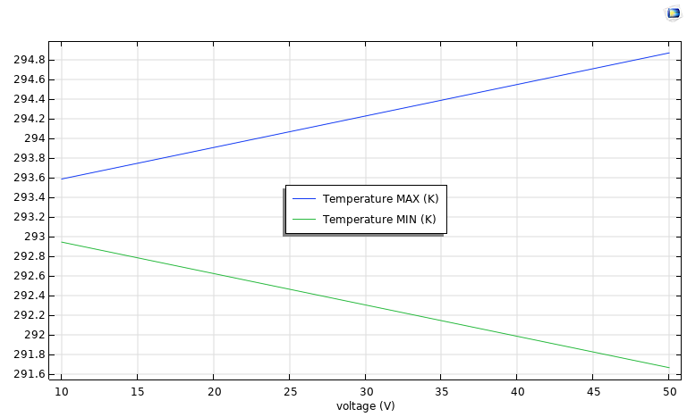
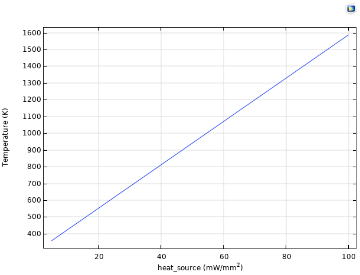

## Objective

Heat generation matters in almost every electronic device and in heaters and thermal sensors. This short
COMSOL exercise looked at a serpentine conductor on a plate, to answer three questions: where does the
current concentrate, how does the applied voltage change the temperature, and how does a heat source
change it?

## Model

A serpentine conductor with two square terminals sits on a thin plate. The left terminal is at the applied
voltage and the right terminal is grounded, with an ambient temperature of 293.15 K.

*The geometry after extrusion.*

## Results at 50 V

### Current density

The current concentrates on the inside of each bend, where the path is shorter and the resistance lower.
This effect is known as current crowding, and these regions are the most likely hot spots and failure
points in a real conductor.

*Current density, highest at the inner edge of the bends, with a peak of about 1.1 × 10⁸ A/m².*

### Electric potential

The potential falls steadily along the conductor from 50 V to 0 V. It is uniform on each terminal, as
the conditions are applied to their whole surface.

*Electric potential, from the 50 V terminal to the grounded terminal.*

### Temperature

The temperature field closely follows the shape of the potential field, varying between about 291.7 K
and 294.9 K.

*Temperature, higher near the 50 V terminal and lower near the grounded terminal.*

## Effect of the voltage

A parametric sweep from 10 V to 50 V gave the extreme temperatures. Both vary linearly with the voltage:

$$
T_\text{max} = 0.0323\, V + 293.257, \qquad T_\text{min} = -0.0317\, V + 293.257
$$

*Maximum and minimum temperatures against the applied voltage.*

The range grows with the voltage, and both lines meet near the ambient temperature at 0 V, with a small
difference of about 0.1 K.

### What this trend indicates

This trend is the most interesting result. Joule heating is proportional to the square of the voltage,
and it can only heat the material:

$$
q_\text{Joule} = \sigma \lvert \nabla V \rvert^2 = \frac{\lvert \mathbf{J} \rvert^2}{\sigma}
$$

Here, the temperature changes **linearly**, and one end falls **below** ambient. So Joule heating alone
does not explain the result. A linear effect that heats one side and cools the other is characteristic of a
thermoelectric effect, such as the Peltier effect, in which the heat is proportional to the current.
Confirming this would require switching off the thermoelectric terms in the model and comparing.

## Effect of a heat source

A sweep of a heat source up to 100 mW/mm² gave a linear rise in the maximum temperature:

$$
T \approx 12.943\, Q + 293.12
$$

*Maximum temperature against heat source intensity.*

This linear result is expected for steady conduction with constant properties. At $$Q = 0$$, the fit gives
a temperature close to ambient, as it should.

## Limitations

- **Guided exercise:** this is a short study, without a mesh study or experimental comparison.
- **High temperatures:** at the top of the sweep, the model reaches about 1600 K. At that level, constant
  properties are unrealistic, radiation would matter, and many materials would fail.
- **Offset at 0 V:** the voltage fits meet about 0.1 K above ambient, which a study with more points at low
  voltage could explain.

## What I learned

- How to couple electrical and thermal physics in COMSOL, and run parametric sweeps.
- How geometry concentrates current, and why this matters for the reliability of conductors.
- How to compare a trend with the physics it should follow, as the shape of a curve can reveal which
  effect is dominant.
