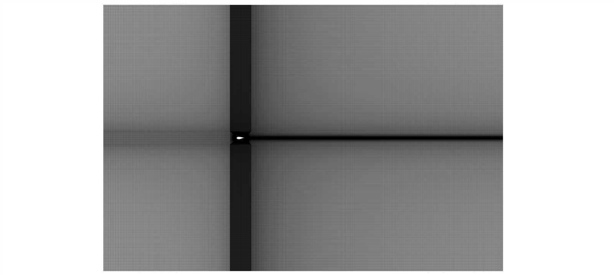
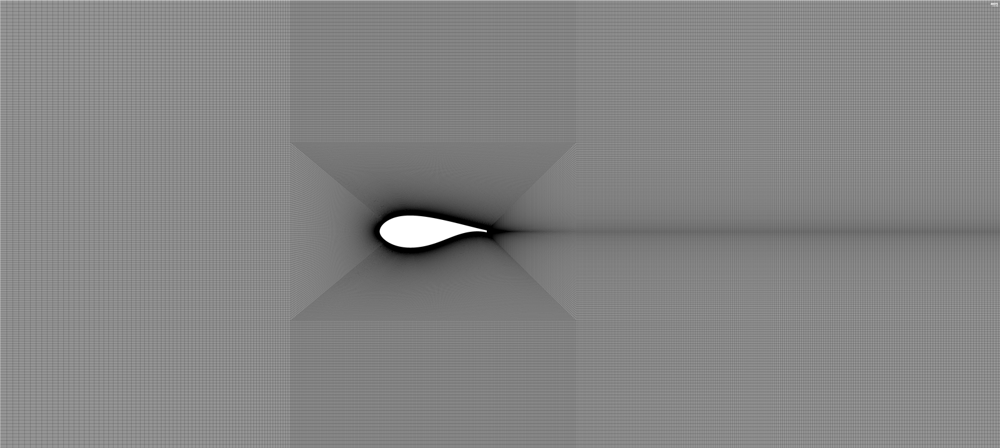
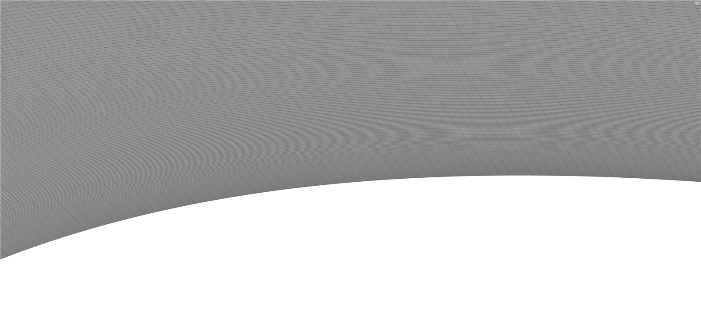
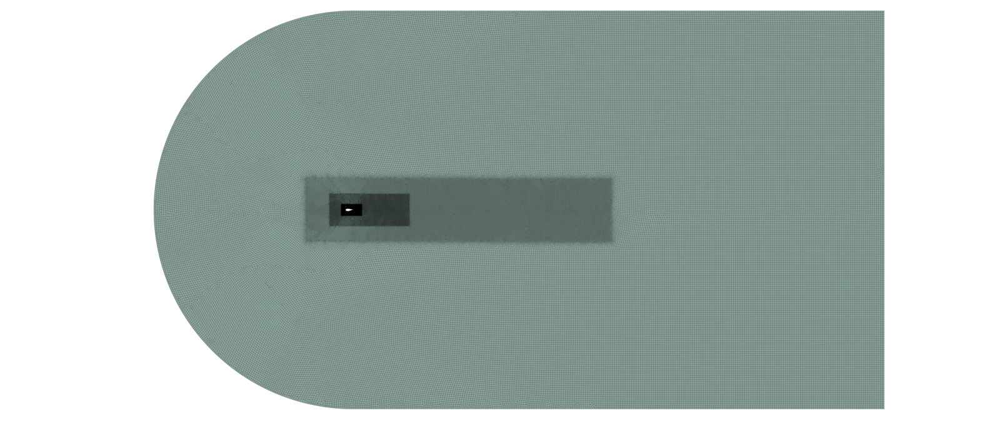
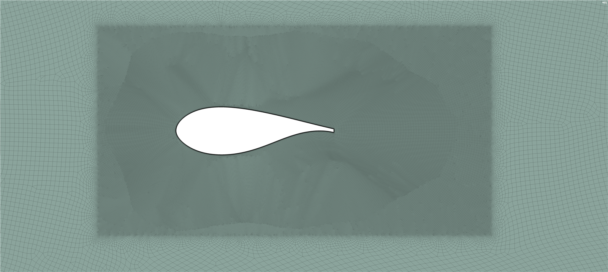
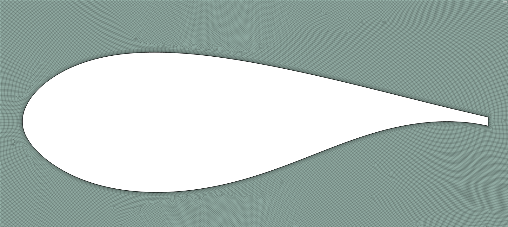
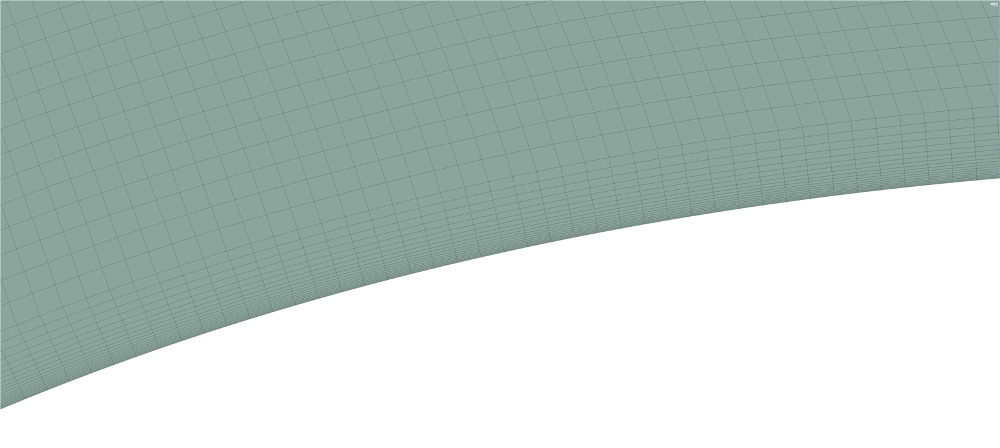

## Objective

Before applying a CFD method to a new problem, it has to be tested on a case with known
answers. The FFA-W3-301 is a 30.1% thick wind turbine airfoil with published wind tunnel
data, which makes it a good first benchmark. This study asked two separate questions:

1. **Verification:** how much do the results change with the mesh?
2. **Validation:** how close are the results to the real flow?

This was a first development stage, so its meshes and settings are not a final
methodology. It also records what would need to be improved afterwards.

## Reference data

The reference is the smooth-airfoil campaign of Fuglsang et al. in the VELUX open-jet wind
tunnel, with a chord of 0.60 m, $$Re_c = 1.6 \times 10^6$$ and a background turbulence
intensity of about 1%. The report gives its results only as graphs, so the values were
digitised, with a reading uncertainty of about ±0.01 in $$C_L$$ and ±0.0005 in $$C_D$$.

## Setup

The Reynolds number and inlet turbulence were chosen to match the experiment. With air at
$$\rho = 1.217$$ kg/m³ and $$\mu = 1.79 \times 10^{-5}$$ Pa·s, the freestream velocity is

$$
U_\infty = \frac{Re_c\, \mu}{\rho\, c} \approx 39.22\ \text{m/s}
$$

| Setting | Value |
|---|---|
| Solver | Fluent, pressure-based, Coupled |
| Turbulence model | k-ω SST, fully turbulent |
| Inlet turbulent viscosity ratio | 1.5, with a check at 3.0 |
| Gradients | Least-squares cell-based |
| Pressure and momentum | Second order |
| Turbulence equations | First-order upwind |
| Residual targets | 10⁻⁵ to 10⁻⁶ |
| Airfoil wall | Smooth, no-slip |
| Incidence | Set through the inlet velocity components |

## Mesh families

Two families were tested, in different domains. Because the outer domain changed along
with the topology, comparing them does not isolate the effect of the topology alone.

### Structured mesh, rectangular domain

A multiblock quadrilateral mesh, with $$-17 \le x/c \le 33$$ and $$\lvert y/c \rvert \le 15$$.

*Complete rectangular domain.*

*Near-field and wake refinement.*

*Near-wall detail on the upper surface.*

### Quad-dominant mesh, C-type domain

An unstructured mesh with 20 inflation layers and a growth ratio of 1.15, with a 15c upstream
radius and the outlet at $$x/c = 65$$.

*Complete C-shaped domain, with nested refinement regions around the airfoil and the wake.*

*Local refinement around the airfoil.*

*Cell distribution around the airfoil.*

*Inflation-layer detail on the upper surface.*

## Verification: grid refinement

The refinement study ran separately, at $$\alpha = 0°$$ and $$Re_c = 3.0 \times 10^6$$.

**Structured mesh**

| Cells | Max. y⁺ | Mean y⁺ | CL | CD |
|---|---|---|---|---|
| 180,000 | 171 | 61.8 | 0.2212 | 0.0205 |
| 713,000 | 54 | 19 | 0.2581 | 0.0168 |
| 756,800 | 16.9 | 6.3 | 0.2589 | 0.0166 |
| 816,800 | 10.5 | 3.9 | 0.2584 | 0.0169 |

**Quad-dominant mesh**

| Cells | Max. y⁺ | Mean y⁺ | CL | CD |
|---|---|---|---|---|
| 81,000 | 26 | – | 0.264 | 0.0168 |
| 308,000 | 12.65 | 7.4 | 0.273 | 0.0175 |
| 637,000 | 8.5 | 4.95 | 0.259 | 0.0174 |

In the final structured refinement, $$C_L$$ changes by 0.19% and $$C_D$$ by 1.78%. In the
final quad-dominant refinement, the changes are 5.41% and 0.57%, and the lift does not
change in a single direction.

So these results **do not show full mesh independence**. The finest structured results are
the least sensitive at zero incidence, but a check at one angle says little about the flow near
separation. Most of these meshes also do not reach $$y^+ < 1$$ over the whole airfoil, so
they do not fully resolve the viscous sublayer.

## Comparison with the experiment

The aerodynamic campaign ran at $$Re_c = 1.6 \times 10^6$$, from −4° to 10° in 2° steps.
Hover over a point to see its values.



*Lift coefficient. Both meshes follow the measured trend but stay above it, by more at the higher angles.*



*Drag coefficient. CFD is above the experiment at low incidence and below it at 10°.*



*Drag polar, formed from the same results.*

| α (°) | CL structured | CD structured | CL quad-dominant | CD quad-dominant | CL experiment | CD experiment |
|---|---|---|---|---|---|---|
| −4 | −0.2328 | 0.0283 | −0.2294 | 0.0291 | – | – |
| −2 | −0.0495 | 0.0224 | −0.0478 | 0.0230 | −0.071 | 0.0161 |
| 0 | 0.2164 | 0.0197 | 0.2192 | 0.0202 | 0.185 | 0.0156 |
| 2 | 0.4826 | 0.0191 | 0.4938 | 0.0195 | 0.438 | 0.0178 |
| 4 | 0.7335 | 0.0198 | 0.7490 | 0.0203 | 0.660 | 0.0195 |
| 6 | 0.9593 | 0.0219 | 0.9745 | 0.0225 | 0.887 | 0.0216 |
| 8 | 1.1474 | 0.0255 | 1.1534 | 0.0269 | 1.082 | 0.0264 |
| 10 | 1.2813 | 0.0327 | 1.2613 | 0.0363 | 1.152 | 0.0441 |

- **Lift:** both meshes capture the trend. On the structured mesh, $$C_L$$ is about 0.02 to
  0.07 above the experiment between −2° and 8°, and about 0.13 above it at 10°.
- **Drag:** near 0°, CFD gives about 0.020 and the experiment about 0.016. Good lift
  therefore does not imply equally good drag.
- **Transition:** the model is fully turbulent, so it does not represent any laminar part of the
  boundary layer. This is a likely contributor to the excess drag at low incidence, although
  the study did not isolate this effect.
- **Inlet turbulence:** raising the viscosity ratio from 1.5 to 3.0 had a modest effect over this
  range.

## Limitations

- The campaign stops at 10°, so it does not establish a stall angle.
- The reference values were read from graphs, with the uncertainty given above, and no
  experimental uncertainty band is assumed.
- Only two mesh families were compared, and their refinement sequences were not uniform, so a
  formal Grid Convergence Index was not calculated.

## What I learned

- Verification and validation are different questions, and agreement in one does not imply the
  other.
- Matching the experiment's conditions matters more than using a convenient standard case.
- A reported y⁺ target has to be checked against what the mesh actually achieves.
- This benchmark showed that the method needed wall-resolved meshes, transition modelling and a
  more careful record of each case.

## Reference

P. Fuglsang, I. Antoniou, K. S. Dahl and H. A. Madsen, *Wind tunnel tests of the FFA-W3-241,
FFA-W3-301 and NACA 63-430 airfoils*, Risø-R-1041(EN), Risø National Laboratory, 1998.
