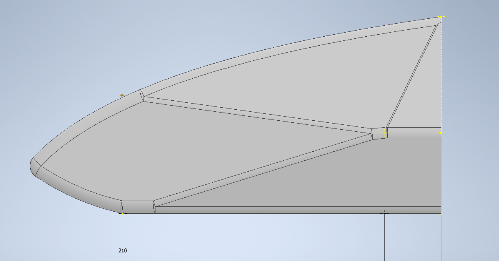
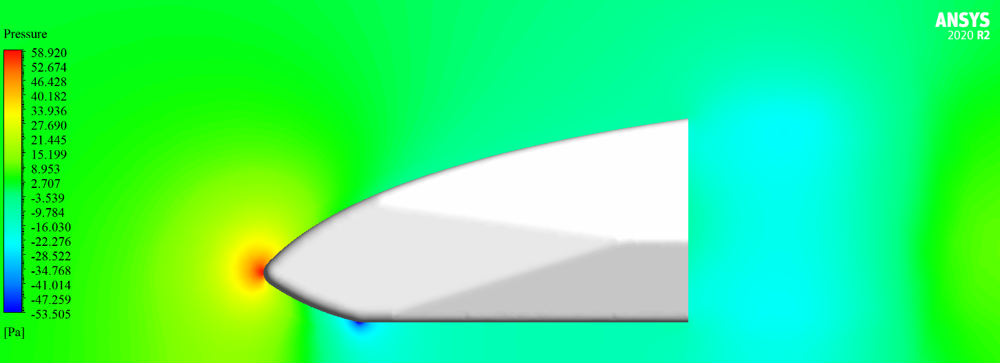
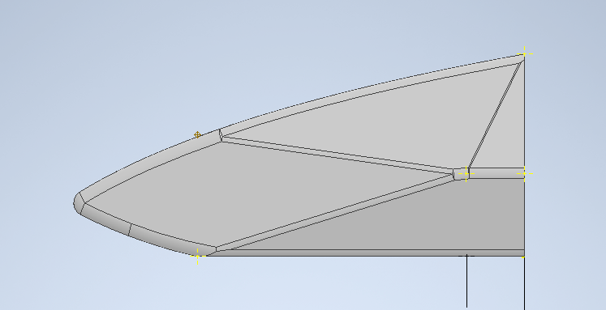
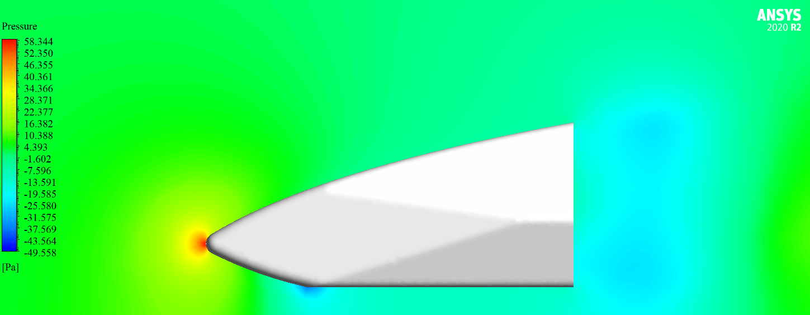
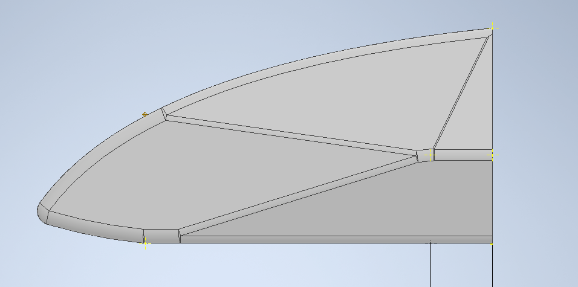
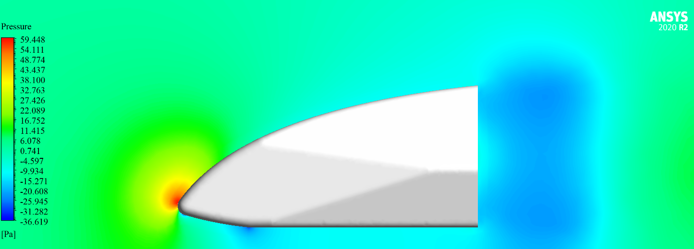

## Objective

The goal was to understand how the shape of the nose cone, especially the height of
its tip, changes the aerodynamic forces on the car, and to choose a design with these
numbers in hand. The study followed an iterative loop: change the CAD, run the CFD,
compare the results, and change the CAD again.

## Process

1. **Parametric CAD (Autodesk Inventor).** The main variable was the tip height,
   controlled through reference sketches and driven dimensions, so a new variant could
   be generated quickly.
2. **Geometry preparation (Ansys SpaceClaim).** Each design was exported as STEP, then
   inspected, simplified and repaired until watertight. All designs used a common
   external flow domain. Symmetry was not used, so asymmetric flow structures could
   still develop.
3. **Meshing.** An unstructured polyhedral/tetrahedral mesh with near-wall prism layers.
4. **Simulation (Ansys Fluent).** The same mesh settings, schemes, convergence criteria
   and ground distance were used for every design, so differences in the results come
   from the geometry.

## Simulation setup

| Setting | Value |
|---|---|
| Solver | Pressure-based, steady |
| Turbulence model | k-ω SST |
| Inlet | Uniform velocity, 10 m/s |
| Inlet turbulence | 1% intensity, viscosity ratio 1.5 |
| Outlet | Pressure outlet, zero gauge pressure |
| Walls | No-slip |
| Spatial discretisation | Second order for all variables |
| Pressure–velocity coupling | SIMPLE or coupled, depending on stability |
| Convergence | Residuals below 10⁻⁵, with stable drag coefficient |

### Near-wall mesh and mesh independence

The k-ω SST model was used with the boundary layer resolved down to the wall, so the
first prism layer was sized for a target of $$y^+ \approx 1$$:

$$
y^+ = \frac{\rho\, u_\tau\, y}{\mu}
$$

The mesh used 12 to 15 prism layers, with a growth ratio of 1.15 to 1.2, to blend
smoothly into the core mesh. A check at three refinement levels showed that the
integrated drag coefficient of the selected mesh differed by less than 1% from the next
finer level.

## Force coefficients

The designs are compared through dimensionless coefficients, with $$\rho$$ the air
density, $$U$$ the inlet velocity and $$A$$ the reference area:

$$
C_L = \frac{L}{\tfrac{1}{2} \rho U^2 A}, \qquad
C_D = \frac{D}{\tfrac{1}{2} \rho U^2 A}, \qquad
C_p = \frac{p - p_\infty}{\tfrac{1}{2} \rho U^2}
$$

Here, a positive $$C_L$$ means downforce.

## Results

| Design | CL (downforce) | CD | CL/CD |
|---|---|---|---|
| Mark III | 0.270 | 0.340 | 0.79 |
| Mark IV | 0.198 | 0.307 | 0.64 |
| Mark V | 0.238 | 0.329 | 0.72 |
| Mark VI | 0.175 | 0.299 | 0.59 |

- **Downforce and drag rise together.** Ranking the designs by CL or by
  CD gives the same order: Mark VI, IV, V and III.
- **There is a trade-off.** Mark VI has the lowest drag, 12% below Mark III, but it also
  has 35% less downforce. Mark III has the highest downforce and the highest
  CL/CD, but also the highest drag.
- **Which is best depends on the car.** The choice depends on how the nose cone works
  with the rest of the aerodynamic package, which this study does not include.

### Mark III

The pressure field is at the top of this page. Mark III has a large inclined surface
under its tip and a sharp corner where that surface meets the flat underside. The plotted
pressure there reaches about −142 Pa, the strongest suction of the four designs.

### Mark IV

*Mark IV geometry in Autodesk Inventor.*

*Mark IV pressure field. CL = 0.198, CD = 0.307.*

### Mark V

*Mark V geometry in Autodesk Inventor.*

*Mark V pressure field. CL = 0.238, CD = 0.329.*

### Mark VI

*Mark VI geometry in Autodesk Inventor.*

*Mark VI pressure field. CL = 0.175, CD = 0.299.*

## Sanity check

For standard air at 10 m/s, the dynamic pressure is

$$
\tfrac{1}{2} \rho U^2 = \tfrac{1}{2} \times 1.225 \times 10^2 \approx 61\ \text{Pa}
$$

At the stagnation point, $$C_p$$ should be close to 1. The peak pressures in the figures,
between 58 and 60 Pa, give $$C_p \approx 0.95$$ to $$0.98$$, as expected.

## Limitations and next steps

- **Isolated part.** The nose cone ends in a flat rear face, followed by a wake. On the
  car, this face connects to the rest of the body, so the absolute CD values
  are not those of the installed nose cone. The comparison between designs is more
  meaningful than the absolute numbers.
- **No experimental validation yet.** The results come from CFD only. The planned next
  steps are transient simulations, wind tunnel validation and structural integration.
- **One speed.** All results are at 10 m/s, so they do not show how the coefficients
  change with Reynolds number.

## What I learned

- How to link parametric CAD and CFD into a fast design loop.
- How to keep a comparison fair by holding the mesh settings, schemes and convergence
  criteria constant.
- How to read force coefficients as a trade-off rather than looking for one winning
  number.
