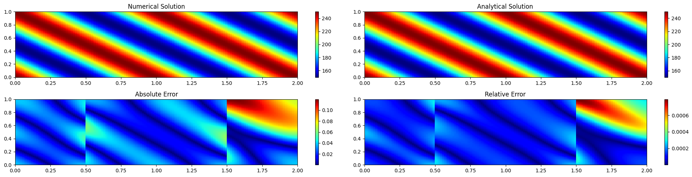
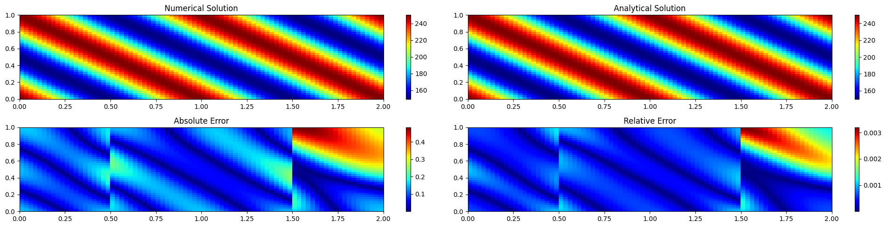
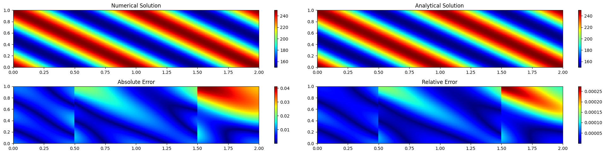

## Objective

Commercial CFD codes hide the discretisation and the linear algebra behind a
GUI. To understand what happens underneath, I wrote a complete finite volume
solver for the **2D steady heat diffusion equation** with spatially varying
thermal conductivity, and checked that it converges to the right answer.

## Method

- **Discretisation:** cell-centred finite volume method on a structured
  rectangular mesh, with conductivity varying in space.
- **Linear solvers**, implemented and compared:
  - direct solver (`numpy.linalg.solve`);
  - Gauss–Seidel iteration;
  - Gauss–Seidel with **successive over-relaxation (SOR)**.
- **Mesh refinement** from coarse grids up to 320 × 160 cells.
- For each solver and mesh, I recorded accuracy, execution time, memory use
  and the number of iterations to converge.

## Verification: Method of Manufactured Solutions

There is no closed-form solution for an arbitrary conductivity field, so I
used the **Method of Manufactured Solutions (MMS)**: choose an analytical
temperature field, derive the source term that makes it an exact solution,
and check that the solver recovers it.

On the finest mesh, the SOR solver converged to a residual of 10⁻⁸ and
reproduced the manufactured field with a **mean absolute error of about
6 × 10⁻⁵** (mean relative error ≈ 3 × 10⁻⁷). The error maps in the figure
above show where the remaining discretisation error sits.

## Results for each linear solver

Each solver produced the same four-panel output: numerical solution,
analytical (manufactured) solution, and the absolute and relative error
between them. Note the different colour scales of the error maps.

*Direct solver (`numpy.linalg.solve`).*

*Gauss–Seidel, converged to a residual of 10⁻⁸.*

*Gauss–Seidel with SOR (optimal relaxation factor ω ≈ 1.98), converged to a residual of 10⁻⁸.*

## Findings

The full comparison of the three solvers (accuracy, time, memory and
convergence history on each mesh) is in the technical report.

## What I learned

- How boundary conditions and face conductivities enter the FVM coefficient
  matrix, and why the matrix is sparse and diagonally dominant.
- How to **verify** a CFD code (MMS, mesh refinement) rather than just
  checking that the plot looks plausible.
- The trade-offs between direct and iterative solvers. These are the same
  trade-offs a commercial solver makes on large industrial meshes.
