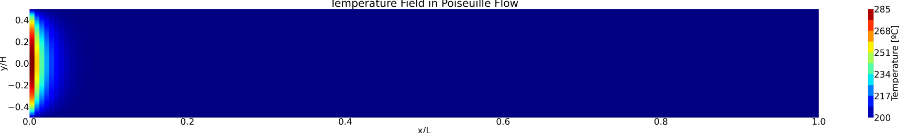
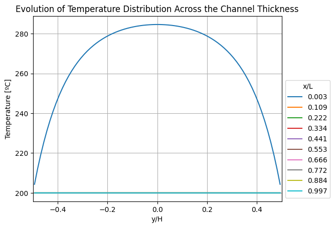
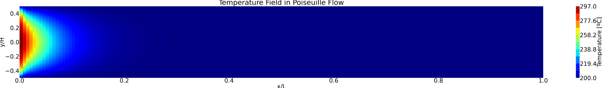
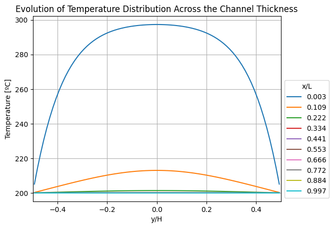
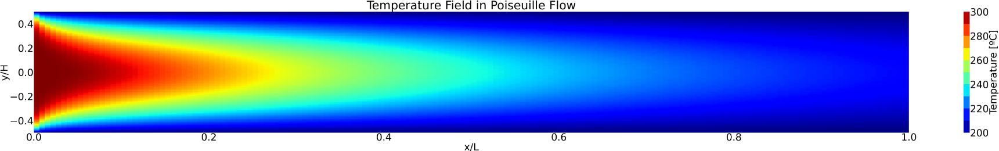
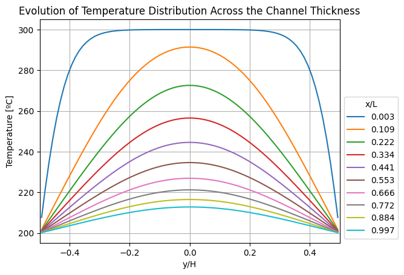
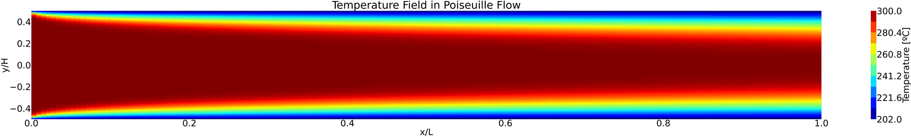
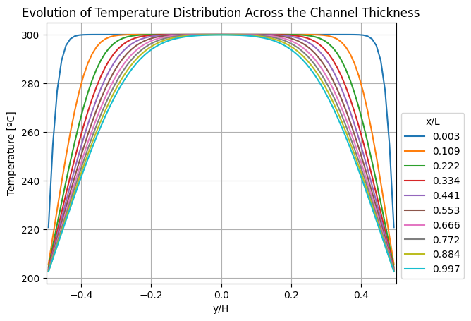
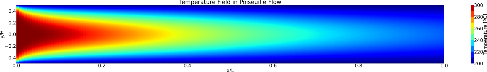
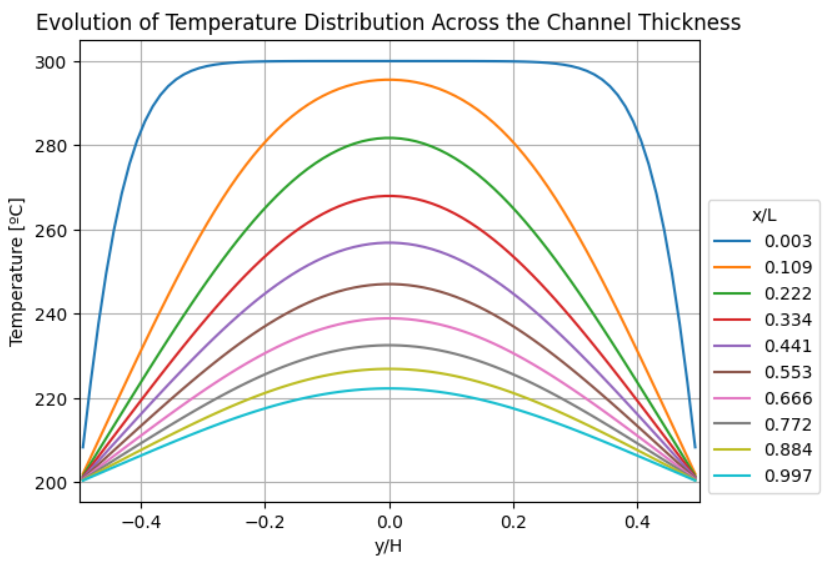

## Objective

Simulate how a hot fluid cools as it flows through a channel with colder walls,
the basic problem behind heat exchangers and cooling passages. The solver handles
the steady energy equation for fully developed laminar flow between parallel
plates, including heating by viscous dissipation.

## Governing equations

The velocity profile is the analytical solution for fully developed Poiseuille
flow, with mean velocity $$U$$ and $$y$$ measured from the channel centreline:

$$
u(y) = \frac{3}{2} U \left[ 1 - \left( \frac{2y}{H} \right)^2 \right]
$$

The temperature follows the steady convection–diffusion equation, with no velocity
across the channel and viscous dissipation $$\Phi$$ as a source term:

$$
\rho c_p\, u(y) \frac{\partial T}{\partial x} = k \left( \frac{\partial^2 T}{\partial x^2} + \frac{\partial^2 T}{\partial y^2} \right) + \Phi
$$

For this velocity profile, the dissipation grows with the square of the distance
from the centreline, so it is largest at the walls:

$$
\Phi = \mu \left( \frac{du}{dy} \right)^2 = \frac{144\, \mu U^2}{H^4}\, y^2
$$

Two dimensionless numbers describe the problem:

$$
\text{Pe} = \frac{\rho c_p U H}{k}, \qquad \text{Br} = \frac{\mu U^2}{k (T_\text{in} - T_w)}
$$

The Péclet number compares heat carried by the flow with heat conducted through the
fluid. The Brinkman number compares viscous heating with heat conducted because of
the temperature difference.

## Setup

| Parameter | Value |
|---|---|
| Channel height H | 4 mm |
| Channel length L | 30 H = 120 mm |
| Inlet temperature Tin | 300 °C |
| Wall temperature Tw | 200 °C |
| Density ρ | 1000 kg/m³ |
| Specific heat cp | 4180 J/(kg·K) |
| Conductivity k | 0.6 W/(m·K) |
| Viscosity μ | 10⁻³ Pa·s |
| Mean velocity U | 0.1 m/s |

These are the default values in the notebook, which correspond to
$$\text{Pe} \approx 2800$$ and $$\text{Br} \approx 1.7 \times 10^{-7}$$.

## Finite volume discretisation

Convection is discretised with the first-order upwind scheme, so a cell receives
convected heat only from its west neighbour. With the convective strength
$$F = \rho c_p u \Delta y$$ and central differences for diffusion:

$$
a_P T_P = a_E T_E + a_W T_W + a_N T_N + a_S T_S + S_U
$$

$$
a_E = k \frac{\Delta y}{\Delta x}, \quad
a_W = k \frac{\Delta y}{\Delta x} + F, \quad
a_N = a_S = k \frac{\Delta x}{\Delta y}
$$

$$
a_P = a_E + a_W + a_N + a_S - S_P, \qquad S_U = \Phi\, \Delta x \Delta y
$$

### Boundary conditions

| Boundary | Type | Neighbour coefficient | Added to SP | Added to SU |
|---|---|---|---|---|
| Inlet | Prescribed temperature | aW = 0 | −(2k Δy/Δx + F) | (2k Δy/Δx + F) Tin |
| Walls | Prescribed temperature | aN or aS = 0 | −2k Δx/Δy | 2k Tw Δx/Δy |
| Outlet | Zero gradient | aE = 0 | 0 | 0 |

### Linear solvers

The coefficients form a system $$\mathbf{A}\mathbf{T} = \mathbf{b}$$. It can be
solved directly, by inverting $$\mathbf{A}$$ with `numpy.linalg.inv`, or iteratively
with **GMRES** (`scipy.sparse.linalg.gmres`) on a sparse copy of the matrix, with a
tolerance of 10⁻⁸. GMRES suits this problem because convection makes
$$\mathbf{A}$$ non-symmetric. Meshes from 20 × 10 up to 160 × 80 were used to check
mesh independence.

## Results: effect of the Péclet number

### Pe = 1

*Conduction dominates. The fluid reaches the wall temperature within a few percent of the channel length.*

*Temperature profiles at ten stations along the channel. Every station after the inlet is already at the wall temperature.*

### Pe = 10

*The thermal entrance region grows.*

*The centreline is still about 13 °C above the wall temperature at x/L ≈ 0.1.*

### Pe = 100

*Convection dominates. Hot fluid persists along the centreline over most of the channel.*

*The near-uniform inlet profile develops into a parabolic shape as the thermal boundary layers merge.*

### Default parameters, Pe ≈ 2800

*Thermal boundary layers grow slowly from the walls and do not meet within the channel.*

*The core of the flow is still at 300 °C at the outlet, so the channel never becomes thermally developed.*

## Viscous dissipation

The dissipation term can be switched on and off in the solver. The case below has it
switched off (Br = 0). At the default parameters its effect is very small: the
largest value, at the walls, is about 22 W/m³, while conduction across the channel
is of the order of $$k \Delta T / H^2 \approx 4 \times 10^{6}$$ W/m³.

*Temperature field with viscous dissipation switched off (Br = 0).*

*Temperature profiles along the channel for Br = 0.*

## Limitations

- The velocity profile is prescribed, so the flow is assumed to be fully developed
  from the inlet.
- Fluid properties are constant, even with a temperature difference of 100 °C.
- First-order upwind adds numerical diffusion, which matters most at high Péclet
  numbers.

## What I learned

- How to discretise a convective term, and how upwinding makes the matrix
  non-symmetric.
- When to use a sparse matrix and a Krylov solver instead of a dense direct solve.
- How to read dimensionless groups physically. The same reasoning applies to cooling
  passages and heat exchangers in compressors.
