## Objective

The goal was to simulate how a rotating impeller drives the flow in a closed tank of
water, and to measure the torque and power it needs. I prepared the geometry, built the
mesh in Fluent Meshing, and ran the case with the Multiple Reference Frame (MRF) method,
which is a common low-cost way of modelling rotating machinery.

## Geometry

The model is a closed cylindrical tank with a central shaft and a disc impeller with six
flat blades and a central hub. The tank has no baffles. A cylindrical zone around the
impeller holds the rotating reference frame.

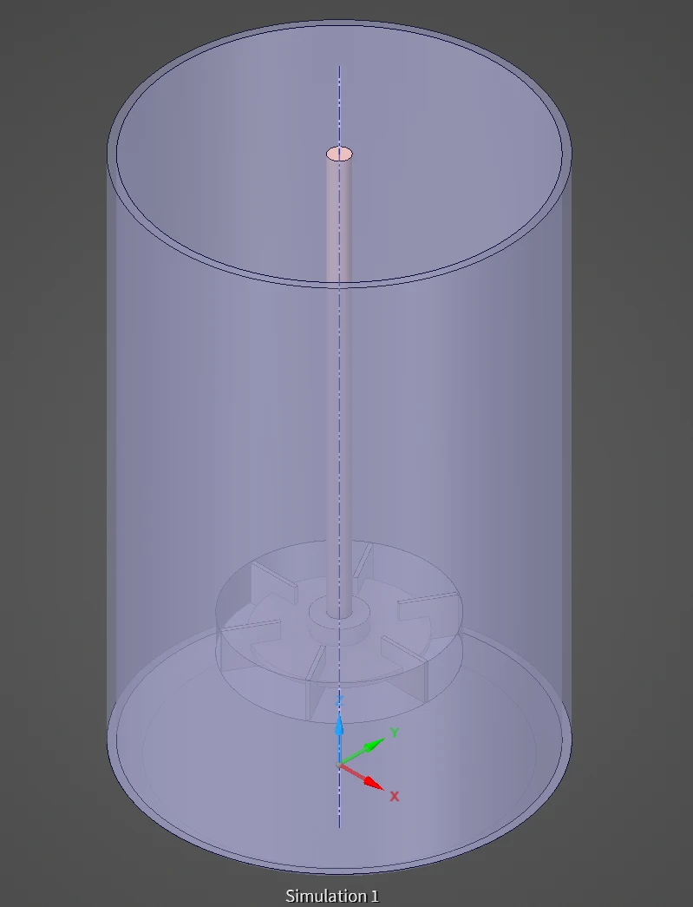
*The tank, the shaft and the impeller, with the rotating zone around the impeller.*

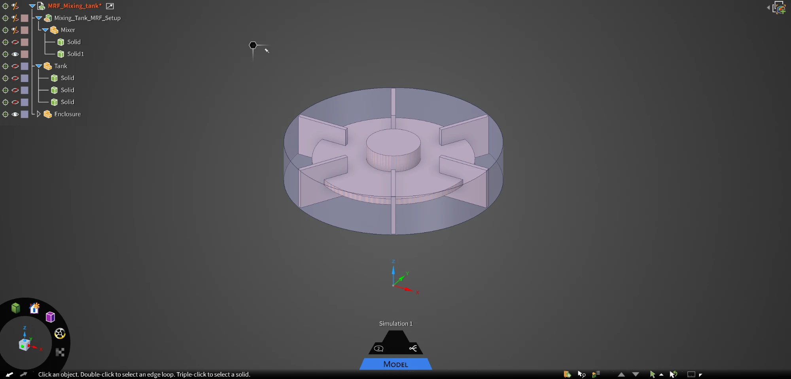
*The rotating zone, with the impeller inside it.*

## The MRF method

The fluid around the impeller is solved in a frame that rotates with it, so the blades
are stationary in that frame and the problem becomes steady. For an angular velocity
$$\vec{\Omega}$$, the absolute and relative velocities are related by

$$
\vec{v} = \vec{v}_r + \vec{\Omega} \times \vec{r}
$$

and the momentum equation in the rotating zone gains the Coriolis and centrifugal
contributions:

$$
\nabla \cdot (\rho \vec{v}_r \vec{v}) + \rho\, \vec{\Omega} \times \vec{v} = -\nabla p + \nabla \cdot \bar{\bar{\tau}}
$$

The rest of the tank is solved in the stationary frame, and the two zones exchange data
at their shared interface. The blades stay fixed in one position relative to the tank.
In a tank without baffles, the tank walls look the same from every angle, which makes
this a reasonable approximation.

## Mesh

The mesh was generated with the Fluent Meshing watertight geometry workflow. The two fluid
zones share a conformal interface, and the impeller solid was left out of the volume
mesh. The result has **382,935 poly-hexcore cells**, with local refinement around the
impeller and the shaft. No prism layers were used, so the near-wall resolution was
checked afterwards through $$y^+$$.

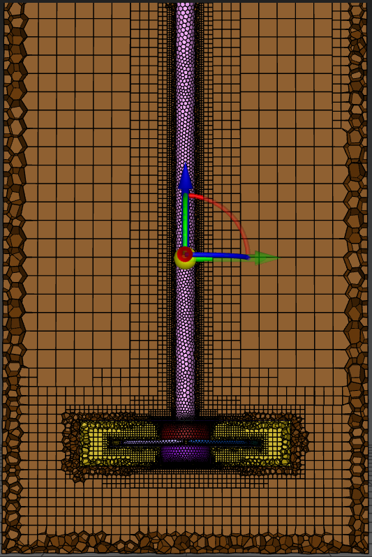
*Vertical section of the mesh through the tank axis.*

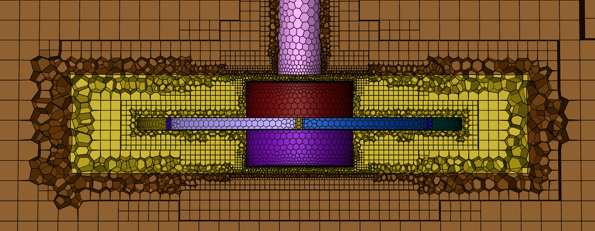
*Detail of the mesh around the impeller, with the rotating zone in yellow.*

## Setup

| Setting | Value |
|---|---|
| Solver | Pressure-based, steady |
| Turbulence model | k-ω SST |
| Fluid | Liquid water, constant properties |
| Rotating zone | Frame motion at 240 rpm (25.13 rad/s) around the z axis |
| Impeller walls | Moving with the rotating zone |
| Shaft | Moving wall, absolute rotation at 240 rpm |
| Tank walls and top | Stationary, no-slip |
| Inlets and outlets | None, the domain is closed |
| Initialisation | Hybrid |

A closed domain has no inlet to carry the flow: the motion comes only from the impeller.
The flow therefore needs many iterations to spread through the tank, so the results were
judged by the integrated quantities and not only by the residuals.

## Convergence

The case ran for **8,415 iterations**, until all the residuals met the convergence
criterion. Two integrated quantities were monitored:

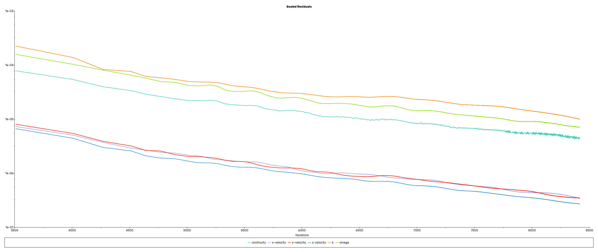
*Scaled residuals from iteration 3,500 onwards.*

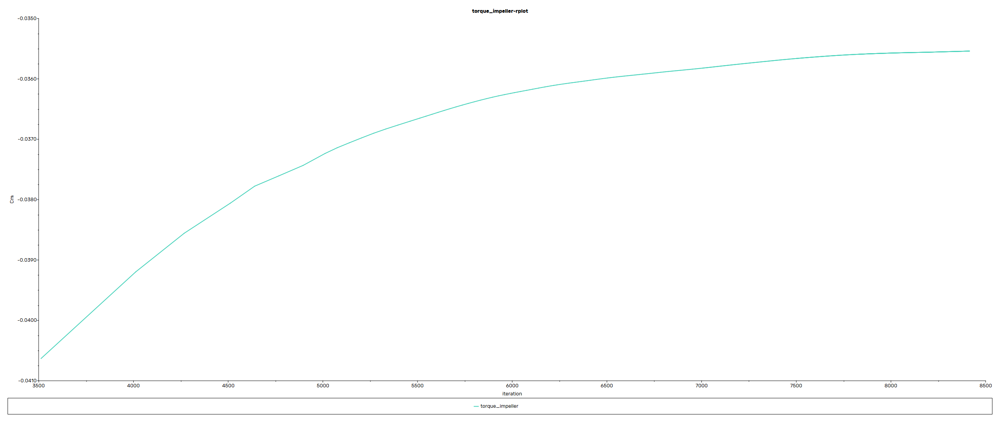
*Moment coefficient of the impeller, from iteration 3,500 onwards.*

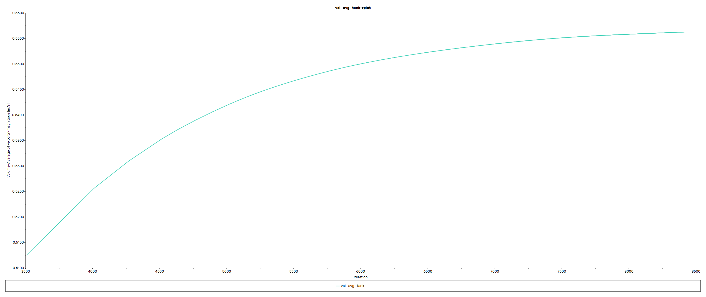
*Volume-averaged velocity in the tank zone, from iteration 3,500 onwards.*

Over the last 800 iterations, the moment coefficient changed by about 0.3% and the mean
velocity by about 0.2%, both still moving slowly in the same direction. The final values
are close to steady, but not completely flat.

## Torque and power

Fluent reports the moment on the impeller as a coefficient, using its reference values
($$\rho_\text{ref} = 1.225$$ kg/m³, $$V_\text{ref} = 1$$ m/s, $$A_\text{ref} = 1$$ m²
and $$L_\text{ref} = 1$$ m). The torque comes from the final value, $$|C_m| = 0.0355$$:

$$
T = C_m \cdot \tfrac{1}{2} \rho_\text{ref} V_\text{ref}^2 A_\text{ref} L_\text{ref}
= 0.0355 \times 0.6125 \approx 0.022\ \text{N·m}
$$

The power absorbed by the impeller is then

$$
P = T\, \Omega = 0.0218 \times 25.13 \approx 0.55\ \text{W}
$$

The mean velocity in the tank zone settles at **about 0.56 m/s**.

The impeller has a radius of 48 mm, so $$D = 0.096$$ m. At $$N = 4$$ rev/s, this gives a tip speed
of about 1.2 m/s and the two standard dimensionless numbers of a stirred tank:

$$
Re = \frac{\rho N D^2}{\mu} \approx 3.7 \times 10^4, \qquad
N_p = \frac{P}{\rho N^3 D^5} \approx 1.05
$$

The Reynolds number is well within the turbulent range for a stirred tank, which supports the use of
a turbulence model. The power number is the value to compare with published power curves for
unbaffled tanks, which would be a useful next check.

## Results

### Horizontal plane through the impeller

The velocity peaks near the blade tips, at about 1.5 m/s, somewhat above the tip speed of 1.2 m/s, and
a wake trails from each tip.
The pattern repeats on all six blades, as expected.

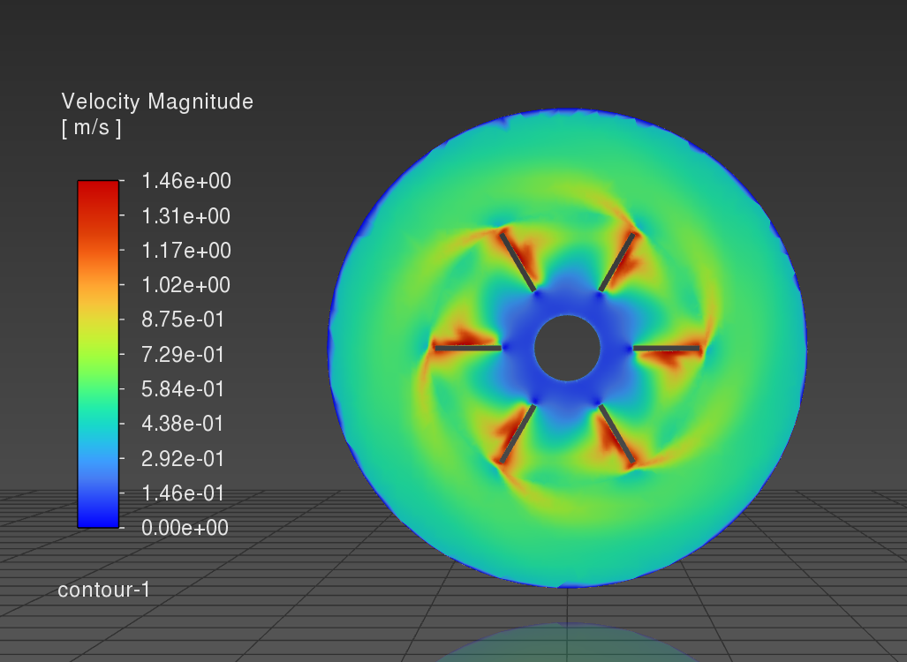
*Velocity magnitude on the impeller plane. The wakes curl away from the six blade tips.*

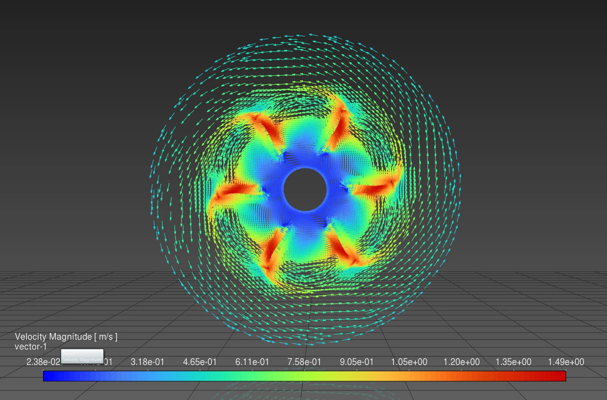
*Velocity vectors on the impeller plane. The fluid swirls around the axis across the whole tank.*

The static pressure shows the low-pressure zone behind each blade. The pressure difference
between the two sides of a blade is the main source of the torque.

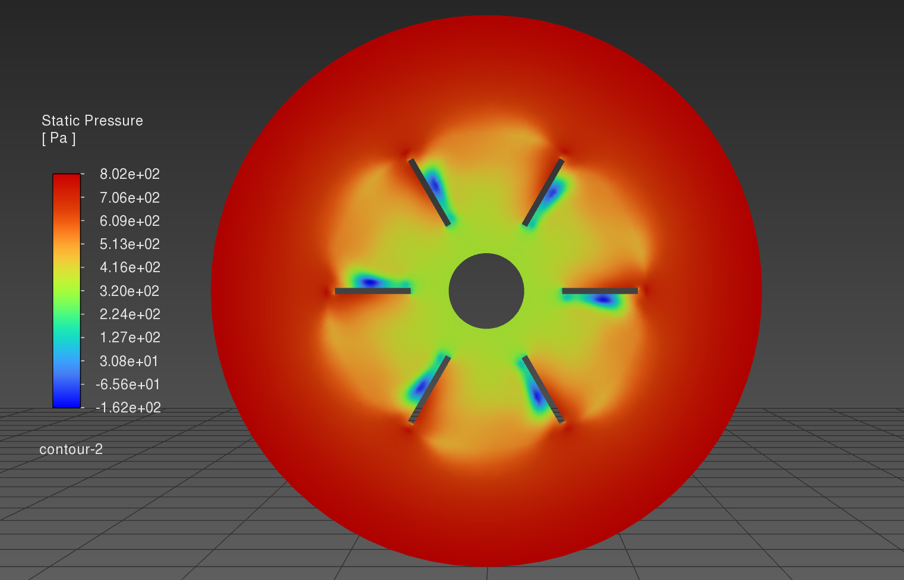
*Static pressure. The lowest values are just behind the blades, and the highest at the wall.*

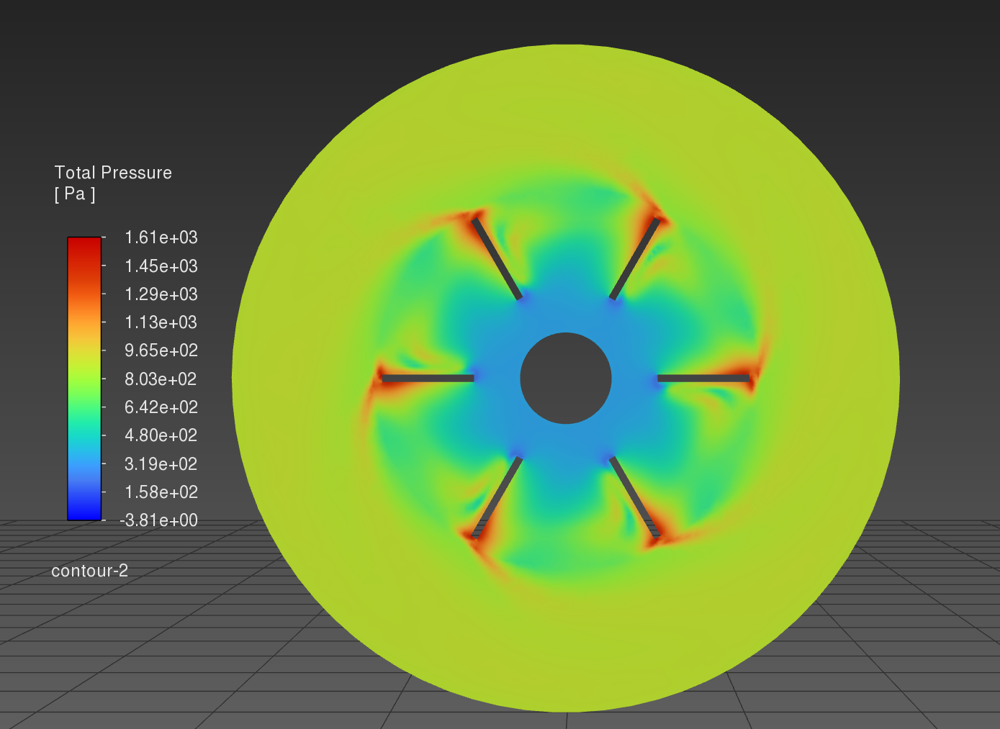
*Total pressure. The highest values are near the blade tips, where the impeller adds the most energy to the fluid.*

### Vertical plane through the axis

Without baffles, the fluid mostly rotates around the axis, along almost the full height of
the tank. The velocity is low near the shaft and in a thin layer at the walls, and strongest
at an intermediate radius.

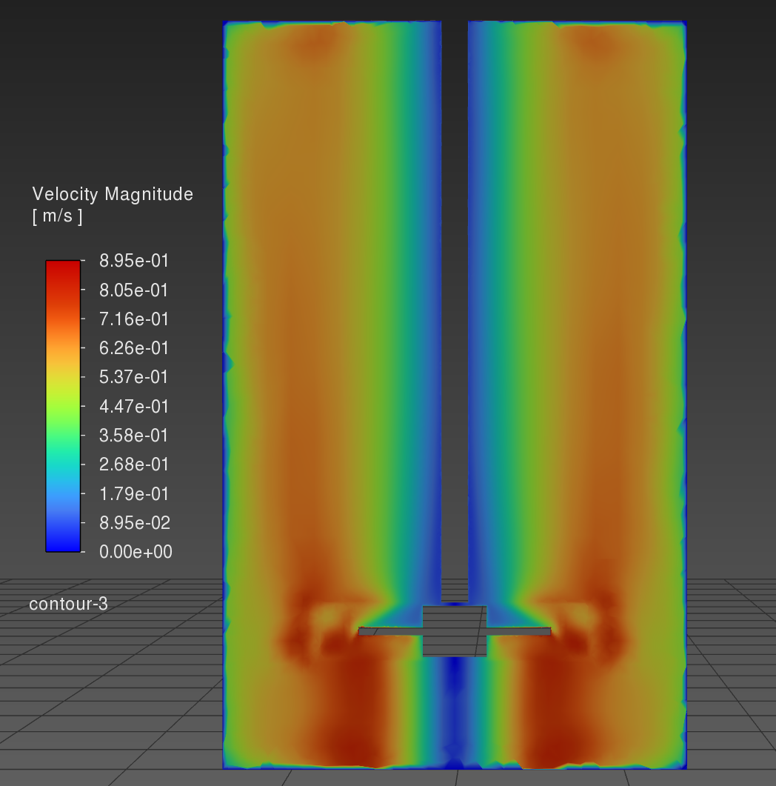
*Velocity magnitude on a vertical plane.*

This rotation sets the pressure field. Rotating flow needs a radial pressure gradient to
balance the centrifugal acceleration, so the pressure rises from the axis to the wall:

$$
\frac{\partial p}{\partial r} = \rho \frac{v_\theta^2}{r}
$$

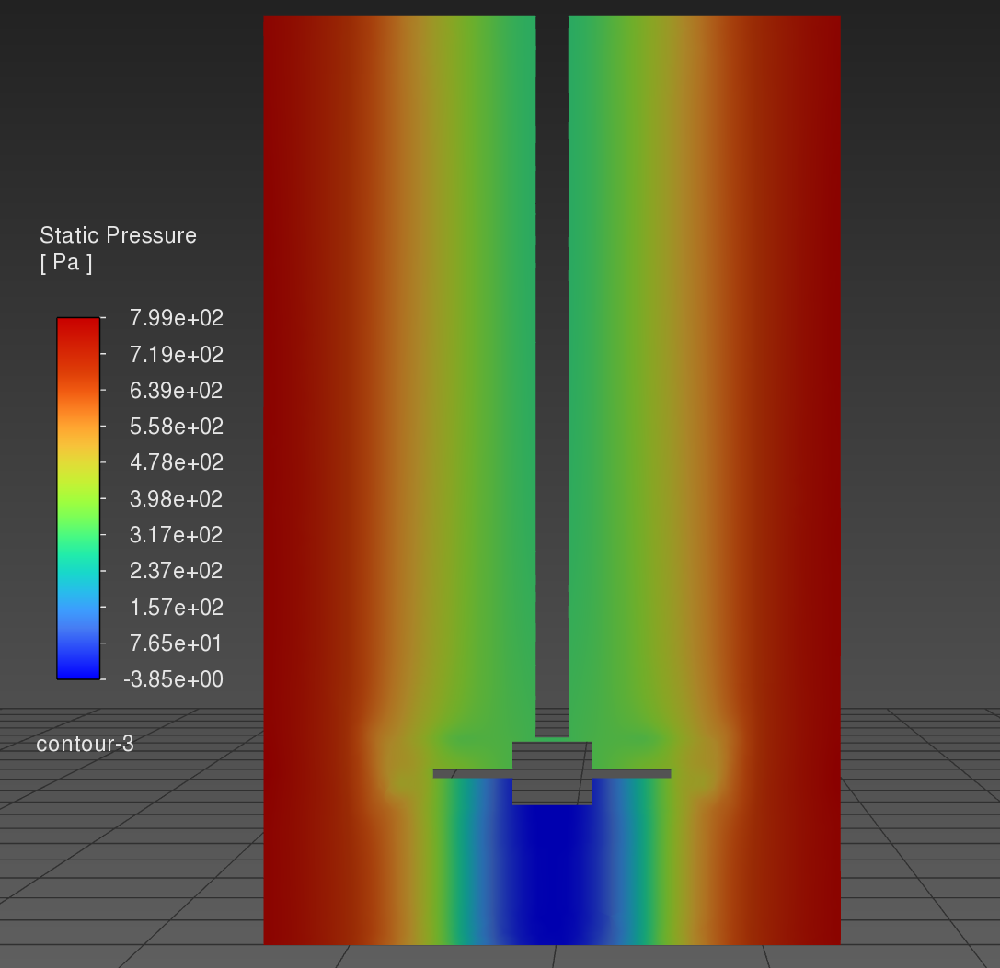
*Static pressure on a vertical plane, with an almost purely radial variation in most of the tank.*

The turbulence is strongest in the wakes just off the blade tips. It then extends as a broad
column above the impeller.

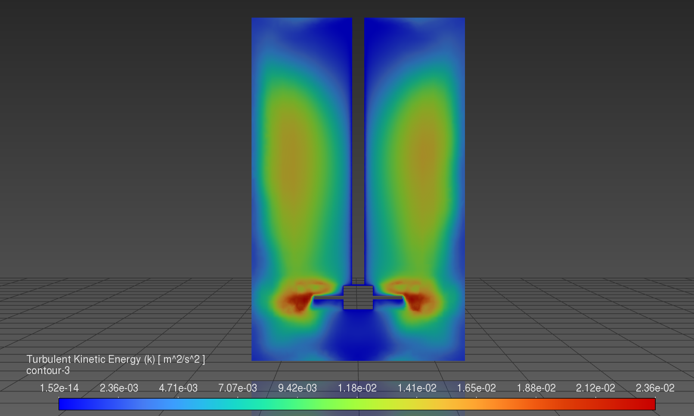
*Turbulent kinetic energy on a vertical plane.*

## Near-wall resolution

| Wall | Mean y⁺ | Maximum y⁺ |
|---|---|---|
| Impeller surfaces | about 1 – 10 | 22 |
| Shaft | 3 | 5 |
| Tank top | 36 | 66 |
| Tank side and bottom | 45 | 82 |

Much of the impeller lies in the buffer layer ($$5 < y^+ < 30$$), where a mesh is neither
fully resolved nor in the wall-function range. The tank walls are mostly in the
wall-function range.

## Limitations and next steps

- **No mesh study or validation yet.** The results come from one mesh and have not been
  compared with experiments. A finer mesh with prism layers would be the first next step.
- **Fixed blade position.** MRF cannot capture the unsteady interaction between blades and
  flow. A transient sliding mesh simulation could check the torque and the wakes.
- **Flat top.** The top is modelled as a stationary wall, so the free surface and the vortex
  that would form at it in a real open, unbaffled tank are not represented.
- **Weak vertical mixing.** Adding baffles would turn part of the swirl into vertical
  circulation. It would be a useful comparison for a mixing study.

## What I learned

- How to prepare a rotating case: separating the fluid zones, naming the surfaces and sharing
  the topology between zones.
- How to define wall motion correctly in a rotating frame.
- How to judge convergence in a closed domain from integrated quantities.
- How to check the units and reference values behind a reported coefficient.
