## Objective

A compressor is designed from a short list of targets: the pressure ratio, the mass flow, the
shaft speed and an expected efficiency. CFD is then used to check whether the bladed geometry
actually delivers them. In this project, I solved a complete three-stage axial compressor in
Ansys CFX and compared the result with its design specification.

The goals were:

1. Set up a multistage case, with six blade rows connected by rotor-stator interfaces.
2. Check the overall performance against the design targets.
3. Look at how the work and the losses are shared between the stages and the blade rows, and
   where the flow departs from the ideal.

| Design specification | Value |
|---|---|
| Stages | 3 (rotor + stator each) |
| Total pressure ratio | 2.25 |
| Mass flow | 85 kg/s |
| Shaft speed | 8500 rpm |
| Isentropic efficiency | 0.78 |
| Blade numbers | R1 29 · S1 35 · R2 41 · S2 35 · R3 49 · S3 52 |
| Inlet total conditions | 101.325 kPa, 288.15 K |
| Outlet static pressure | 180 kPa |

From these values, the design implies a total temperature ratio and temperature rise of

$$
\tau = 1 + \frac{\pi^{(\gamma-1)/\gamma} - 1}{\eta}
$$

With $$\pi = 2.25$$ and $$\eta = 0.78$$, this gives $$\tau = 1.334$$, a temperature rise of
$$\Delta T_0 = 96.3$$ K, and a shaft power of about $$\dot m \, c_p \, \Delta T_0 \approx 8.2$$ MW. If the three stages
shared the pressure rise equally, each would have a pressure ratio of $$2.25^{1/3} = 1.31$$.

## Geometry and mesh

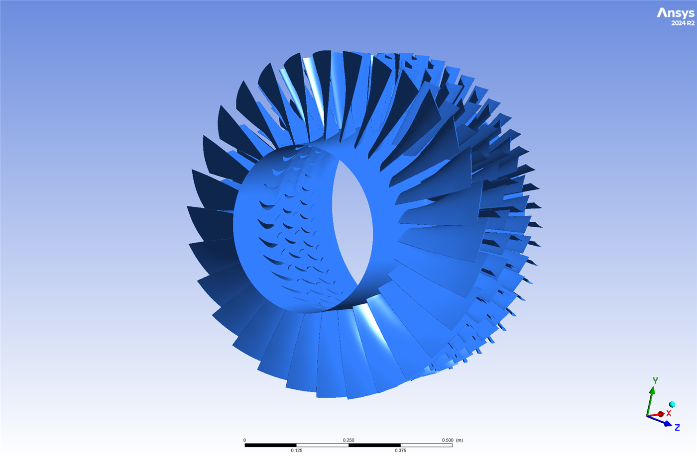
*The three rotors and three stators, built in CFD-Post by repeating each single passage around
the annulus. The casing is hidden.*

<figure>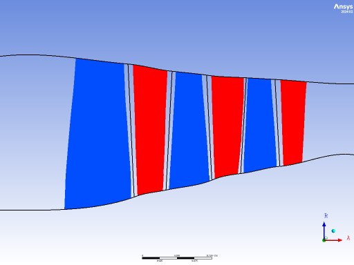<figcaption>Meridional view: the rotors in blue and the stators in red. The hub rises and the annulus narrows along the machine, as the air becomes denser.</figcaption></figure>
<figure>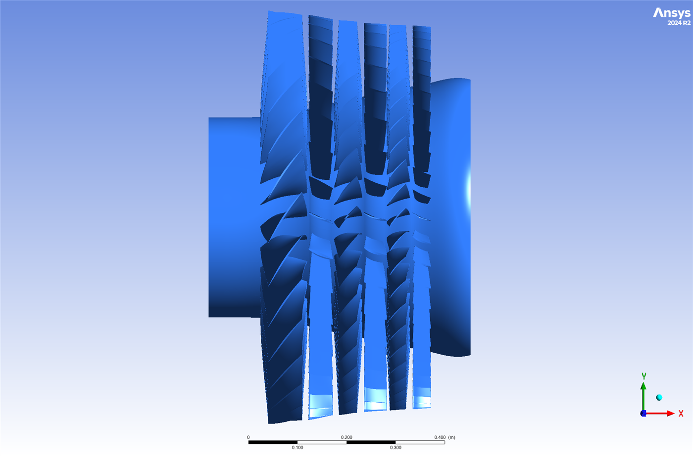<figcaption>Side view of the blading. The blades get shorter from the first to the last row.</figcaption></figure>

Each blade row is modelled as **one blade passage** with rotational periodicity, so the whole
compressor is solved with six passages instead of 241 blades. The mesh, made of structured
hexahedral blocks, has **791,401 nodes**:

| Blade row | R1 | S1 | R2 | S2 | R3 | S3 |
|---|---|---|---|---|---|---|
| Nodes | 140,164 | 22,218 | 202,158 | 25,788 | 182,742 | 218,331 |

The first two stators have a much coarser mesh than the other rows, with 6 to 8 times fewer nodes.
I come back to this in the convergence and limitations sections.

## Solver setup

| Setting | Value |
|---|---|
| Analysis | Steady RANS, rotating frame in the rotors |
| Fluid | Air, ideal gas with constant $$c_p$$ |
| Energy | Total energy, including viscous work |
| Turbulence | k-ω SST, automatic wall treatment |
| Inlet | $$p_0$$ = 101.325 kPa, $$T_0$$ = 288.15 K, normal to the boundary |
| Outlet | Average static pressure 180 kPa |
| Rotor-stator interfaces | Stage (mixing plane), GGI connection |
| Walls | Adiabatic, no slip |
| Casing | Stationary (counter-rotating wall in the rotor frames) |
| Advection scheme | High resolution |
| Run | 500 iterations, 4 h 25 min on 16 cores |

### Connecting rotors and stators

The rotors turn at 8500 rpm and the stators are fixed, and each row has a different number of
blades. A **mixing-plane (stage) interface** connects them: at each interface, the flow is
averaged around the circumference and passed to the next row as a radial profile. This removes
the wakes and the blade-to-blade variation between rows, and allows a steady solution with one
passage per row. The cost is that the unsteady interaction between rotor wakes and the
downstream blades is lost, and the averaging itself creates a small mixing loss at every
interface.

## Performance quantities

The inlet and outlet values are **mass-flow averages**, and the total pressure and temperature
are taken in the stationary frame:

$$
\pi = \frac{\overline{p_{0,\text{out}}}}{\overline{p_{0,\text{in}}}}, \qquad
\tau = \frac{\overline{T_{0,\text{out}}}}{\overline{T_{0,\text{in}}}}, \qquad
\eta = \frac{\pi^{(\gamma-1)/\gamma} - 1}{\tau - 1}
$$

The mass flow is not imposed. It is a result of the solution, set by the inlet total pressure,
the outlet static pressure and the blade geometry, so it is a real test of the design.

## Convergence

The run stopped at the 500-iteration limit, without reaching the RMS target of $$10^{-6}$$. The
residuals fell for about 130 iterations, and then levelled off at about $$10^{-4}$$ for momentum
and energy, $$3 \times 10^{-4}$$ for k and $$10^{-5}$$ for continuity, with a slow oscillation.

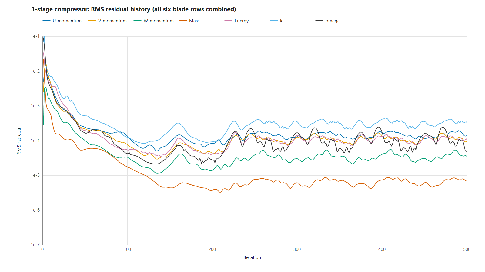
*RMS residuals of the whole compressor. After about 130 iterations, they stop falling.*

The residuals of each blade row show where this comes from. At the last iteration, the momentum
residual is about $$10^{-6}$$ in R1 and S1, $$10^{-5}$$ in R2, and between $$10^{-4}$$ and
$$4 \times 10^{-4}$$ in R3, S2 and S3. The oscillation sits in the rear of the machine, where
the stator flow separates near the hub (see below) and where S2 has its coarse mesh.

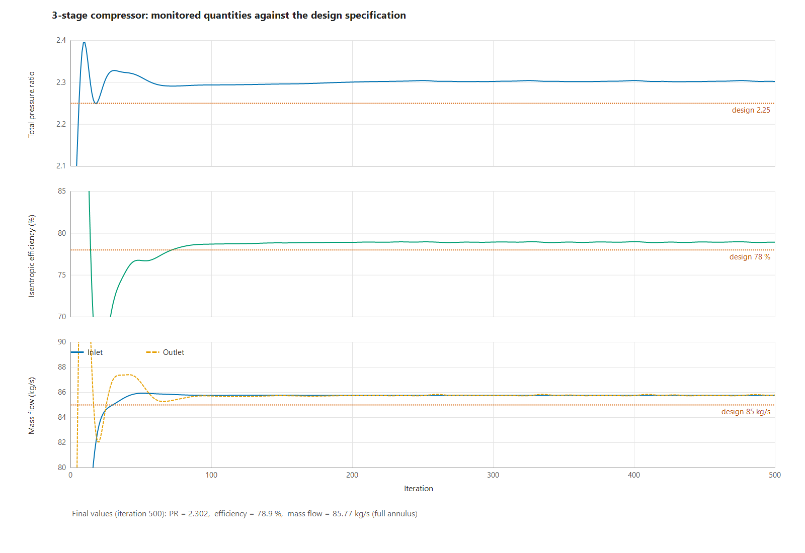
*Pressure ratio, efficiency and inlet and outlet mass flow during the run, with the design
values as dotted lines.*

| Quantity | Iteration 200 | Iteration 500 |
|---|---|---|
| Total pressure ratio | 2.301 | 2.302 |
| Isentropic efficiency | 78.9 % | 78.9 % |
| Mass flow, inlet | 85.77 kg/s | 85.77 kg/s |
| Mass flow, outlet | 85.75 kg/s | 85.79 kg/s |

After iteration 200, the pressure ratio moves by less than 0.1% and the efficiency by less than
0.1 points. The largest imbalance of any equation in any row is 0.03% (mass in R3). The
performance values are converged for engineering purposes, but the flow details in the last
stage carry more uncertainty than in the first.

## Results against the design specification

| Quantity | Design | Ansys CFX | Difference |
|---|---|---|---|
| Mass flow | 85 kg/s | 85.77 kg/s | +0.9 % |
| Total pressure ratio | 2.25 | 2.291 | +1.8 % |
| Isentropic efficiency (total-to-total) | 78 % | 79.0 % | +1.0 points |
| Total temperature ratio | 1.334 (implied) | 1.341 | +0.5 % |
| Total temperature rise | 96.3 K (implied) | 98.2 K | +2.0 % |
| Shaft power | ≈ 8.2 MW (implied) | 8.46 MW | +2.9 % |
| Outlet static pressure | 180 kPa | 180.0 kPa | imposed |

The pressure ratio and efficiency are from the CFD-Post turbo report. The CFX monitors, which
average directly on the inlet and outlet boundaries, give 2.302 and 78.9%. The polytropic
efficiency is 81.3%.

**The geometry meets the specification.** At the specified back pressure, it passes slightly
more air than required and gives a slightly higher pressure ratio and efficiency. The
differences are all within about 3%, which is about the accuracy that can be expected from a
steady RANS model with mixing planes. The compressor is operating close to its design point.

## How the work is shared between the stages

| Stage | $$\pi$$ | $$\tau$$ | $$\eta_\text{poly}$$ | Power | $$\phi$$ | $$\psi$$ |
|---|---|---|---|---|---|---|
| 1 | 1.369 | 1.118 | 81.6 % | 2.93 MW | 0.68 | 0.33 |
| 2 | 1.260 | 1.091 | 82.9 % | 2.52 MW | 0.74 | 0.28 |
| 3 | 1.324 | 1.099 | 84.9 % | 3.01 MW | 0.75 | 0.34 |

Here $$\pi$$ and $$\tau$$ are the total pressure and temperature ratios of the stage,
$$\eta_\text{poly}$$ the polytropic efficiency, $$\phi$$ the inlet flow coefficient and
$$\psi$$ the polytropic head coefficient, from the CFD-Post turbo report.

The pressure ratio is **not shared equally**. Compared with the equal split of 1.31 per stage:

- **Stage 1** does the most compression, with a pressure ratio of 1.37. Its inlet air is the
  coldest and least dense, so the same blade speed produces a larger pressure ratio. It is also the
  least efficient stage, because its rotor is transonic (see below).
- **Stage 2** is the most lightly loaded, with the lowest head coefficient (0.28) and power. It
  takes the smallest share of the work.
- **Stage 3** is the most efficient. Its polytropic efficiency of 84.9% is 3 points above the
  first stage.

The three stage power values add up to 8.46 MW. This matches the energy balance
$$\dot m \, c_p \, \Delta T_0 = 85.77 \times 1004.4 \times 98.2 \approx 8.46$$ MW.

## Flow field

### The first rotor is transonic

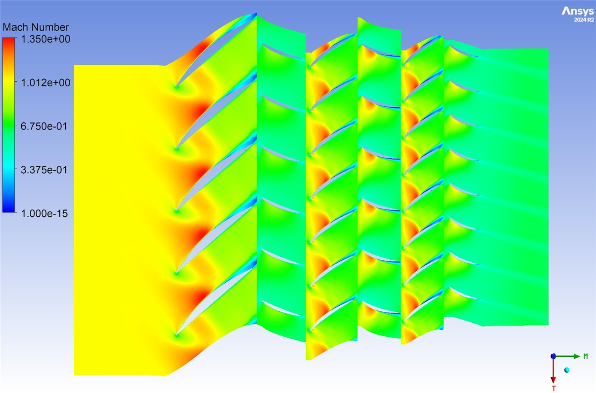
*Mach number at 50% span through the six blade rows. In each rotor, CFX shows the relative Mach
number; in each stator, the absolute one.*

At the first rotor, the blade speed and the axial velocity combine into a relative inflow of about
Mach 1.06 on average. The relative Mach number at the leading edge rises from **0.78 at the hub to 1.26 at the
tip**, so the outer half of the R1 blade sees supersonic flow. The rear rotors are subsonic,
because the air has already been heated and the speed of sound is higher:

<figure>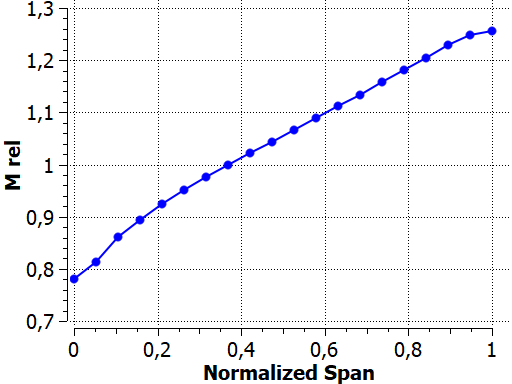<figcaption>R1: relative Mach number at the leading edge, from hub (0) to casing (1). Supersonic above about 35% span.</figcaption></figure>
<figure>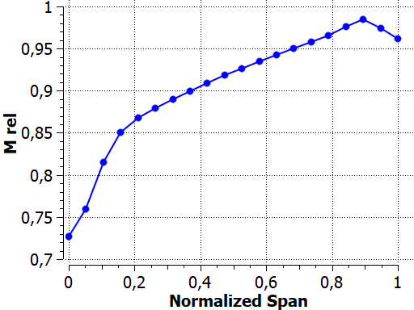<figcaption>R2: subsonic everywhere, peaking at 0.98 near 90% span.</figcaption></figure>

The contours at three span heights show a supersonic pocket on the suction side of R1, which
ends in a shock. It is largest near the tip:

<figure>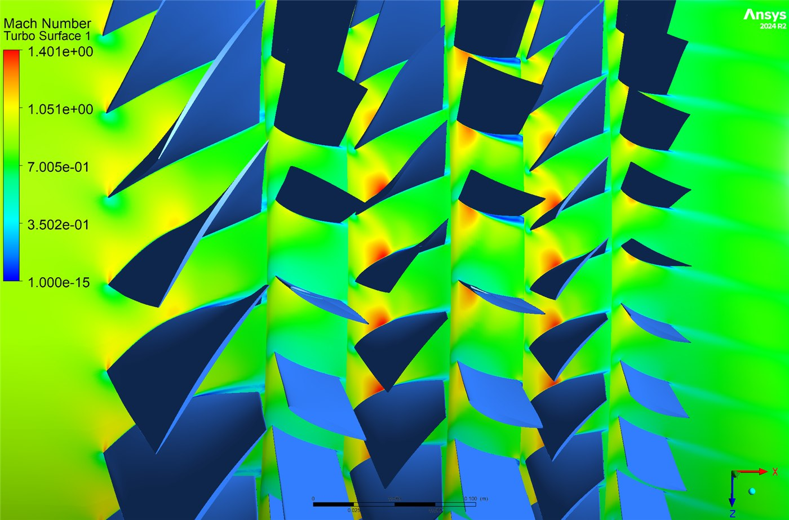<figcaption>20% span.</figcaption></figure>
<figure>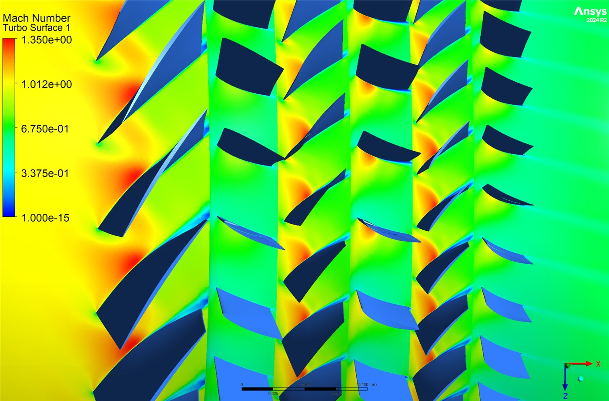<figcaption>50% span.</figcaption></figure>
<figure>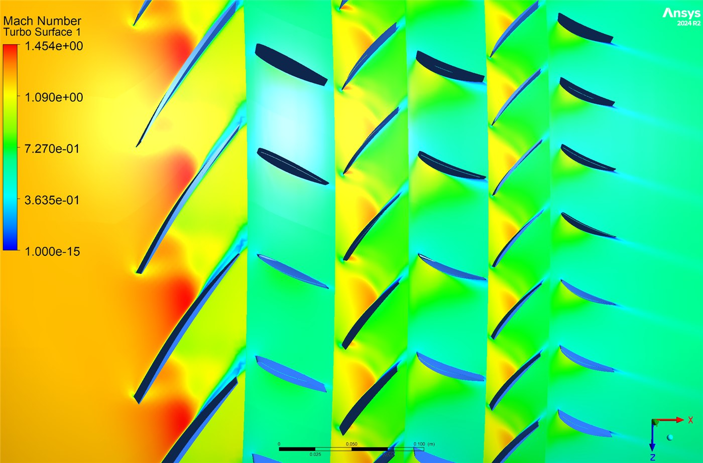<figcaption>90% span: the supersonic region over the front of R1 is largest, at up to Mach 1.45.</figcaption></figure>
<figure>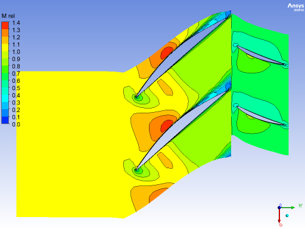<figcaption>Stage 1 at 50% span, from the turbo report, with the mixing plane between R1 and S1.</figcaption></figure>

### Blade loading

Each chart shows the static pressure on the blade at 50% span, from the leading edge (0) to the
trailing edge (1). The area between the two curves is proportional to the blade force.

<figure>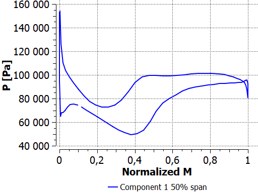<figcaption>R1: the suction side pressure drops to about 50 kPa and then jumps at about 40% of the chord, where the shock meets the blade.</figcaption></figure>
<figure>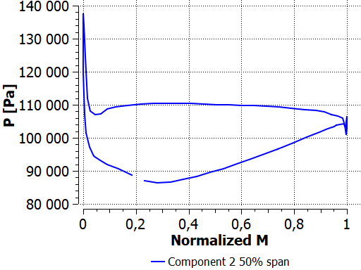<figcaption>S1: a smooth, front-loaded subsonic distribution.</figcaption></figure>
<figure>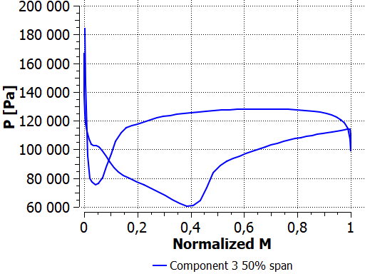<figcaption>R2.</figcaption></figure>
<figure>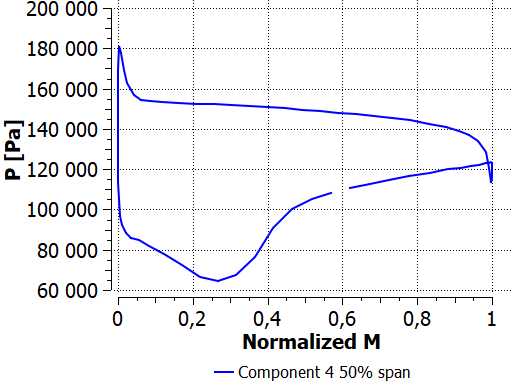<figcaption>S2.</figcaption></figure>
<figure>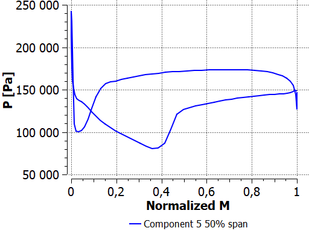<figcaption>R3.</figcaption></figure>
<figure>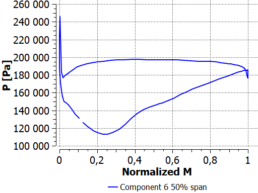<figcaption>S3.</figcaption></figure>

In R2 and R3, the relative inflow is subsonic, but the flow still accelerates over the front of the
suction side. The suction side pressure has a sharp rise near 40% of the chord, a sign that a
small local supersonic region forms and ends in a weak shock. In the stators, the suction side
pressure reaches its minimum at about 25–30% of the chord and then rises steadily towards the
trailing edge, as a subsonic diffuser blade should.

### Pressure, temperature and velocity

<figure>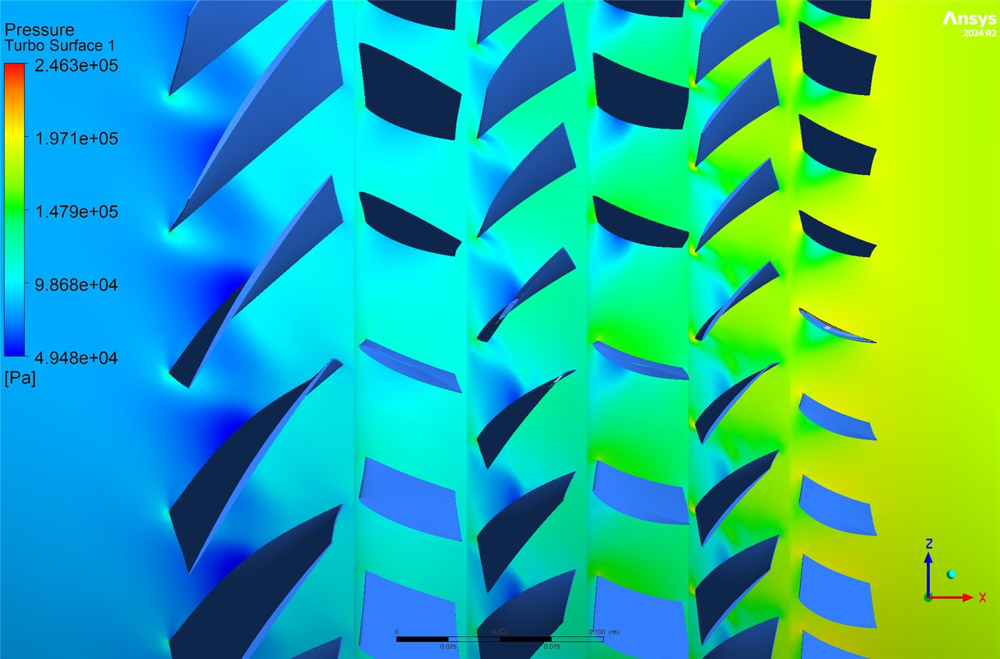<figcaption>Static pressure at 50% span. It falls over the front of R1, where the flow accelerates, and then rises through every row.</figcaption></figure>
<figure>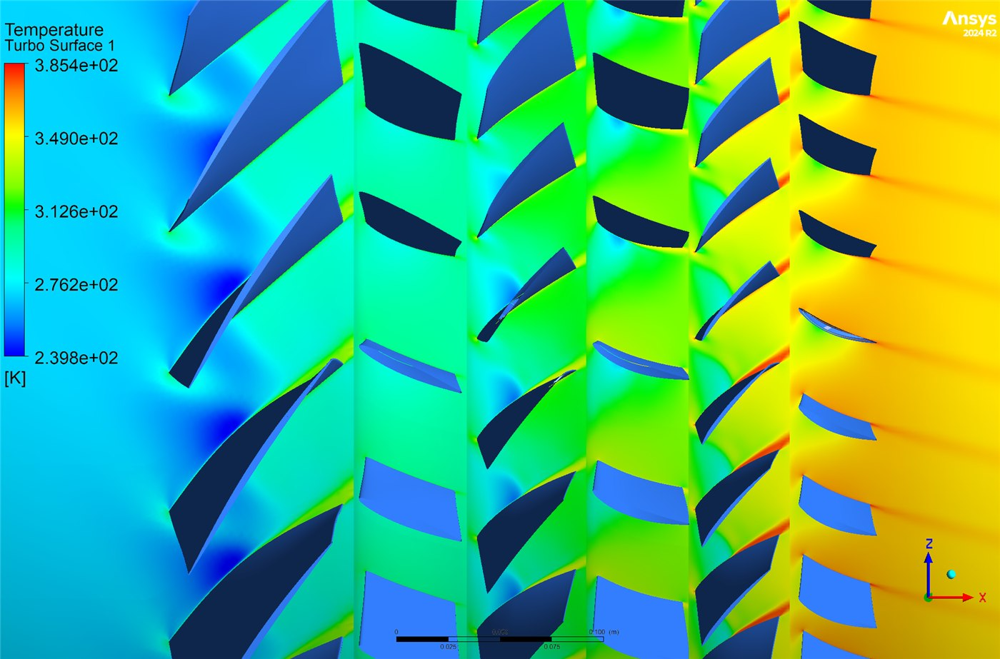<figcaption>Static temperature at 50% span, from about 270 K at the inlet to about 360 K at the outlet.</figcaption></figure>

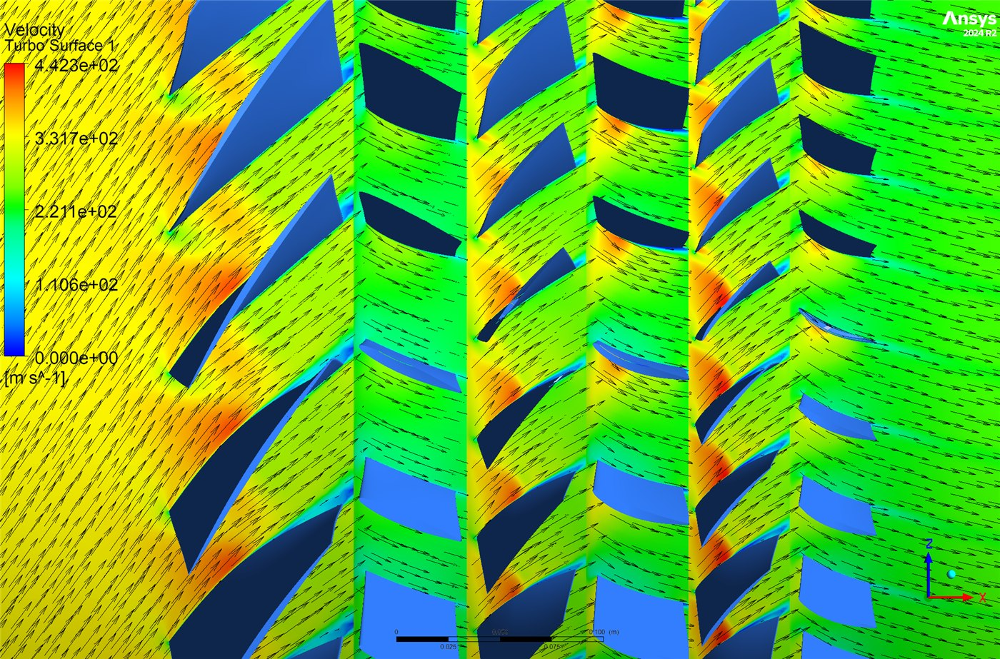
*Velocity at 50% span, with vectors. The rotors add swirl to the flow, and the stators remove it.*

### Along the machine

CFD-Post averaged the flow at the inlet, leading edge, trailing edge and outlet of each row. The
horizontal axis runs from 0 (R1 inlet) to 6 (S3 outlet), one unit per blade row:

<figure>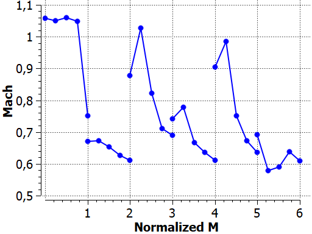<figcaption>Area-averaged Mach number: relative in the rotors, absolute in the stators.</figcaption></figure>
<figure>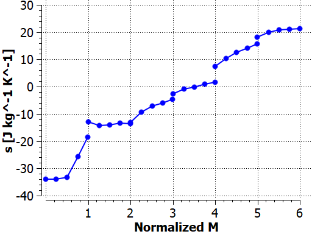<figcaption>Mass-averaged static entropy.</figcaption></figure>

- **The Mach number** falls through every row, as each row diffuses the flow. It jumps back up at
  the inlet of the next row, where the change of frame turns the relative velocity of one row
  into the absolute velocity of the next, or the other way round.
- **The entropy** rises by about 55 J/(kg·K) in total. Stage 1 adds about 21, stage 2 about 21 and
  stage 3 about 14 J/(kg·K). Stage 2 does less work than stage 1 for the same loss, which gives it
  its lower pressure ratio. Stage 3 does the most work for the least loss, so it is the most
  efficient stage.
- **The mixing planes add loss.** Part of the entropy rise happens at the interfaces between rows,
  where the circumferential averaging mixes out the wakes all at once. In a real machine, this
  mixing is spread over the next blade row.

### Where the losses come from

<figure>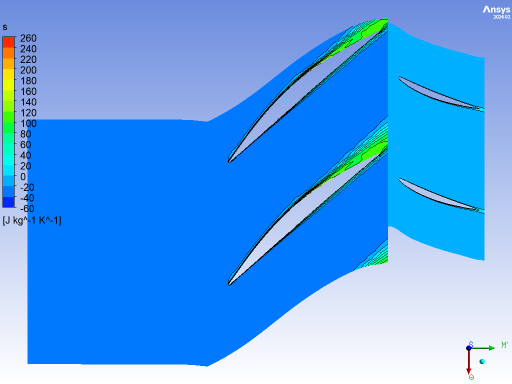<figcaption>Stage 1: entropy at 50% span.</figcaption></figure>
<figure>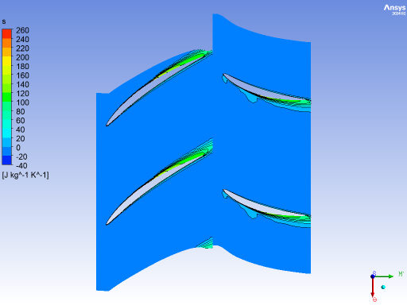<figcaption>Stage 2.</figcaption></figure>
<figure>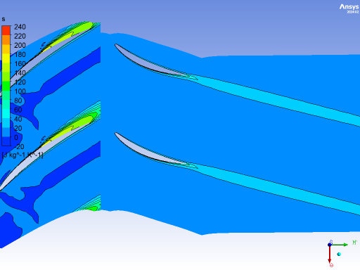<figcaption>Stage 3. The S3 wakes carry on through the outlet duct.</figcaption></figure>

At mid-span, the losses are confined to the blade boundary layers and the wakes. Most of the loss
in a compressor comes from near the endwalls instead, where the circumferentially averaged
(meridional) views are more useful:

<figure>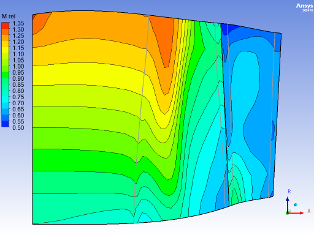<figcaption>Stage 1, Mach number on the meridional plane. The relative Mach number in R1 grows with radius, as the blade speed does.</figcaption></figure>
<figure>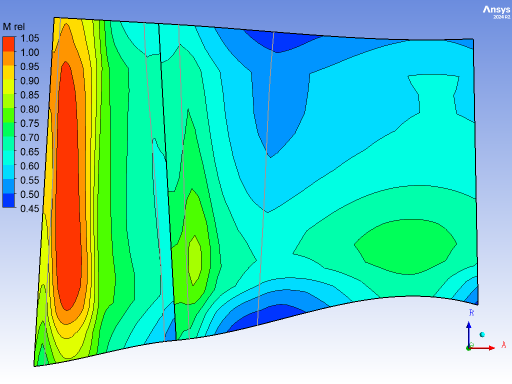<figcaption>Stage 3, Mach number on the meridional plane.</figcaption></figure>
<figure>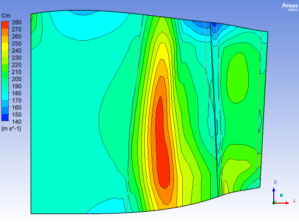<figcaption>Stage 1, meridional velocity.</figcaption></figure>
<figure>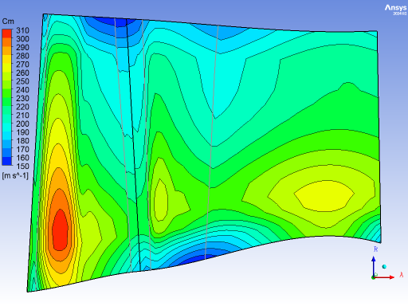<figcaption>Stage 3, meridional velocity. The low-velocity regions near the casing and the hub are blockage.</figcaption></figure>

### The stator exit flow

A stator should turn the flow back towards the axial direction, ready for the next rotor. The
exit flow angle along the span shows how well each stator does this:

<figure>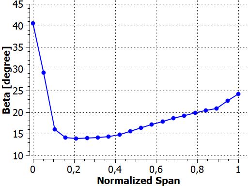<figcaption>S1 trailing edge.</figcaption></figure>
<figure>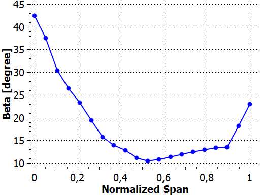<figcaption>S2 trailing edge.</figcaption></figure>
<figure>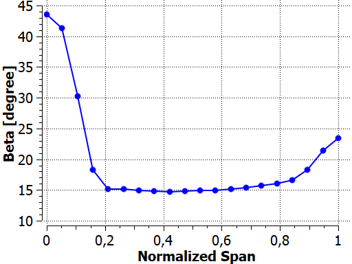<figcaption>S3 trailing edge.</figcaption></figure>
<figure>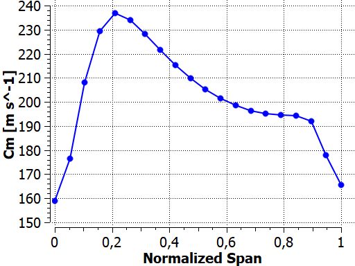<figcaption>S3 trailing edge: meridional velocity.</figcaption></figure>

Over the middle of the span, the stators leave the flow at about 11–16°. Near the hub, the exit
angle climbs to **40–44°** in all three stators, so the flow there is barely turned. This
under-turning, together with the drop in meridional velocity near the hub (159 m/s at the hub
against 237 m/s at 20% span in S3), is the signature of a **hub corner separation**. The low-energy
fluid in the corner between the stator suction side and the hub cannot follow the blade, and it
blocks part of the passage. It is a well-known loss mechanism in compressor stators, and here it
is the most likely source of the unsteady residuals in the rear stages.

The flow also leaves the compressor with about **16° of swirl** (mass-averaged at the S3 outlet).
In an engine, an outlet guide vane or the combustor diffuser would remove it, but it is not part of
this model.

### Energy check

The rothalpy $$I = h_0 - U C_\theta$$ should be constant through a rotor in steady, adiabatic
flow. Across the three rotors, it changes by 141, 81 and 100 J/kg, which is 0.3–0.4% of the work
input of each rotor. The small change comes from the friction of the stationary casing, which does
work on the fluid in the rotating frame.

## Limitations and next steps

- **Coarse stator meshes.** S1 and S2 have only 22,000 and 26,000 nodes. The hub corner
  separation and the stator losses are sensitive to the mesh, so a mesh study, starting with these
  two rows, is the first next step.
- **One operating point.** A speed line at 8500 rpm, from choke to near stall, would show the
  margin of the design point from stall. This is where the hub corner separation of the rear
  stators matters most.
- **Mixing planes.** A frozen-rotor or a transient blade row calculation would capture the wake
  interaction between the rows, at a much higher cost.
- **Unconverged rear stages.** The residuals in R3, S2 and S3 stall at about $$10^{-4}$$. A
  transient run could show whether the hub separation is really unsteady.

## What I learned

- How to set up a multistage compressor in CFX, with stage (mixing-plane) interfaces between
  rotating and stationary rows with different blade numbers.
- How to read a CFD result as a check of a design: the mass flow is an output, and the pressure
  ratio, efficiency and temperature rise have to be consistent with each other.
- How the work splits between the stages, and why the first stage, with the coldest air and a
  transonic rotor, behaves differently from the rear ones.
- How to use the spanwise and blade-row data to find a specific loss mechanism, here the hub
  corner separation in the stators, and connect it to the convergence behaviour.
