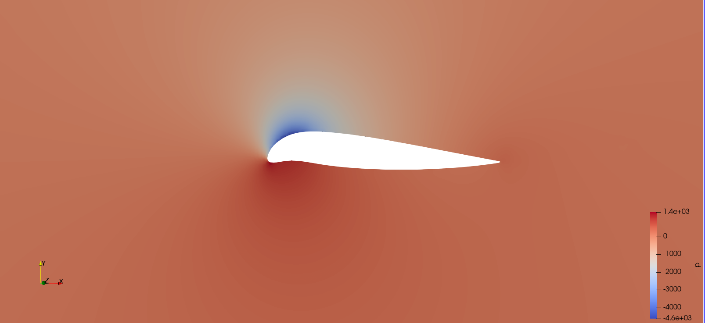
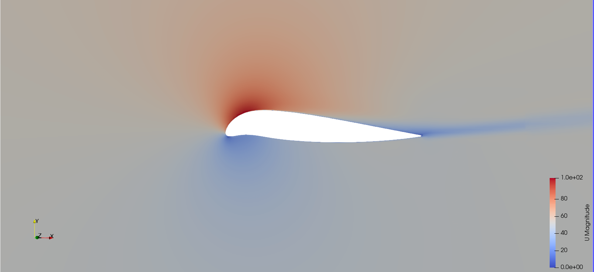
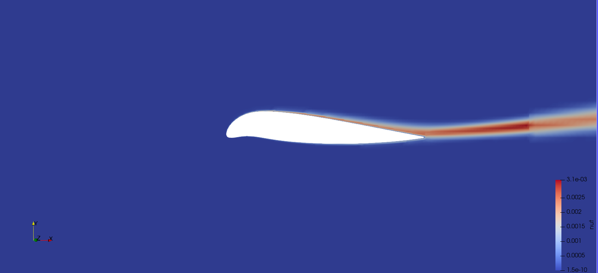

## Objective

The goal was to find a NACA 5-digit airfoil that maximises an objective function combining drag
and lift, at a fixed flight condition. With $$\alpha = 0.8$$ and $$\beta = 0.2$$:

$$
F = \frac{\alpha}{F_D} + \beta\, F_L
$$

In practice, this strongly favours low drag. For the best airfoil, the drag term contributes about
23.3 of the total of 23.76, and the lift term about 0.43.

## What the digits mean

| Digits | Meaning | Example: NACA 63114 |
|---|---|---|
| First | Design lift coefficient, 0.15 per unit | 6 gives a design CL of 0.9 |
| Second | Position of maximum camber, as a share of the chord | 3 gives 15% of the chord |
| Third | Reflex: 0 for none, 1 for a reflexed camber line | 1, reflexed |
| Fourth and fifth | Thickness, as a percentage of the chord | 14% |

## Workflow

1. Generate the coordinates of each airfoil with 200 points, using Airfoil Tools.
2. Build the airfoil and square domain in Autodesk Inventor, with a 1 m chord and a 1 mm extrusion,
   and export them as STL.
3. Generate a 2D mesh with cfMesh `cartesian2DMesh`, with three nested refinement boxes around the
   airfoil and 10 boundary layers.
4. Run `simpleFoam` and read the lift and drag from the `forces` function object.

## Setup

The flow conditions follow the OpenFOAM NACA 0012 tutorial.

| Setting | Value |
|---|---|
| Flow | Steady, incompressible, turbulent, external |
| Reynolds number | 6 × 10⁶ |
| Mach number | About 0.15 |
| Angle of attack | 10° |
| Inlet velocity vector | (50.70, 8.94, 0) m/s |
| Solver | `simpleFoam` |
| Turbulence model | Spalart-Allmaras, with `nutUSpaldingWallFunction` |
| Linear solvers | `smoothSolver` for U and ν̃, GAMG for p, Gauss-Seidel smoother |
| Relaxation | 0.4 for p, 0.6 for U and ν̃ |
| Convective terms | Upwind |
| Residual target | 10⁻⁵ |

## Domain study

Five square domains were tested with the NACA 24012, doubling the size each time:

| Domain | Cells | F |
|---|---|---|
| 10 × 10 m | 158,595 | 12.43 |
| 20 × 20 m | 202,987 | 16.06 |
| 40 × 40 m | 323,639 | 17.10 |
| 80 × 80 m | 600,728 | 18.74 |
| 160 × 160 m | 819,308 | 19.57 |

The target was a change below 5%. Going from 80 m to 160 m changes F by about 4%, which meets this
target. As F was still rising, the 160 × 160 m domain was used for all the following runs.

## Mesh study

Next, four meshes were tested in the 160 × 160 m domain, halving every cell size parameter at each
step:

| Mesh | Cells | FD (N) | FL (N) | F | Change from the next mesh |
|---|---|---|---|---|---|
| 1 | 33,647 | 0.1981 | 0.5065 | 4.14 | 60.8% |
| 2 | 121,267 | 0.0778 | 1.4727 | 10.58 | 39.6% |
| 3 | 458,656 | 0.0466 | 1.6693 | 17.51 | 0.11% |
| 4 | 1,730,836 | 0.0465 | 1.6687 | 17.53 | – |

Mesh 3 was selected, well within the 3% target. These values differ from the domain study because
the meshes differ: the 160 m case there has 819,308 cells, against 458,656 here. A repeat with the NACA 13112 gave a change of 0.20%
between meshes 3 and 4, so the choice holds for a different airfoil.

## Parametric study

The digit groups were varied one at a time, keeping the best value from each step. In total, 15
different airfoils were tested with the selected domain and mesh.

### First digit: design lift coefficient



*Airfoils with last digits 3112. A higher design lift coefficient improves F, with diminishing returns.*

### Second and third digits: camber position and reflex



*Airfoils with first digit 6 and thickness 12%. Reflex helps, as 65112 beats 65012 and 61012 is the worst of the group. The best camber position tested is 15% of the chord.*

### Fourth and fifth digits: thickness



*Airfoils with first digits 631. Very thin sections perform poorly, and there is a broad plateau from 12% to 15%.*

### All the results

| Airfoil | FD (N) | FL (N) | F | L/D |
|---|---|---|---|---|
| NACA 03112 | 0.0453 | 1.510 | 17.97 | 33.3 |
| NACA 13112 | 0.0401 | 1.604 | 20.26 | 40.0 |
| NACA 43112 | 0.0352 | 2.002 | 23.16 | 56.9 |
| NACA 63112 | 0.0346 | 2.130 | 23.56 | 61.6 |
| NACA 61012 | 0.0442 | 1.802 | 18.46 | 40.8 |
| NACA 65012 | 0.0391 | 2.434 | 20.96 | 62.3 |
| NACA 62112 | 0.0356 | 2.031 | 22.91 | 57.1 |
| NACA 64112 | 0.0350 | 2.233 | 23.30 | 63.8 |
| NACA 65112 | 0.0362 | 2.400 | 22.57 | 66.3 |
| NACA 63105 | 0.0667 | 1.803 | 12.35 | 27.0 |
| NACA 63110 | 0.0364 | 2.086 | 22.39 | 57.3 |
| NACA 63113 | 0.0348 | 2.139 | 23.43 | 61.5 |
| **NACA 63114** | **0.0343** | **2.165** | **23.76** | **63.1** |
| NACA 63115 | 0.0345 | 2.173 | 23.62 | 63.0 |
| NACA 63120 | 0.0368 | 2.119 | 22.18 | 57.6 |

## Flow around the selected airfoil

*Pressure field, with the strong suction peak near the leading edge at 10° angle of attack.*

*Velocity magnitude, with the acceleration over the upper surface and the wake behind the airfoil.*

*Turbulent viscosity, which grows through the boundary layer and into the wake.*

## How far the result can be trusted

- **The top airfoils are close:** NACA 63112, 63113, 63114 and 63115 lie within about 1.4% of each
  other, and the values are not monotonic with thickness. So 63114 is the best one tested, but the
  data shows a family of similar airfoils rather than a sharp optimum.
- **Not a global optimum:** varying one group of digits at a time can miss better combinations. 65112,
  for example, has the highest L/D but a lower F.
- **Domain:** F still changes by about 4% between the two largest domains, so absolute values carry
  some domain dependence. A far-field boundary treatment could reduce it.
- **Absolute drag:** the convective terms are first-order upwind, the first cell is relatively
  coarse for this Reynolds number, and there is no comparison with experiments. The results are
  best read as a comparison between airfoils.
- **One operating point:** the study covers only 10° and Re = 6 × 10⁶, so it says nothing about the
  performance at other conditions or near stall.

## What I learned

- How to run a complete OpenFOAM case from CAD to forces, editing the dictionary files directly.
- How to generate 2D meshes with cfMesh, with refinement boxes and boundary layers.
- Why domain and mesh studies come before any design comparison.
- How the weights in an objective function shape the outcome, here pushing the result towards low drag.
