## Objective

NASA Rotor 37 is a transonic axial compressor rotor, designed as the inlet stage of an aircraft
engine core compressor. In 1994, it was the blind test case of the ASME/IGTI turbomachinery
committee: CFD groups predicted its performance without seeing the measurements first. It is still
one of the standard tests for compressor CFD.

The goals of this project were:

1. Set up and solve the rotor in Ansys CFX, from the mesh to the post-processing.
2. Understand the flow: where the shock forms, how it interacts with the blade boundary layer,
   and where the losses come from.
3. Check the convergence, and compare the result with the NASA test data.

| Design parameter | Value |
|---|---|
| Number of blades | 36 |
| Design speed | 17,188.7 rpm (1800 rad/s) |
| Tip speed | 454 m/s |
| Design pressure ratio | 2.106 |
| Choke mass flow (measured) | 20.93 kg/s |
| Tip clearance | 0.356 mm |
| Inlet hub-to-tip ratio | 0.7 |

## Geometry and mesh

The model is a single blade passage, with rotational periodicity on both sides. Each blade sees
the same flow in a steady analysis, so one passage represents the whole rotor at 1/36 of the cost.

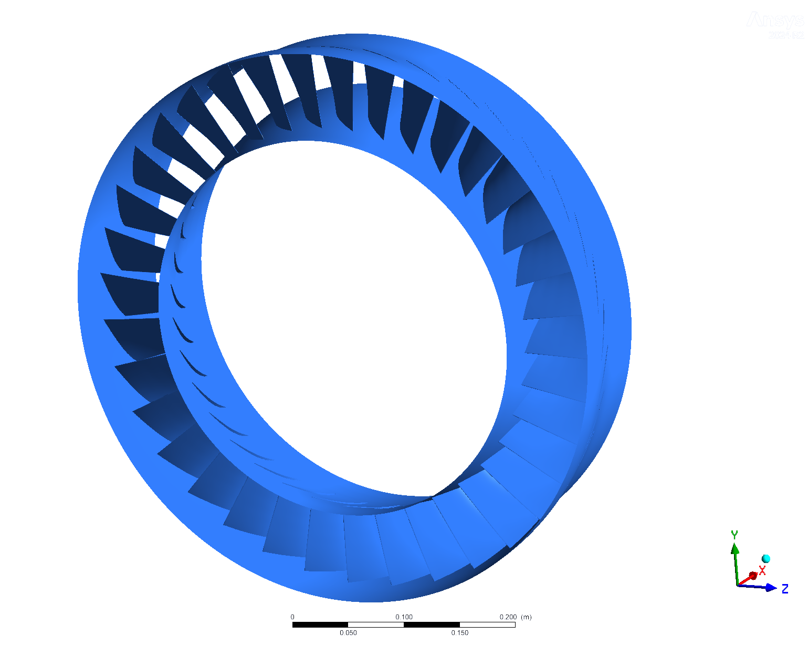
*The 36-blade rotor, built in CFD-Post by repeating the single passage.*

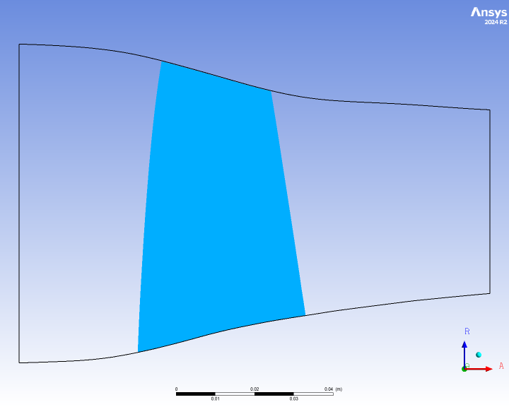
*Meridional view of the passage. The hub (bottom) rises along the flow, so the annulus area
decreases as the air is compressed and becomes denser.*

The mesh was built in Ansys TurboGrid, which generates structured hexahedral meshes for blade
rows. It has **158,309 nodes** and includes the tip clearance between the blade and the casing.

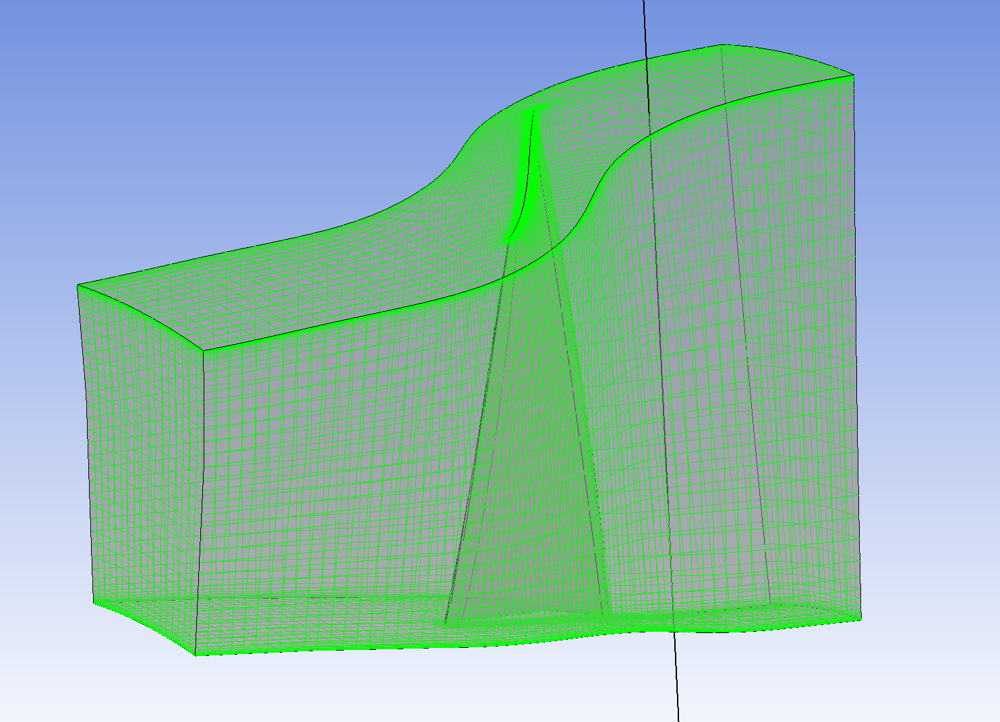
*Structured mesh of one passage: inlet on the left, blade in the middle, outlet on the right.*

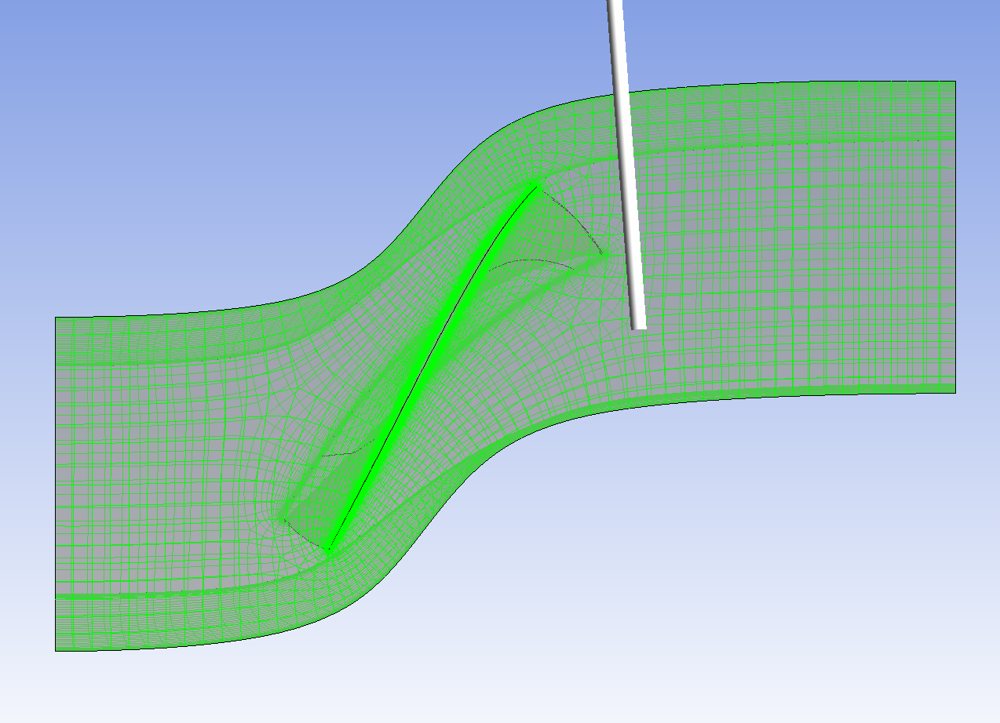
*Blade-to-blade view of the mesh, with the cells clustered around the blade.*

## Solver setup

| Setting | Value |
|---|---|
| Analysis | Steady RANS, rotating frame of reference |
| Fluid | Air, ideal gas with constant $$c_p$$ |
| Energy | Total energy, including viscous work |
| Turbulence | k-ε with scalable wall functions |
| Inlet | Total pressure 1 atm, total temperature 288.15 K, axial flow |
| Outlet | Average static pressure 1.3 atm |
| Hub and blade | Adiabatic no-slip walls, rotating with the rotor |
| Casing (shroud) | Adiabatic no-slip wall, stationary (counter-rotating in the rotor frame) |
| Advection scheme | High resolution |
| Run | 500 iterations, 2 h 21 min on 16 cores |

The outlet static pressure sets the operating point. A higher back pressure moves the rotor
towards stall, a lower one towards choke.

## Performance quantities

The flow at the inlet and outlet planes is not uniform, so each quantity has to be averaged. The
performance values use **mass-flow averages**, which give each part of the plane a weight equal
to the mass that crosses it:

$$
\overline{p_0} = \frac{\int p_0 \, \rho \, (\mathbf{V}\cdot\mathbf{n}) \, dA}{\int \rho \, (\mathbf{V}\cdot\mathbf{n}) \, dA}
$$

An area average would give the same weight to wakes and boundary layers, where little mass flows.
The total pressure is taken in the stationary frame, because the rotor adds energy in the
absolute frame, and the next blade row and the probes are stationary.

The total pressure ratio, total temperature ratio and adiabatic efficiency follow from these
averages, with $$\gamma = 1.4$$:

$$
\pi = \frac{\overline{p_{02}}}{\overline{p_{01}}}, \qquad
\tau = \frac{\overline{T_{02}}}{\overline{T_{01}}}, \qquad
\eta = \frac{\pi^{(\gamma-1)/\gamma} - 1}{\tau - 1}
$$

The work done by the rotor comes from the Euler turbomachinery equation, where $$U$$ is the blade
speed and $$C_\theta$$ the tangential velocity in the absolute frame:

$$
\Delta h_0 = U_2 C_{\theta 2} - U_1 C_{\theta 1}
$$

## Convergence

The run stopped at the 500-iteration limit. The RMS residual target of $$10^{-6}$$ was only reached
by the continuity equation. The momentum and energy residuals settled at about $$4$$–$$5 \times 10^{-5}$$,
and the turbulence residuals at about $$10^{-3}$$, with a regular saw-tooth oscillation.

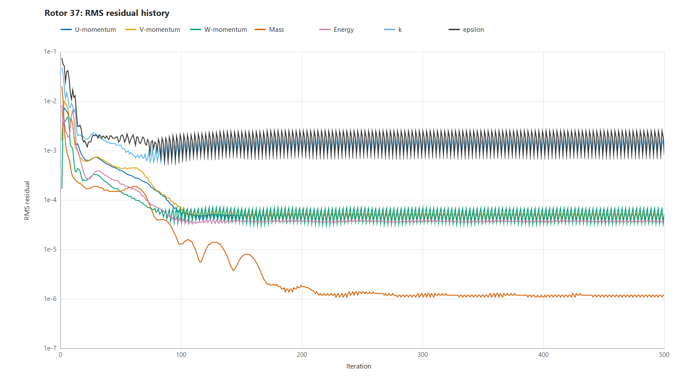
*RMS residual history. After about 90 iterations, the residuals stop falling and oscillate in a
repeating pattern.*

Residuals alone do not show whether the answer has settled. The pressure ratio, efficiency and
mass flow were monitored during the run:

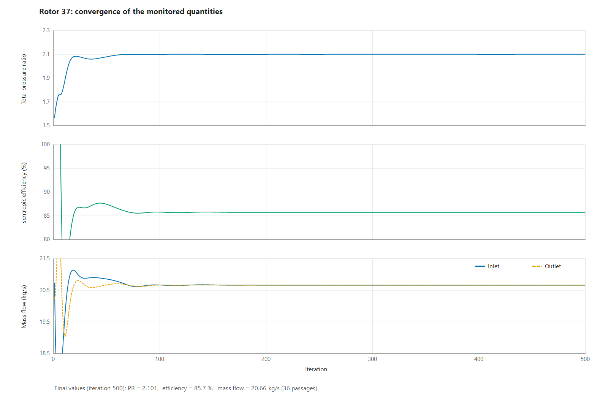
*Pressure ratio, efficiency and inlet and outlet mass flow against the iteration number.*

| Quantity | Iteration 200 | Iteration 500 |
|---|---|---|
| Total pressure ratio | 2.1008 | 2.1008 |
| Adiabatic efficiency | 85.76 % | 85.75 % |
| Mass flow (36 passages) | 20.662 kg/s | 20.661 kg/s |

From iteration 200 onwards, the results change only in the fourth significant figure. The final
imbalances of mass, momentum and energy are all below 0.001%. The solution is converged for
engineering purposes, even though the residuals stalled above the target. The repeating residual
pattern suggests a small region of the flow that does not settle to a steady state, most likely
around the shock or the tip clearance.

## Flow field

### The passage shock

The air enters the rotor axially at an absolute Mach number of about 0.53. The blade moves at
close to 400 m/s, so the air reaches the blade at a **supersonic relative Mach number**, about 1.3
on average and higher towards the tip. The contours below show the Mach number in the rotating
frame.

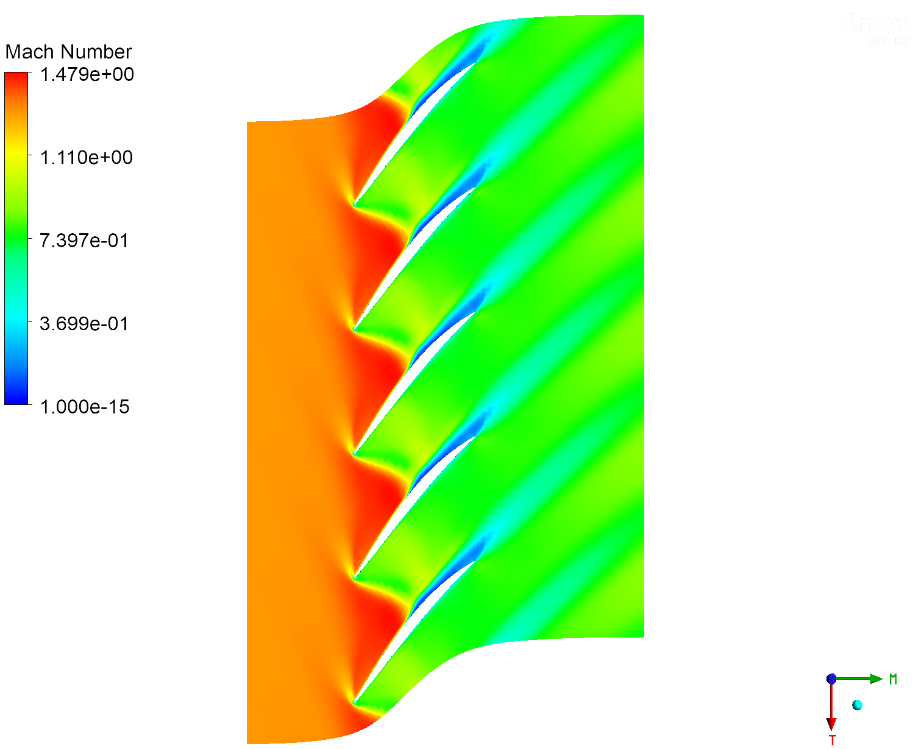
*Relative Mach number at 50% span. A shock stands at the leading edge, and its passage leg crosses
to the suction side of the next blade.*

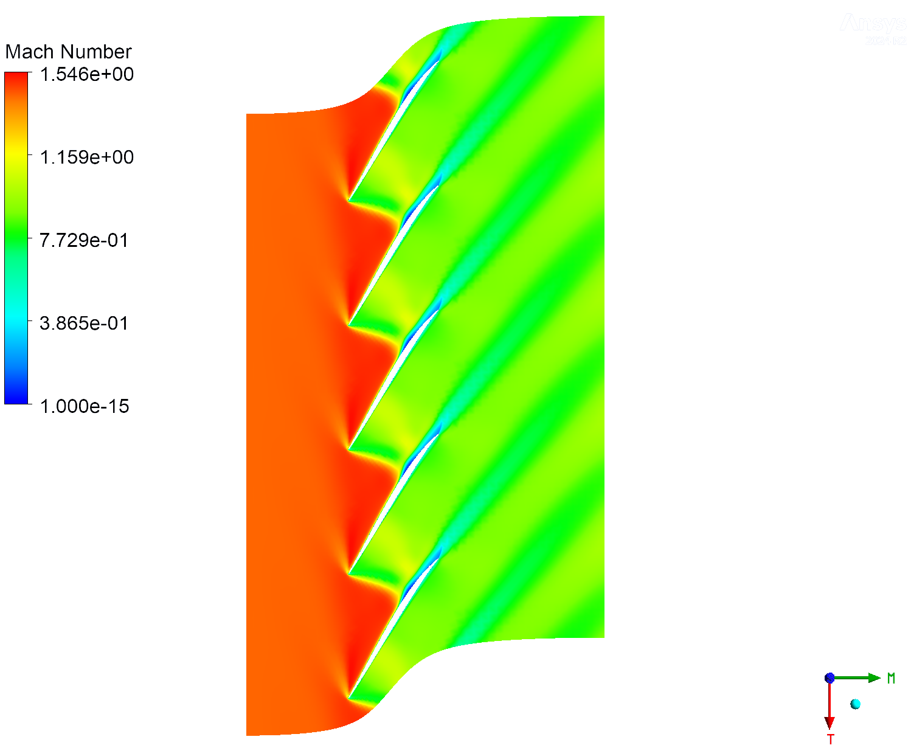
*Relative Mach number at 90% span, where the blade speed and the inlet Mach number are higher.*

The shock changes along the span, because the blade speed grows with the radius. The contour
lines at 20% and 80% span show it more clearly:

<figure>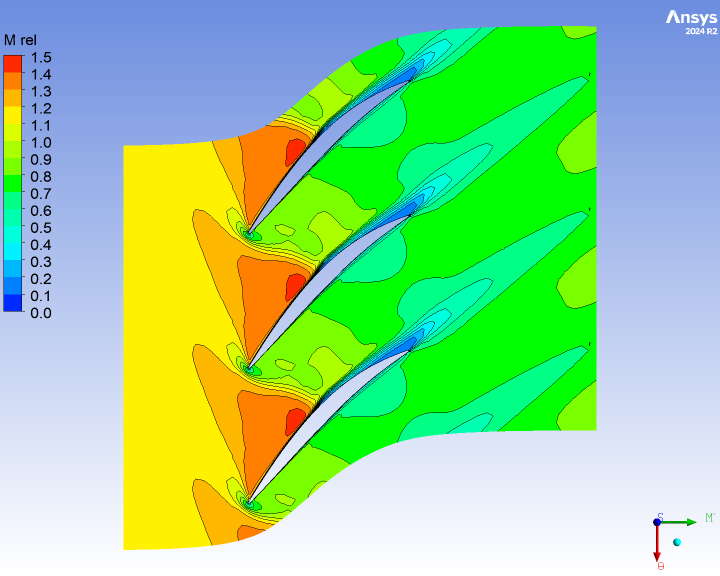<figcaption>20% span: the inflow is only just supersonic, and a small supersonic pocket forms on the suction side near the leading edge.</figcaption></figure>
<figure>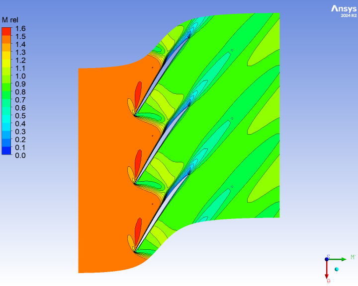<figcaption>80% span: the whole inflow is supersonic, at about Mach 1.4, and the shock is stronger.</figcaption></figure>

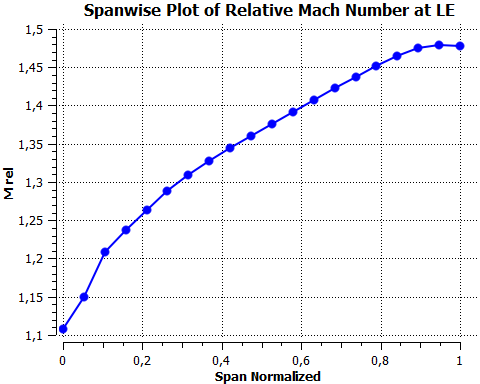
*Circumferentially averaged relative Mach number at the leading edge, from hub (0) to casing (1).*

At the leading edge, the relative Mach number rises from **1.11 at the hub to 1.48 at the tip**.
The NASA design values were 1.13 at the hub and 1.48 at the tip, so the inflow to the blade is
well reproduced.

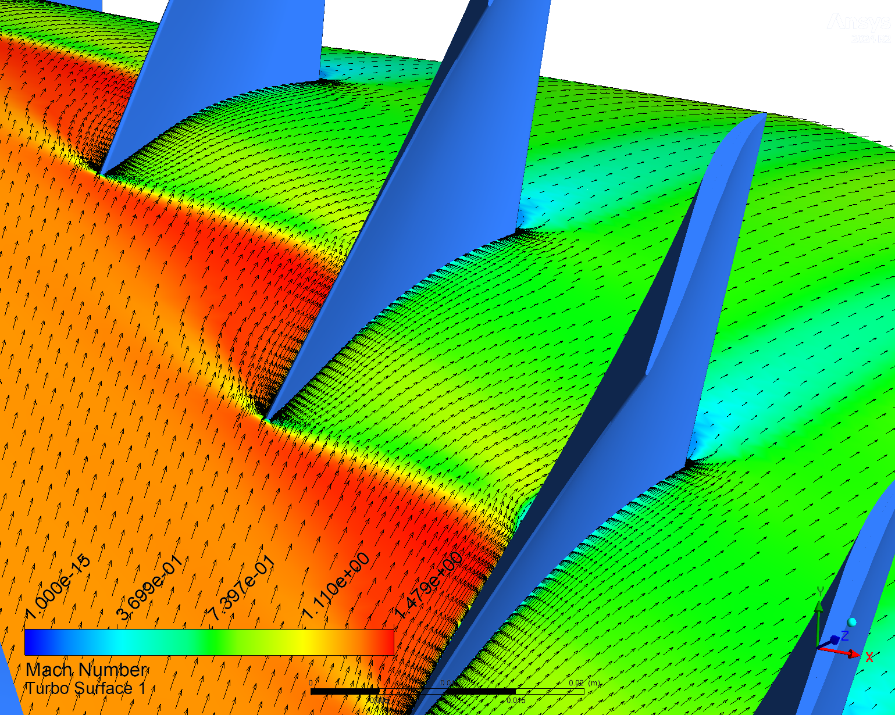
*Close-up at 50% span with velocity vectors. Behind the shock, the flow next to the suction side
slows down sharply.*

The shock decelerates the flow from supersonic to subsonic in a very short distance. The blade
loading shows where it reaches the blade. Each chart gives the static pressure on the blade from
leading edge (0) to trailing edge (1): the upper curve is the pressure side and the lower curve
the suction side.

<figure>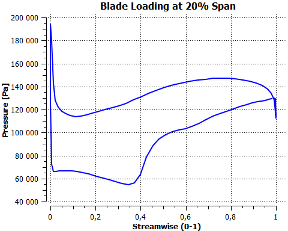<figcaption>20% span.</figcaption></figure>
<figure>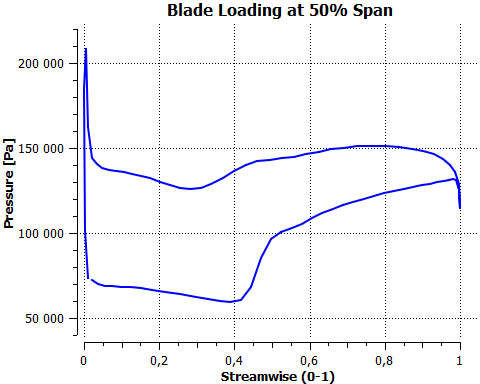<figcaption>50% span.</figcaption></figure>
<figure>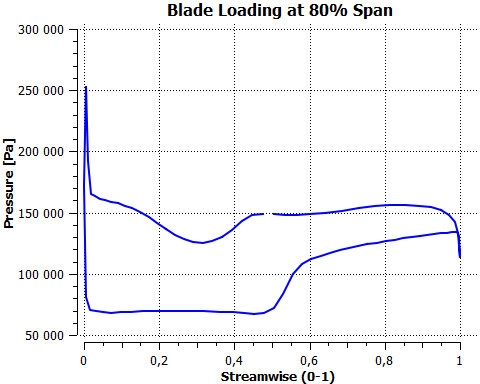<figcaption>80% span.</figcaption></figure>

On the suction side, the pressure stays low, near 55–70 kPa, over the front of the blade, then
jumps by about 40 kPa within a few percent of the chord. This jump is the shock hitting the
suction surface. It moves back along the span: from about 37% of the chord at 20% span to about
40% at mid-span and 52% at 80% span. Behind the shock, the two curves come closer, so most of the
blade force is produced over the front half of the blade. The short gap in the 80% curve is a
gap in the plotted line, not in the flow.

### Where the losses come from

A sudden pressure rise is hard for a boundary layer to survive. Behind the shock, the suction
side boundary layer thickens and separates, and this low-momentum region continues into the wake.
The entropy contour shows where the losses are generated:

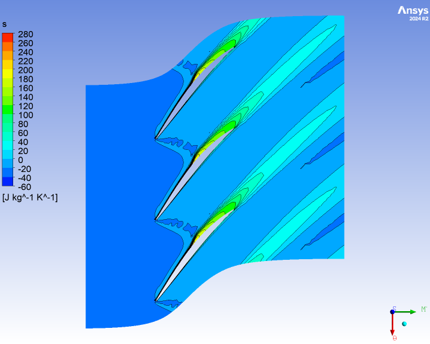
*Static entropy at 50% span. Entropy rises across the shock, and most strongly in the suction side
boundary layer behind it and in the wake.*

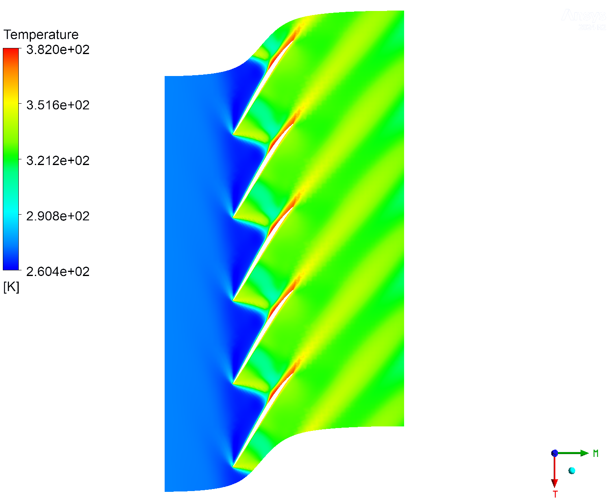
*Static temperature at 90% span. The hot band along the suction side marks the slow, separated
flow behind the shock, where the kinetic energy has been dissipated.*

The meridional view averages the flow around the circumference, and shows how the shock and the
low-speed regions change along the span:

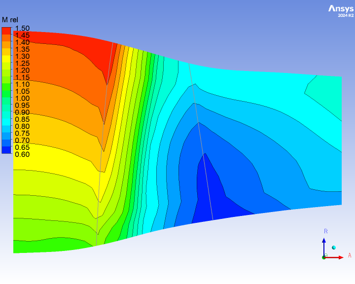
*Mass-averaged relative Mach number on the meridional plane. The packed contours near the leading
edge show the shock across the span, and the lowest Mach numbers appear near the hub at the back
of the blade.*

<figure>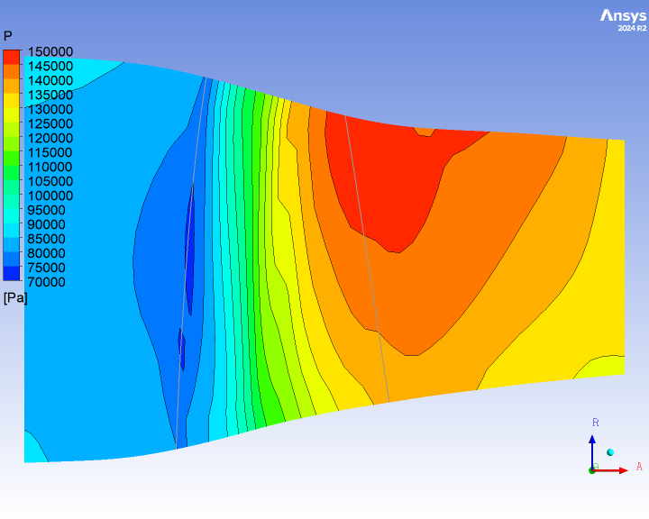<figcaption>Static pressure on the meridional plane. The pressure rises through the blade row, and is highest near the casing behind the blade, where the swirl pushes the flow outwards.</figcaption></figure>
<figure>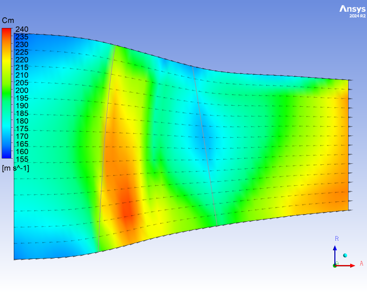<figcaption>Meridional velocity, with vectors. The flow accelerates near the hub at the leading edge and slows down near the casing inside the blade row.</figcaption></figure>

### At the trailing edge

<figure>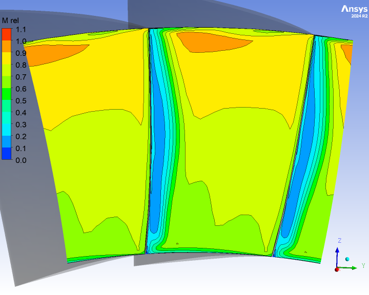<figcaption>Relative Mach number on a plane at the trailing edge. The wakes are the narrow low-speed bands behind each blade.</figcaption></figure>
<figure>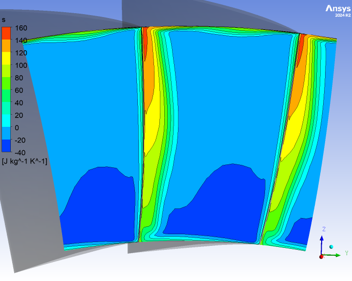<figcaption>Entropy on the same plane. The highest entropy is in the wake near the casing, most likely where the tip clearance flow and the shock interact.</figcaption></figure>

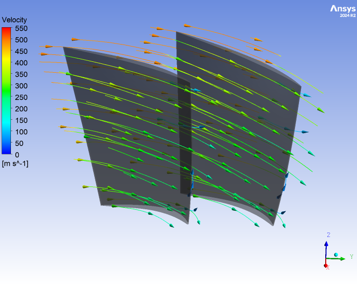
*Streamlines through two passages, coloured by velocity. The flow enters fastest near the tip and
leaves the blade row more slowly.*

### Through the rotor

CFD-Post averaged the flow on ten planes from the inlet (0) to the outlet (1) of the domain. The
blade sits between about 0.25 and 0.55:

<figure>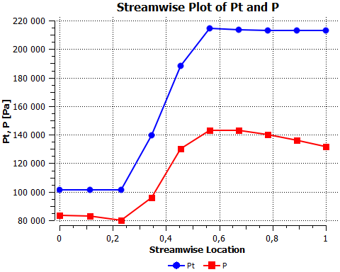<figcaption>Total and static pressure.</figcaption></figure>
<figure>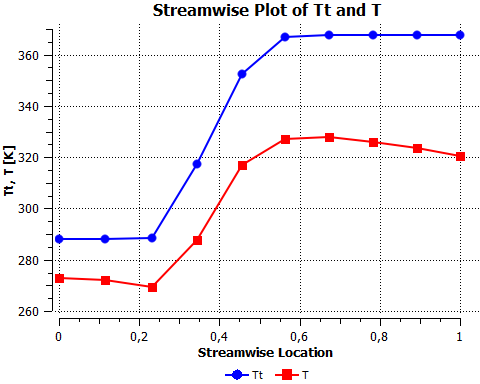<figcaption>Total and static temperature.</figcaption></figure>
<figure>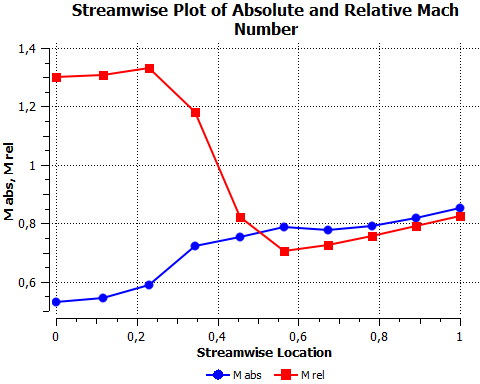<figcaption>Absolute and relative Mach number.</figcaption></figure>
<figure>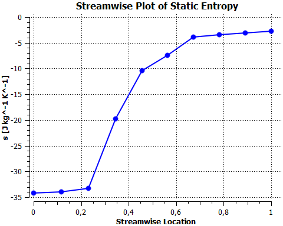<figcaption>Static entropy.</figcaption></figure>

- **Total pressure and temperature** rise only across the blade, where the work is done, and stay
  almost constant downstream.
- **The relative Mach number** falls from about 1.3 to 0.7 across the blade, mostly through the
  shock. The absolute Mach number rises, because the rotor adds swirl.
- **Entropy** rises by about 26.6 J/(kg·K) between the inlet and the trailing edge, and by another
  4.9 J/(kg·K) after it. About **15% of the losses happen downstream of the blade**, as the wakes
  mix with the rest of the flow.
- Downstream of the blade, the static pressure falls from about 143 kPa to 132 kPa and the
  absolute Mach number keeps rising, because the annulus area continues to decrease.

### Along the span

<figure>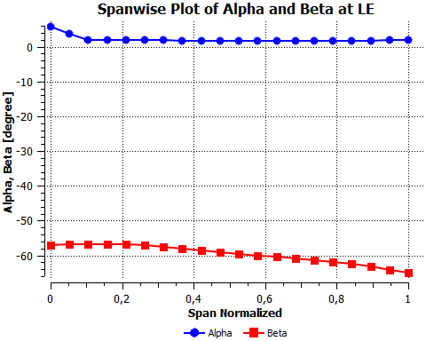<figcaption>Absolute (alpha) and relative (beta) flow angles at the leading edge.</figcaption></figure>
<figure>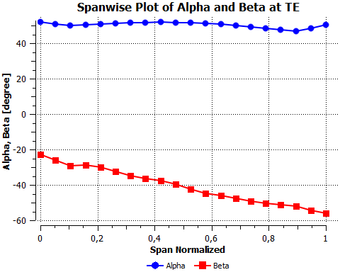<figcaption>Absolute (alpha) and relative (beta) flow angles at the trailing edge.</figcaption></figure>
<figure>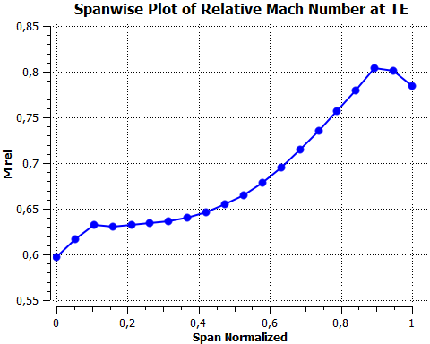<figcaption>Relative Mach number at the trailing edge.</figcaption></figure>
<figure>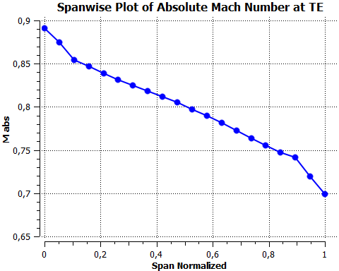<figcaption>Absolute Mach number at the trailing edge.</figcaption></figure>

The flow turning is very different along the span. The relative flow angle changes from about
−57° to −23° at the hub, a turning of about 34°, but only from about −65° to −56° at the tip,
about 9°. Near the hub, where the blade speed is lower, the blade has to turn the flow more to do
the same work. Near the tip, most of the pressure rise comes from the shock instead.

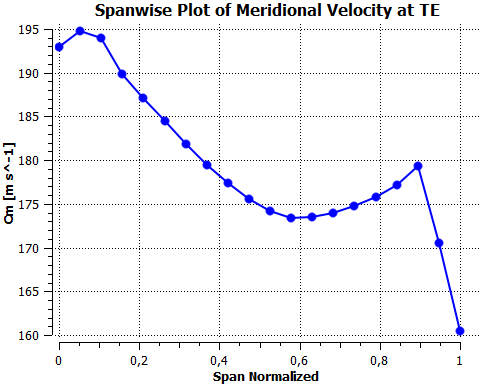
*Meridional velocity at the trailing edge. It drops sharply in the last 10% of the span.*

The meridional velocity at the trailing edge falls from about 179 m/s at 90% span to 160 m/s at
the casing. This is the blockage caused by the tip clearance flow and the casing boundary layer,
which carry less mass flow through the passage.

### Overall results

| Quantity | Inlet | Outlet |
|---|---|---|
| Absolute Mach number | 0.53 | 0.86 |
| Relative Mach number | 1.30 | 0.83 |
| Relative flow angle | −65.7° | −39.1° |
| Absolute flow angle | 0.0° | 42.0° |
| Total pressure | 101.3 kPa | 212.9 kPa |
| Total temperature | 288.2 K | 367.5 K |

The rotor turns the relative flow by about 27° and adds swirl to the absolute flow, which a
stator would then remove. The input power is about 1.65 MW for the whole rotor.

As a check, the **rothalpy** $$I = h_0 - U C_\theta$$ should be constant along a streamline in a
steady, adiabatic rotating flow, if the casing friction is neglected. It changes by 123 J/kg
between inlet and outlet, only about 0.16% of the work input. The friction of the stationary
casing on the fluid, which the energy balance shows, is one expected source of this small change.

## Comparison with the NASA test data

The NASA measurements give the overall operating curve of the isolated rotor at design speed,
from choke towards stall, as tabulated by Boretti (2010) for the blind test. The CFX point is at
20.66 kg/s, or 98.7% of the measured choke flow. The closest measured point is at 20.67 kg/s:

| Quantity | NASA experiment | Ansys CFX | Difference |
|---|---|---|---|
| Mass flow | 20.67 kg/s | 20.66 kg/s | −0.02% |
| Total pressure ratio | 2.065 | 2.101 | +1.7% |
| Total temperature ratio | 1.2595 | 1.2755 | +1.3% |
| Total temperature rise | 74.8 K | 79.4 K | +6.2% |
| Adiabatic efficiency | 88.7% | 85.7% | −3.0 points |

The CFX efficiency uses the same formula and $$\gamma$$ as the experimental data. The CFD-Post
turbo report gives 86.1% with its own definition, which is still about 2.6 points below the
measurement.

### What the comparison shows

- **The pressure ratio is close.** The difference is 1.7%.
- **The temperature rise is too high.** The model predicts about 6% more work input than measured.
  As the pressure rise is closer than the temperature rise, the predicted efficiency is lower.
- **Most of the original blind test predictions showed the same trend**, overpredicting both the
  pressure and the temperature ratio. Rotor 37 is a known difficult case.

Several simplifications in this model can explain the gap:

1. **Turbulence model:** k-ε with wall functions is not well suited to shock-induced
   separation. The k-ω SST model is a more common choice for transonic compressors.
2. **Mesh:** 158,000 nodes is coarse for this case. A recent study of the same rotor used about
   0.97 million cells, and no mesh study was done here.
3. **Measurement planes:** NASA measured about 4 cm upstream and 10 cm downstream of the hub
   leading edge (stations 1 and 4). The CFX inlet and outlet planes are those of the course
   domain, and were not moved to these stations.
4. **Hub leakage:** in the test rig, there is a small gap between the stationary and rotating
   hub upstream of the rotor. Some researchers attribute the low total pressure measured near
   the hub to a leakage flow through this gap. It is not modelled here.

## Limitations and next steps

- Only one operating point was solved. Running a full speed line, from choke to near stall,
  would show whether the trend holds across the operating range.
- Repeating the case with k-ω SST and a finer mesh, with a mesh study, would show how much of the
  difference comes from each.
- Moving the averaging planes to stations 1 and 4 would allow a comparison of the radial profiles
  of pressure and temperature ratio, which is where most codes struggle on this rotor.

## References

- A. Boretti, "Experimental and Computational Analysis of a Transonic Compressor Rotor",
  17th Australasian Fluid Mechanics Conference, Auckland, 2010. Source of the tabulated
  operating curve and test conditions.
- L. Reid and R. D. Moore, "Design and overall performance of four highly loaded, high speed
  inlet stages for an advanced high-pressure-ratio core compressor", NASA TP-1337, 1978.
- J. Dunham (ed.), "CFD Validation for Propulsion System Components", AGARD-AR-355, 1998.
- Y. Zhang, X. Ji and K. Xu, "An implicit gas-kinetic scheme for internal and external flows",
  arXiv:2508.07644, 2025. Source of the measured choke mass flow (20.93 kg/s) and the mesh size
  quoted above.
