## Objective

Unlike my CFD projects, this one covers a whole aircraft at system level. The aim was to
find a coherent concept that meets the mission, with each discipline feeding the next:
mission, configuration, weight, wing, power, geometry and aerodynamic checks. At this stage,
the goal is a consistent design with reasonable margins, not an optimised one.

| Requirement | Value |
|---|---|
| Payload and crew | 50 passengers, 3 crew |
| Design range | 1000 km, plus 1 h loiter |
| Cruise speed | About 250 mph (111.8 m/s) |
| Maximum operating altitude | 20,000 ft |
| Runway | 1000 m minimum |

## Design process

1. Define the mission and requirements.
2. Estimate aerodynamics from similar aircraft.
3. Compare configurations and select one.
4. Iterate the takeoff weight.
5. Size the wing and the installed power.
6. Define the engine, wing, fuselage, tail and landing gear.
7. Build the 3D model and check it with a low-fidelity solver.

## Why a high-wing turboprop

The cruise Mach number is low, at about 0.33 to 0.35, where turboprops have a clear efficiency
advantage over turbofans.

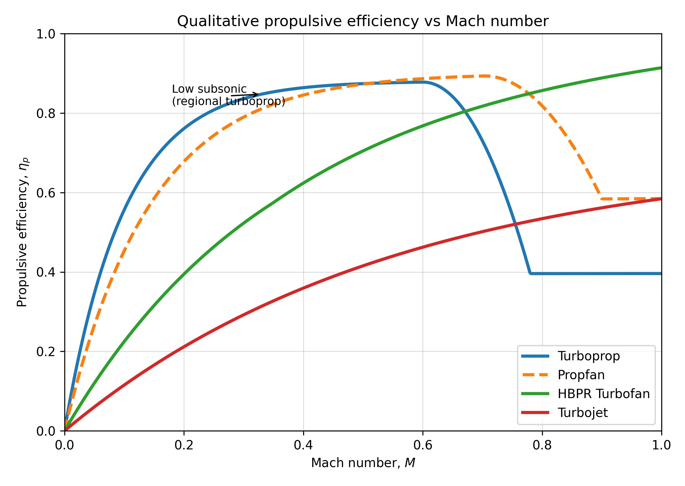
*Qualitative propulsive efficiency trends. The low subsonic regime favours the turboprop.*

A high wing gives better propeller clearance and suits short runways with limited
infrastructure, while wing-mounted tractor engines are the conventional, proven installation.

| Criterion | High-wing turboprop | Low-wing turboprop | Turbofan |
|---|---|---|---|
| Aerodynamic efficiency | High | High | Medium |
| Short runway capability | High | Medium | Low |
| Structural integration | Medium | Medium | Medium |
| Operational robustness | High | Medium | Medium |
| Technological maturity | High | High | High |
| Regional mission suitability | High | Medium | Low |
| **Overall** | **Preferred** | Acceptable | Not selected |

## First aerodynamic estimate

Three similar aircraft (ATR 42-500, DHC-8-300 and Fokker 50) provided the starting values. The
maximum lift coefficient comes from the lift equation at stall, with
$$V_S = V_\text{ref} / 1.3$$:

$$
C_{L,\max} = \frac{2W}{\rho_0 V_S^2 S}
$$

This gives 3.16 to 3.23, so $$C_{L,\max} \approx 3.2$$ was adopted for landing. The induced
drag factor comes from the aspect ratio, with an Oswald factor of $$e = 0.8$$:

$$
K = \frac{1}{\pi A e} \approx 0.033
$$

Cruise data from the same aircraft gave a mean $$C_{D_0} \approx 0.027$$, which leads to the
parabolic drag polar and its maximum lift-to-drag ratio:

$$
C_D = 0.027 + 0.033\, C_L^2, \qquad
\left(\frac{L}{D}\right)_{\max} = \frac{1}{2\sqrt{C_{D_0} K}} \approx 16.7
$$

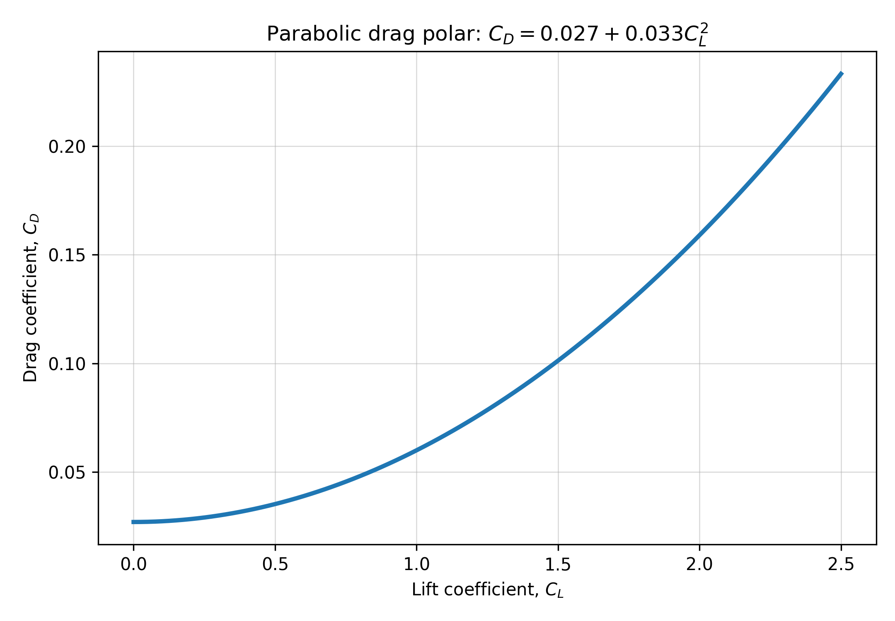
*The parabolic drag polar used for sizing.*

## Takeoff weight iteration

Takeoff weight depends on the empty weight and fuel, and both depend on takeoff weight, so it
has to be solved iteratively:

$$
W_0 = \frac{W_\text{payload} + W_\text{crew}}{1 - W_f/W_0 - W_e/W_0}
$$

The empty-weight fraction comes from a correlation for twin turboprops, and the fuel fraction
from the product of the weight ratios of each mission segment, with a 6% margin:

$$
\frac{W_e}{W_0} = 0.92\, W_0^{-0.05}, \qquad
\frac{W_f}{W_0} = 1.06\left(1 - f_1 f_2 f_3 f_4 f_5\right)
$$

Cruise and loiter use the exponential range and endurance relations, with the engine's
brake-specific fuel consumption converted to an equivalent value:

$$
f_3 = \exp\left(-\frac{R \cdot \text{SFC}_{cr}}{V (L/D)}\right), \qquad
f_4 = \exp\left(-\frac{E \cdot \text{SFC}_{lo}}{0.866 (L/D)}\right)
$$

From a first guess of 50 t, the iteration converged within six steps:

| Result | Value |
|---|---|
| Takeoff weight W₀ | 154.8 kN (about 15.8 t) |
| Empty weight fraction | 0.506 |
| Fuel fraction | 0.145 |
| Payload fraction | 0.333 |
| Crew fraction | 0.016 |

## Wing loading and power

The landing constraint links wing loading to the approach speed, with
$$V_\text{app} \approx 1.3\, V_S$$:

$$
\frac{W}{S} = \frac{1}{2} \rho_0 C_{L,\max} \left(\frac{V_\text{app}}{1.3}\right)^2
$$

An approach speed of 55 to 65 m/s gives a wing loading of about 3,500 to 5,000 N/m² and a
wing area of about 31 to 44 m². A power loading of 65 to 75 N/kW, typical of short-runway
turboprops, gives a total installed power of about **2,060 to 2,380 kW**.

As a check, cruise at 20,000 ft with $$S \approx 37$$ m² needs a lift coefficient of about 0.92
and a shaft power of about 1.2 MW, at a propulsive efficiency of 0.8. Cruise therefore does not
size the engines: takeoff and climb do.

The Pratt & Whitney Canada PW127XT-M was adopted as the reference engine for packaging
(2.13 m long, 0.72 m wide and 495 kg dry). Its rating of 2,051 kW per engine is well above the
requirement of about 1,030 to 1,190 kW per engine, so a final design would need to revisit
this choice.

## Component sizing

### Wing

With no compressibility reason for sweep at this Mach number, the wing is almost straight, and
the high lift comes from slats and double-slotted Fowler flaps.

| Parameter | Value |
|---|---|
| Area, aspect ratio | 40 m², 12 |
| Span | 21.9 m |
| Taper ratio | 0.45 |
| Root and tip chord | 2.52 m, 1.13 m |
| Mean aerodynamic chord | 1.91 m |
| Quarter-chord sweep | 2° |
| Washout, incidence | −2°, 2° |
| Airfoils, root to tip | NACA 4415 to NACA 4412 |

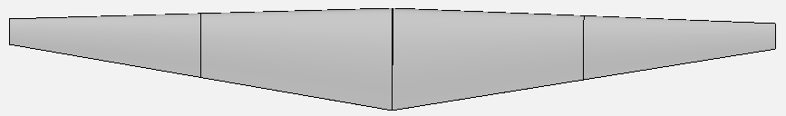
*Wing in the clean configuration.*

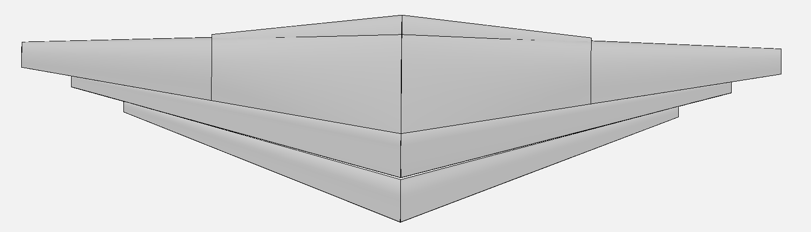
*Wing with slats and Fowler flaps extended.*

### Fuselage

A 2+2 layout at a 30 in pitch needs 13 rows, or 52 seats, and benchmarking against the reference
aircraft guided the final dimensions.

| Parameter | Value |
|---|---|
| Cabin width and length | 2.55 m, 12.0 m |
| Fuselage diameter and length | 2.70 m, 23.5 m |
| Target cargo volume | 9 m³ |

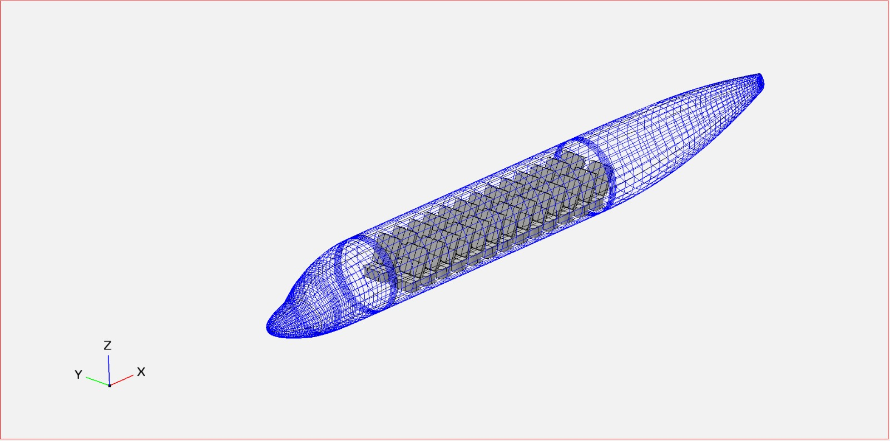
*Fuselage and cabin layout in OpenVSP.*

### Tail and landing gear

The tail was sized from volume coefficients, with a tail arm of about 7.5 to 8 m:

$$
V_H = \frac{S_H l_H}{S \bar{c}} \approx 0.8, \qquad
V_V = \frac{S_V l_V}{S b} \approx 0.05
$$

This gives a horizontal tail of about 7 to 8 m² and a vertical tail of about 5.5 to 6.5 m². The
retractable tricycle landing gear uses first estimates of 4.38 m for the track and 8.23 m for
the wheelbase.

## 3D model and aerodynamic check

All the components were combined in a parametric OpenVSP model, which was checked for alignment,
interference and propeller clearance. The centre of gravity stays close to the wing's mean
aerodynamic chord.

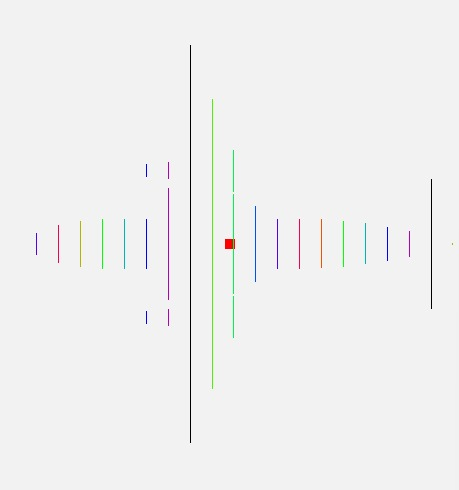
*Centre of gravity of each component (lines) and of the aircraft (red square), top view.*

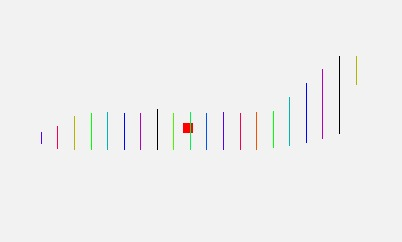
*The same distribution in side view.*

The vortex lattice solver VSPAERO was then used as an independent check.

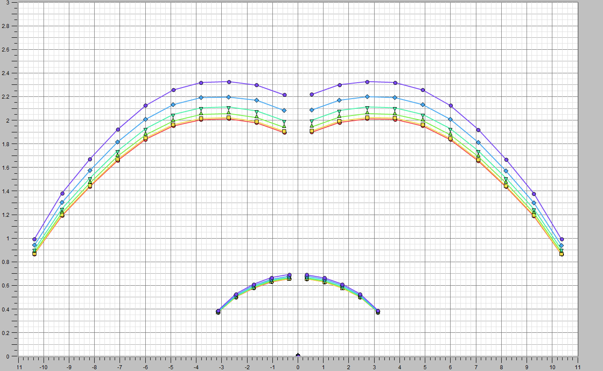
*Spanwise loading at α = 8°, for Mach numbers from 0.01 (lowest curve) to 0.55 (highest). The loading grows with Mach number while keeping its shape.*

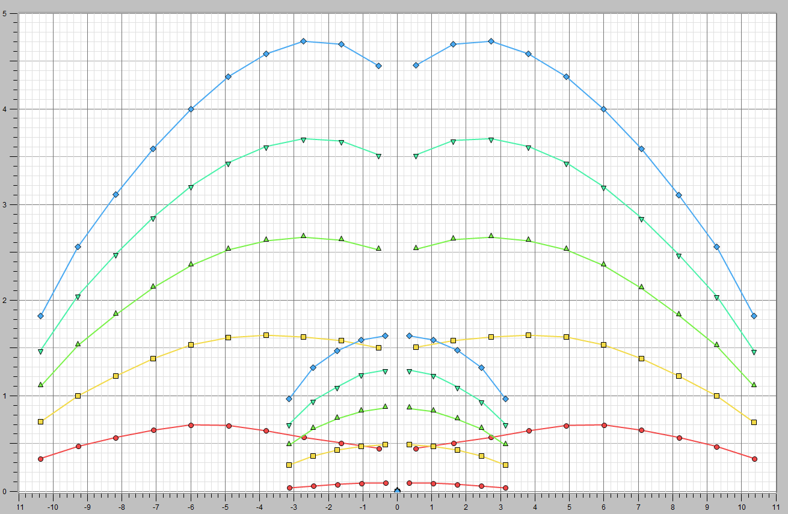
*Spanwise loading at Mach 0.33, for α = 1°, 5.8°, 10°, 15° and 20° (lowest to highest). The dip at the centre reflects the fuselage.*

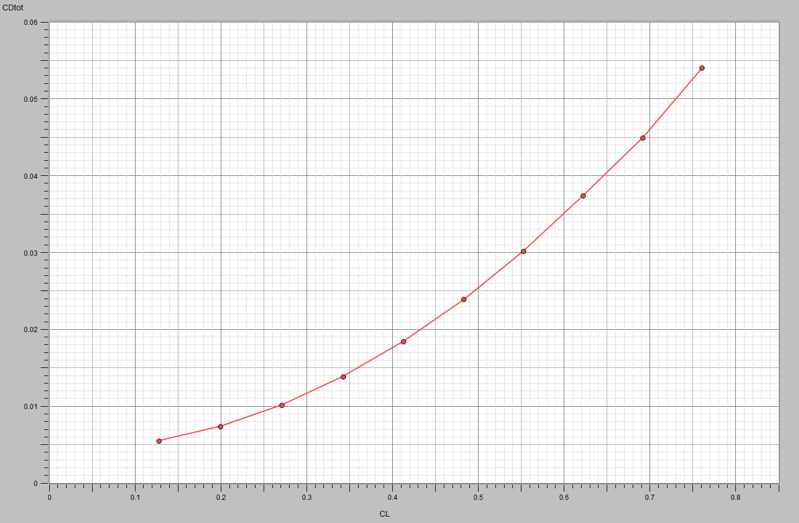
*Drag polar from VSPAERO, which follows the expected quadratic trend.*

VSPAERO gave $$K \approx 0.030$$, close to the 0.033 assumed for sizing. Its $$C_{D_0}$$ of 0.005
to 0.010 covers the wing only, without the fuselage and interference drag, so the higher
estimate of 0.027 was kept.

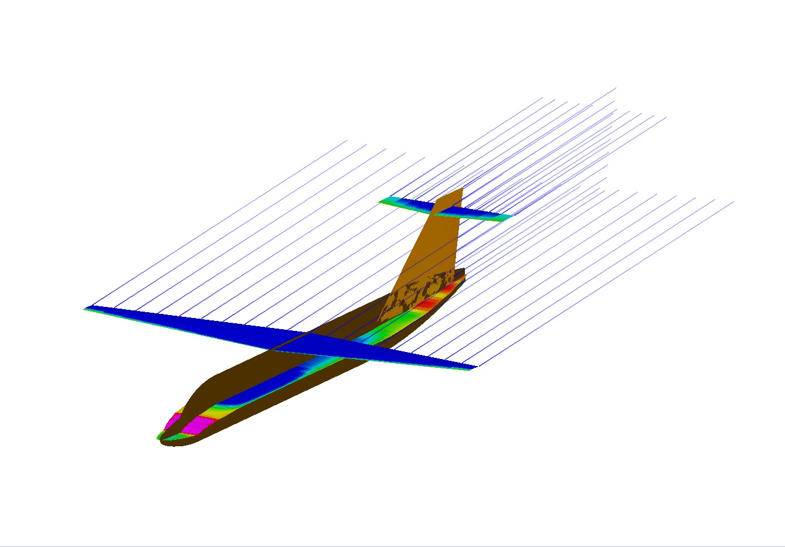
*Vorticity, with the strongest values towards the wing tips, as expected for a finite wing.*

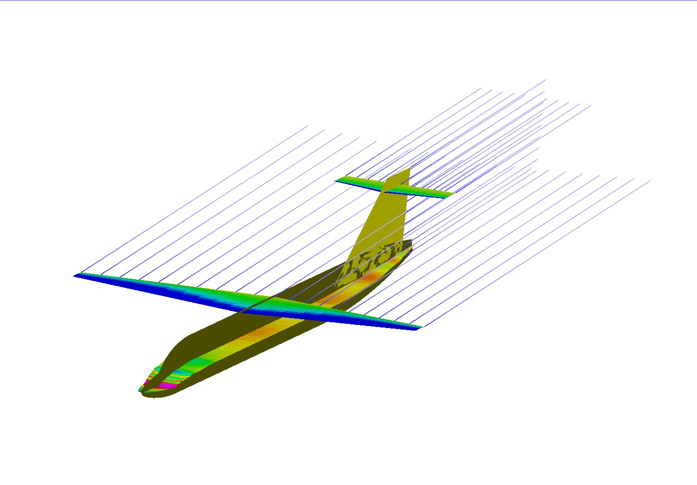
*Pressure distribution over the aircraft.*

## Limitations and next steps

- **Low fidelity:** the weights come from statistical correlations, and the vortex lattice
  method is inviscid. It cannot predict stall, so its high-angle results are only trends. The
  results are a consistency check, not a true validation.
- **Not yet checked:** the one-engine-inoperative case, detailed stability and control, and the
  takeoff and landing distances still need dedicated analysis.
- **Next steps:** structural sizing, a constraint diagram for the wing and power loading, CFD of
  the configuration, and an economic assessment.

## What I learned

- How strongly the disciplines of aircraft design are coupled, and why sizing is iterative.
- How to get useful first estimates from existing aircraft and classical correlations.
- How to check that assumptions stay consistent across the sections of a design.
- How to use low-fidelity tools for what they are good at, without overstating their results.

## References

D. P. Raymer, *Aircraft Design: A Conceptual Approach*, 6th ed., AIAA, 2018.
E. Torenbeek, *Synthesis of Subsonic Airplane Design*, Springer, 2013.
