## Objective

Twist affects how a wing carries load, so measuring it is a basic test in aeroelasticity. The goal
was to design a simple, low-cost rig to apply a known torque to a wing and measure how far it
twists, without any testing machine.

## Requirements

- Test a **NACA 2412** wing made by additive manufacturing, within a 256 × 256 × 256 mm print
  volume.
- Clamp one end rigidly.
- Apply the torque at the other end, as close as possible to pure torsion, with minimal bending.
- Apply the load using masses only.
- Include a direct way to measure the twist angle.

## Design

A cable runs from the rotating support, over a pulley at the edge of the table, to the hanging
masses. Each part of the rig handles one part of this load path.

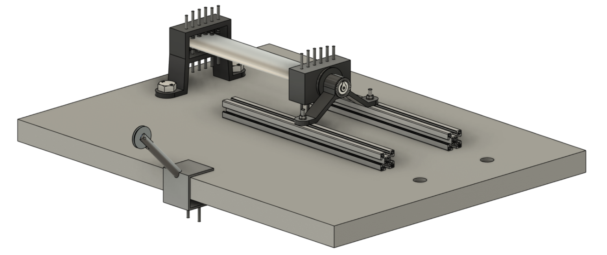
*First version, designed for additive manufacturing.*

### Root support

The root support stops the wing from moving or rotating at that end, so the measured angle comes
from the wing. Swivel-tip clamping screws spread the contact pressure and avoid damaging the
surface, and they can adapt to other airfoils or thicknesses.

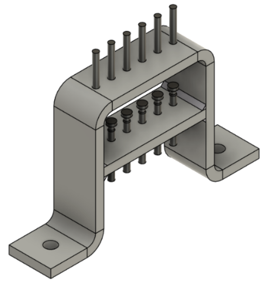
*Root support, with the clamping screws above and below the wing.*

### Rotating support

The free end has two parts. A fixed housing sits on aluminium rails, so the rig can take wings of
different lengths. A rotating part is connected to it by two deep groove ball bearings, leaving
rotation about the wing axis as the only free motion.

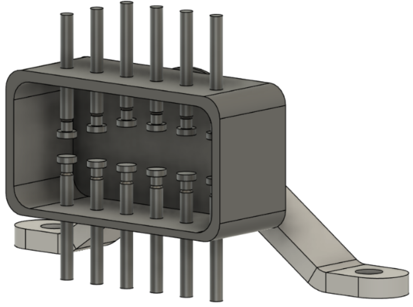
*The part of the support that rotates, clamped to the free end of the wing.*

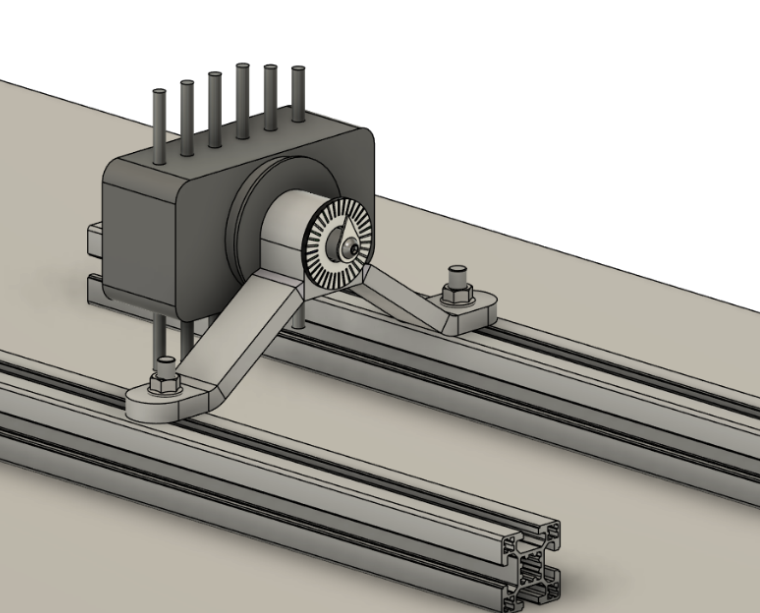
*The support on the rails, with the protractor on its front face.*

### Angle measurement

A pointer on the rotating part moves over a graduated protractor, so the angle can be read directly
as masses are added. The pointer position can be adjusted to set the zero before each test, to
compensate for alignment errors or pre-deformation from the assembly.

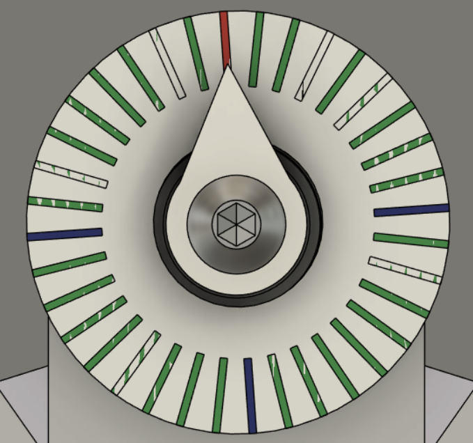
*Graduated protractor and adjustable pointer.*

### Pulley

The pulley support clamps to the edge of the table, and guides the cable so that the weight pulls
at a right angle to the arm of the rotating support.

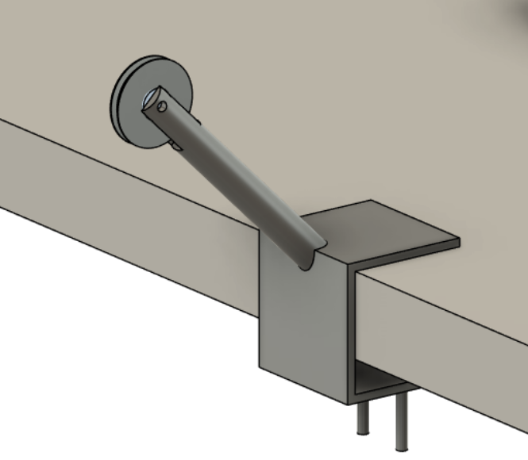
*Pulley support at the table edge.*

### Standard parts and manufacturing

Standard parts keep the rig easy to source: a 40 × 40 mm aluminium profile, T-bolts and M8 nuts,
24 swivel-tip clamping screws, a cable pulley and two 61802-2RS1 ball bearings. After the 3D-printed
concept, the rig was redesigned in sheet metal to reflect how it would be made by bending, in
S235JR steel. Every part received a part number within an assembly hierarchy, and a full set of
technical drawings was produced.

## Loads

A hanging mass $$m$$ creates a force, and the torque follows from the pulley radius of
$$r = 34$$ mm:

$$
F = m g, \qquad M = F r
$$

| Mass | Force | Torque |
|---|---|---|
| 1 kg | 9.81 N | 0.33 N·m |
| 2 kg | 19.62 N | 0.67 N·m |
| 4 kg | 39.24 N | 1.33 N·m |
| 8 kg | 78.48 N | 2.67 N·m |
| 16 kg | 156.96 N | 5.34 N·m |
| 32 kg | 313.92 N | 10.67 N·m |
| 64 kg | 627.84 N | 21.35 N·m |

## Finite element analysis of the wing

The wing was analysed first because it sets the largest load the rig has to carry. At 64 kg, the
tip moves by about 38 mm, which corresponds to a twist of about 21°.

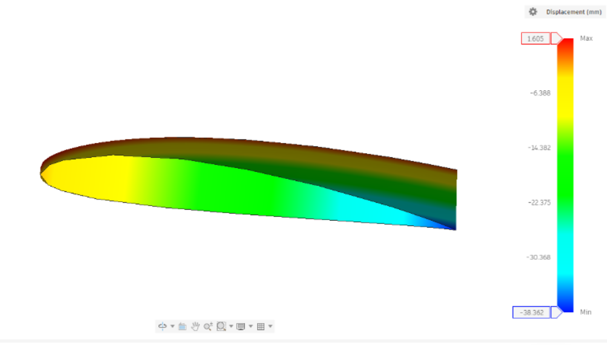
*Wing displacement at the maximum torque.*

The minimum safety factor at this load is **0.256**, so the 3D-printed wing would fail. This makes
64 kg a limit case, used to size the rig so that it stays safe even if the wing breaks.

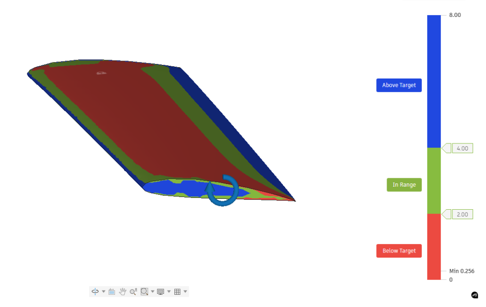
*Safety factor of the wing at the maximum torque. Below 1, the material exceeds its limit.*

For a linear analysis, the stress is proportional to the load. On that basis, the safety factor would
reach 1 at about 16 kg:

$$
m_{SF=1} \approx 0.256 \times 64\ \text{kg} \approx 16\ \text{kg}
$$

The tests should therefore add masses gradually and stay below this level to remain in the
elastic range.

## Finite element analysis of the rig

Each part was checked at the 64 kg condition, with a fixed support at its mounting faces.

| Part | Max. displacement | Max. von Mises stress | Result |
|---|---|---|---|
| Root support | ≈ 0.004 mm | 2.65 MPa | Oversized |
| Rotating support, fixed part | 0.002 mm | 6.4 MPa | Oversized |
| Rotating support, rotating part | 0.003 mm | 8.1 MPa | Very stiff |
| **Pulley support** | **0.37 mm** | **85 MPa** | **Critical part, safety factor 2.43** |

### Root support

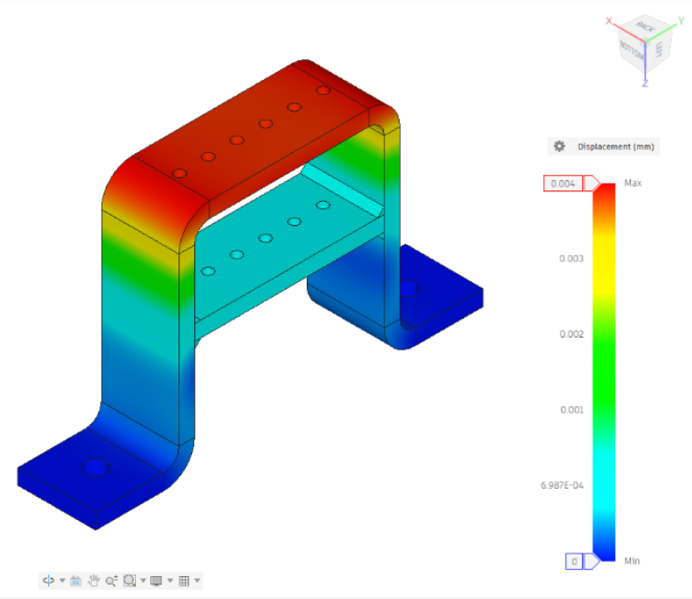
*Displacement.*

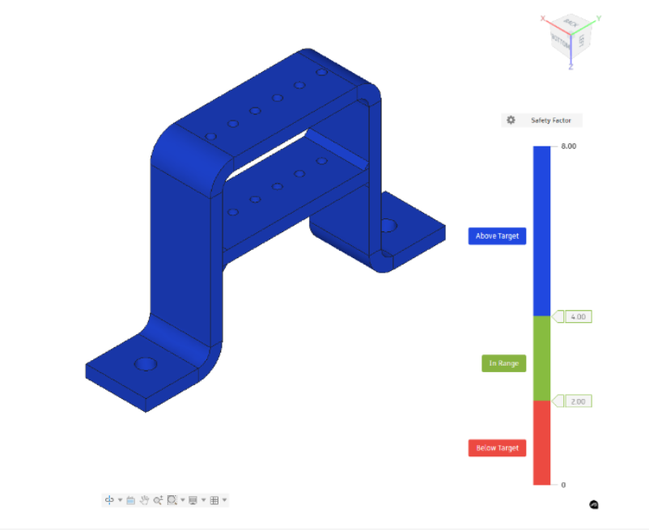
*Safety factor.*

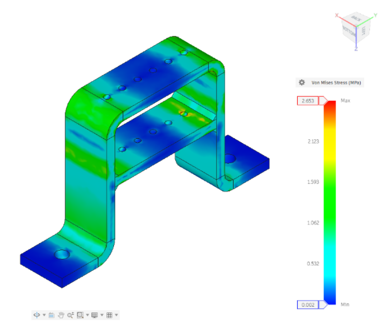
*Von Mises stress.*

### Rotating support, fixed part

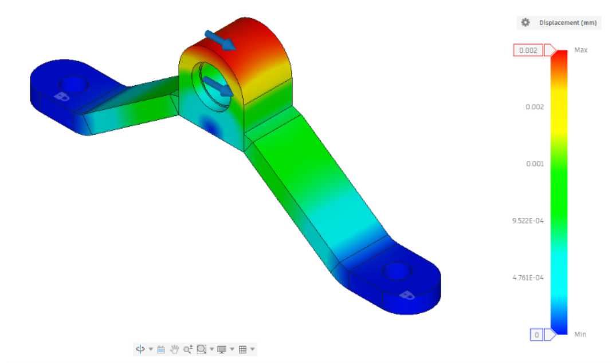
*Displacement, with a force of 314 N at each bearing seat.*

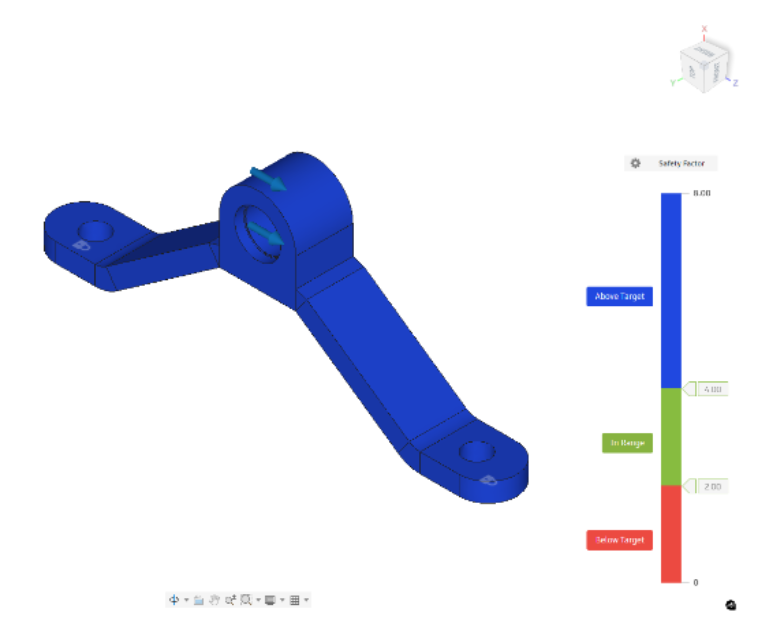
*Safety factor.*

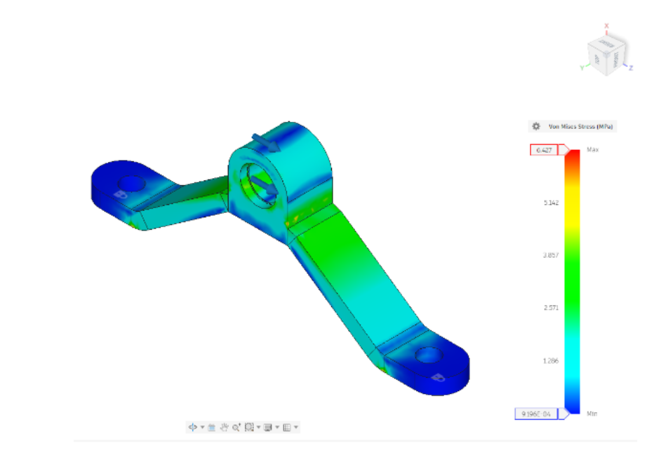
*Von Mises stress.*

### Rotating support, rotating part

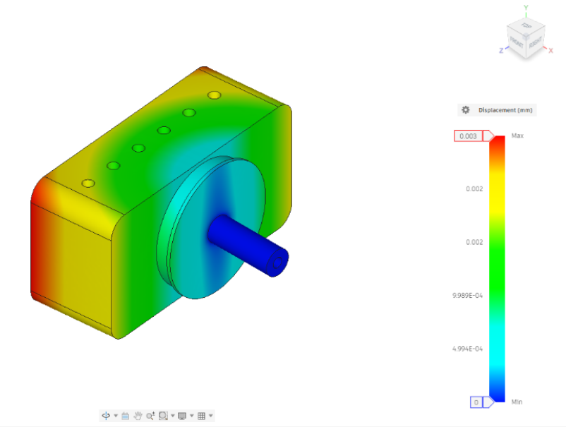
*Displacement, with the shaft fixed at the bearings and the 628 N force at the cable attachment.*

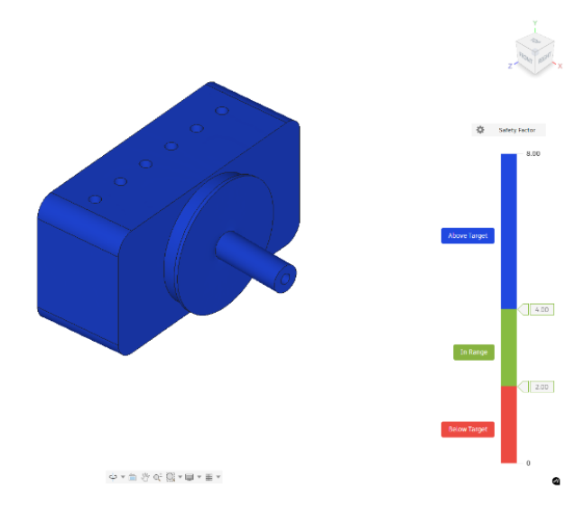
*Safety factor.*

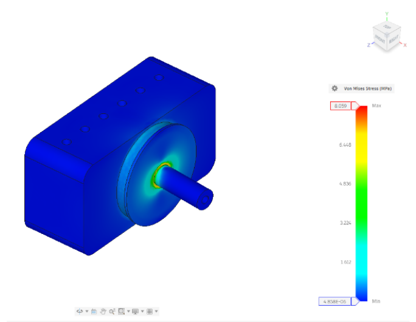
*Von Mises stress.*

### Pulley support

The pulley support is the most loaded part. The highest stress is where its shaft meets the body,
as expected for a cantilever under bending.

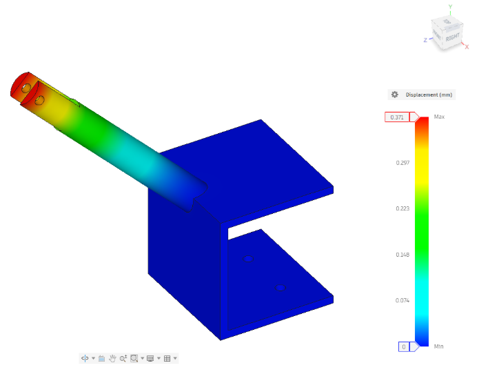
*Displacement, largest at the end of the shaft.*

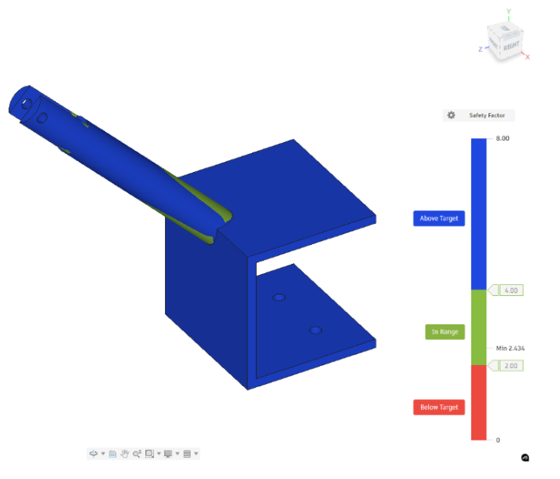
*Safety factor, with a minimum of 2.43.*

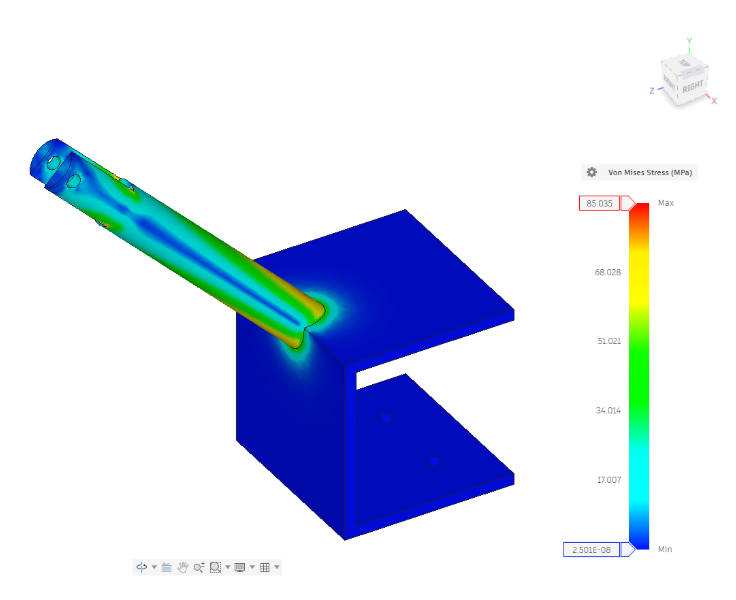
*Von Mises stress, with a maximum of 85 MPa at the root of the shaft.*

## Bearing check

With the 1.9 kN dynamic load rating of each bearing, the safety factor is 3.0 if one bearing takes
the whole 628 N, and 6.0 if the two share it equally:

$$
SF = \frac{C}{F} = \frac{1900}{628} \approx 3.0, \qquad \frac{1900}{314} \approx 6.0
$$

## Limitations and next steps

- **Design stage:** the rig was designed but not built, so all the results come from linear static
  simulations, and none has been measured. Plastic printed parts are not isotropic, and they deform non-linearly near failure. So the
  wing's limit is an estimate, which a real test would need to confirm.
- **No mesh study:** peak stresses at sharp corners are mesh dependent, so these peak values are
  indicative.
- **Pulley load:** the analysis applies 628 N at the pulley. If the cable turns through 90°, the
  force on the pulley is $$\sqrt{2} F \approx 888$$ N. With a linear scaling, this would give about
  120 MPa and a safety factor of about 1.7. That is still above 1, but it is the next check to make.
- **Bearings:** the load is almost static, so a check with the static load rating would be more
  appropriate.
- **Next steps:** build the rig and run the test, compare the measured stiffness with the simulation, add
  finer instrumentation for the angle, and try other wing materials and airfoils.

## What I learned

- How to turn a test requirement into a mechanical design, using standard parts where possible.
- How to analyse the part that fails first, and use it to set the design load for the rest.
- How manufacturing methods change a design, from 3D printing to sheet metal.
- How to read a safety factor critically, and check that loads and boundary conditions are right.
