## Objective

Monitoring blood flow in arteries could help detect cardiovascular problems early. The goal was to
develop and simulate a non-invasive ultrasonic flow sensor, placed on the skin. The model was built
in stages, first checking the coupled physics with a simple channel of water, and then adding blood
flow, human tissue layers and better-suited materials.

## How the sensor works

A piezoelectric crystal converts an alternating voltage into vibration, which sends an ultrasonic
wave through the medium. A second crystal does the reverse, turning the arriving wave into a voltage.

A wave travelling with the flow arrives earlier than one travelling against it. For a path of length
$$L$$, at an angle $$\theta$$ to the flow of speed $$v$$, in a medium with a speed of sound $$c$$:

$$
t_1 = \frac{L}{c + v \cos\theta}, \qquad t_2 = \frac{L}{c - v \cos\theta}
$$

The difference between these two times gives the flow speed:

$$
\Delta t = t_2 - t_1 = \frac{2 L v \cos\theta}{c^2 - v^2 \cos^2\theta}
$$

Placing both crystals on the same side of the artery allows both to sit on the skin, avoiding surgery.
The wave then reflects off the far side of the artery.

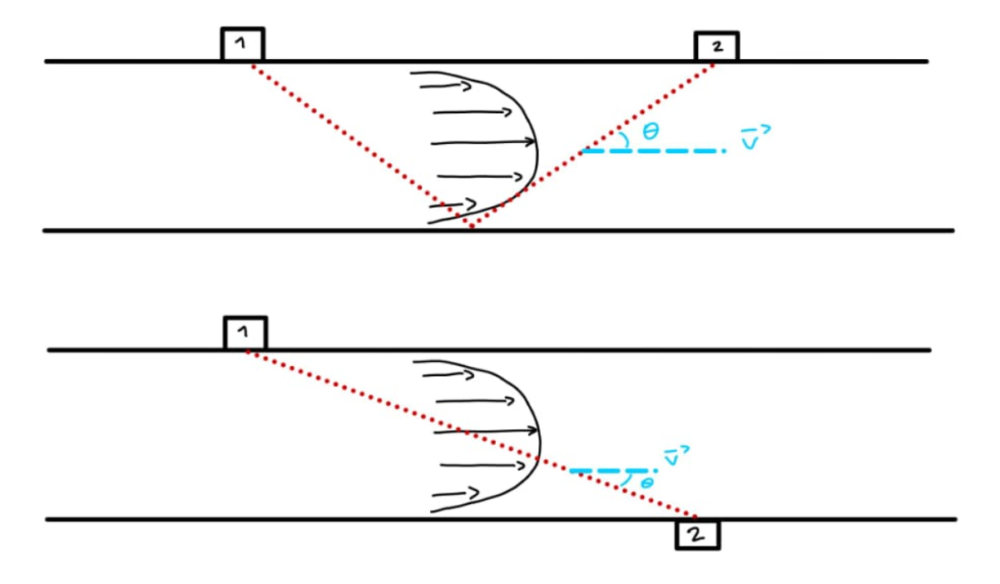
*Two possible arrangements. The upper one, with both crystals on the same side, was selected.*

## Stage 1: Preliminary model

The first model is a 2D channel of water with two PZT-5H crystals, to check that the coupled physics
behaves as expected, with the fluid at rest.

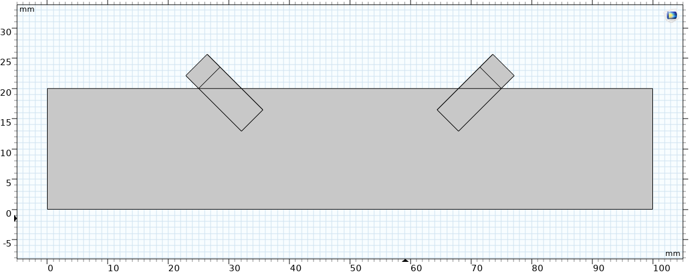
*Geometry of the preliminary model, in mm.*

| Physics | Role | Applied to |
|---|---|---|
| Pressure Acoustics, Transient | Wave propagation | Fluid |
| Electrostatics | Voltage on the crystals | Crystals |
| Solid Mechanics | Vibration of the crystals | Crystals |
| Piezoelectric Effect | Couples voltage and deformation | Crystals |
| Acoustic-Structure Boundary | Couples crystals and fluid | Their interfaces |

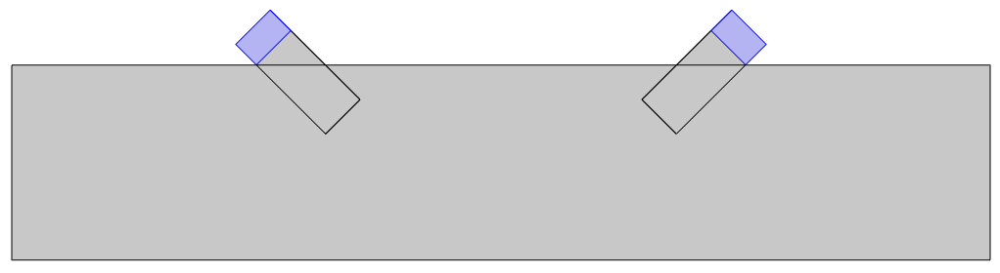
*The piezoelectric crystals, in blue.*

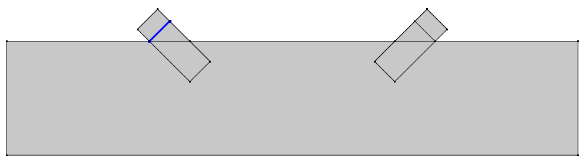
*Ground on the emitting crystal.*

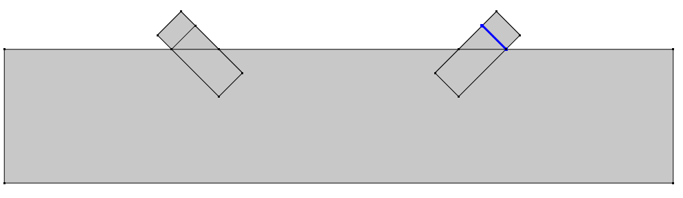
*Ground on the receiving crystal.*

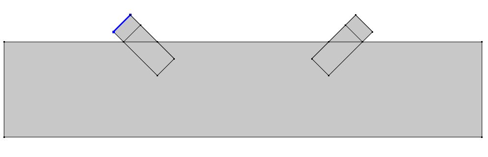
*Electric potential, applied only to the emitting crystal.*

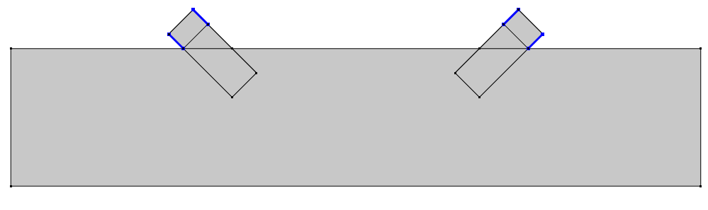
*Fixed constraints on both crystals.*

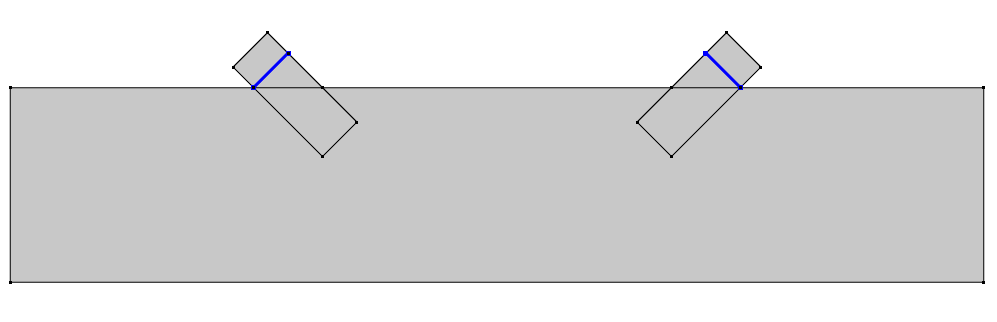
*Acoustic-structure boundaries, between the crystals and the fluid.*

The emitter is driven at its thickness resonance, with an amplitude of 50 V. A 5 mm crystal with a
speed of sound of about 4000 m/s gives 400 kHz:

$$
V = V_1 \cos(2 \pi f t), \qquad f = \frac{c_\text{PZT}}{2t} = 400\ \text{kHz}
$$

### Results

The wave reaches the fluid, then the receiver vibrates, and finally a voltage appears across it, in
the expected order.

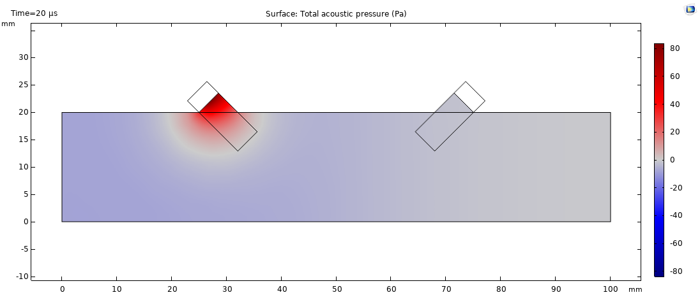
*Acoustic pressure at 20 µs, spreading from the emitter.*

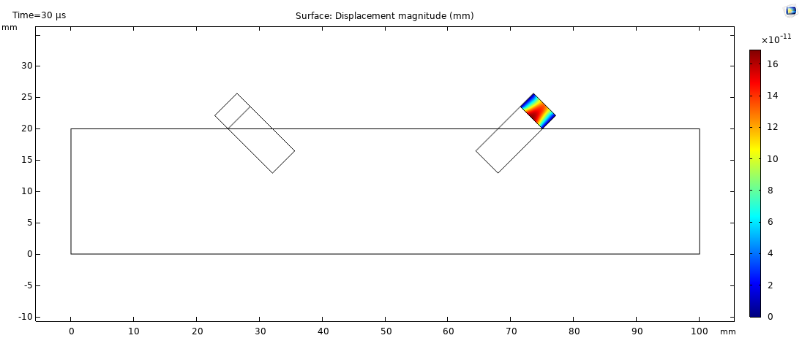
*Displacement of the receiving crystal at 30 µs.*

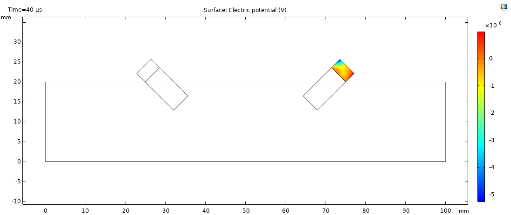
*Voltage induced in the receiving crystal at 40 µs.*

## Stage 2: A more realistic model

### Lead-free crystals

PZT contains lead, which is unsuitable for a medical device. Potassium sodium niobate is a lead-free
alternative, but it is hard to synthesise and not widely used. Barium titanate (BaTiO₃) was selected as
a biocompatible and available option, although its piezoelectric constant is much lower. With a speed
of sound of about 4500 m/s, the resonance moves to about 450 kHz.

### Blood as a non-Newtonian fluid

Water was replaced by blood, with a density of 1050 kg/m³ and a speed of sound of 1540 m/s. A laminar
flow model calculates its velocity, using the Carreau-Yasuda model for the shear-thinning viscosity:

$$
\mu(\dot\gamma) = \mu_\infty + (\mu_0 - \mu_\infty)\left[1 + (\lambda \dot\gamma)^a\right]^{\frac{n-1}{a}}
$$

with $$\mu_0 = 0.056$$ Pa·s, $$\mu_\infty = 0.0035$$ Pa·s, $$\lambda = 3.313$$ s, $$n = 0.3568$$ and
$$a = 2$$.

### Tissue layers

The wave has to cross several tissues to reach the artery. Their properties came from the literature.

| Layer | Thickness | Young's modulus | Poisson's ratio |
|---|---|---|---|
| Skin | 1.45 mm | 10 MPa | 0.3 |
| Subcutaneous fat | 3 mm | 11 kPa | 0.49 |
| Pectoral muscle | 8.5 mm | 300 MPa | 0.3 |
| Artery wall | 7.5 mm | 1.08 MPa | 0.49 |
| Aorta (blood) | 20 mm diameter | – | – |

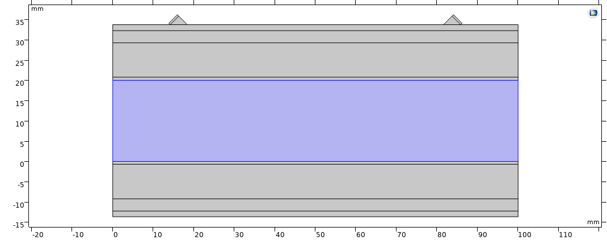
*The final geometry, with the sensors on the skin and the blood domain in blue.*

### Acoustic matching layer

The crystal has a much higher acoustic impedance than tissue, so most of the wave would reflect at
that interface. An intermediate matching layer reduces this reflection:

$$
Z_\text{match} = \sqrt{Z_\text{transducer} \cdot Z_\text{skin}} = \sqrt{21.4 \times 1.68} \approx 6\ \text{MRayl}
$$

An alumina-epoxy composite with a 1:1 ratio by weight is close to this target, with a density of
1974 kg/m³ and a speed of sound of 3288 m/s, which gives 6.5 MRayl. The source does not provide its
elastic constants, so a mixture rule gave a Poisson's ratio of about 0.32 (with a volume fraction of
alumina of about 0.24), and the Young's modulus followed from the wave speed:

$$
E = \rho c^2 \frac{(1 + \nu)(1 - 2\nu)}{1 - \nu} \approx 15\ \text{GPa}
$$

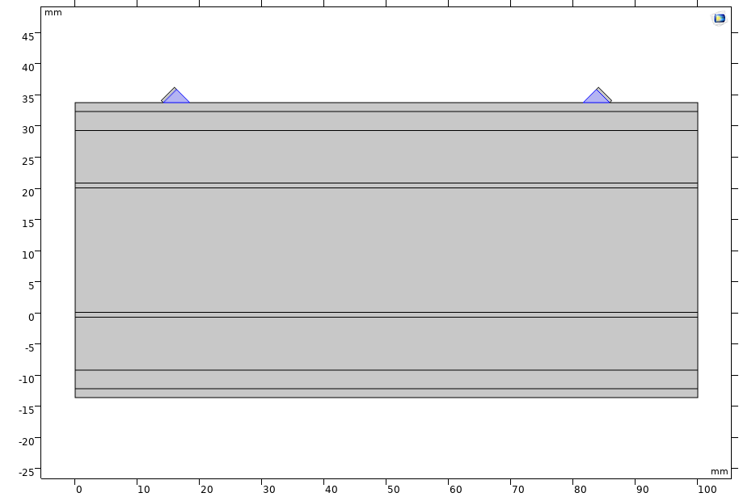
*The matching layer, in blue, under the two sensors.*

### Results: blood flow

A stationary study calculated the flow for inlet speeds of −5, 1, 5 and 10 mm/s. The boundary layers
develop quickly from the inlet into a fully developed profile.

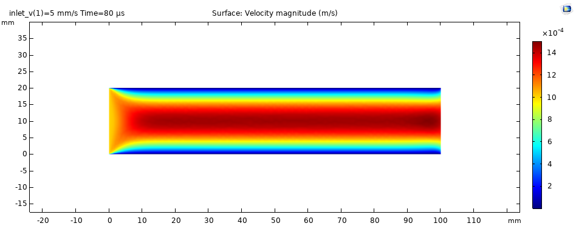
*Velocity magnitude for a 1 mm/s inlet speed. The label in the plot title comes from the software's parametric sweep.*

*Velocity magnitude for a 10 mm/s inlet speed.*

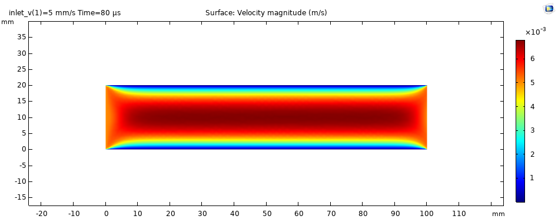
*Velocity magnitude for a −5 mm/s inlet speed, with the flow in the opposite direction.*

### Results: wave propagation

The transient study shows the wave entering the blood and spreading through it.

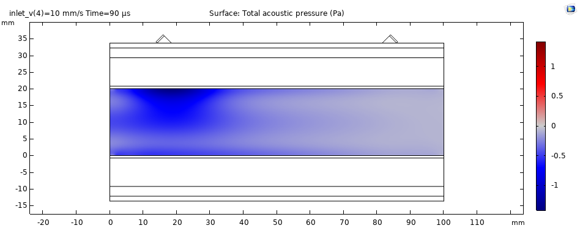
*Acoustic pressure in the blood at 90 µs, for 10 mm/s.*

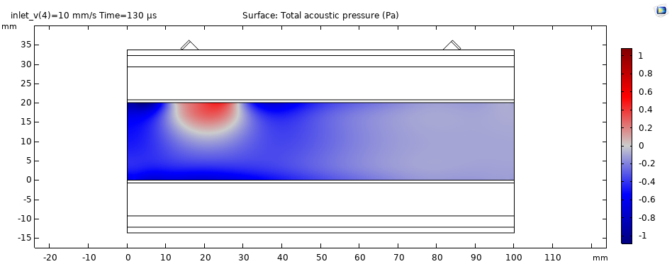
*Acoustic pressure in the blood at 130 µs, for 10 mm/s.*

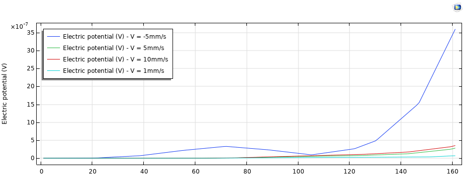
*Maximum voltage on the receiver for the four flow speeds.*

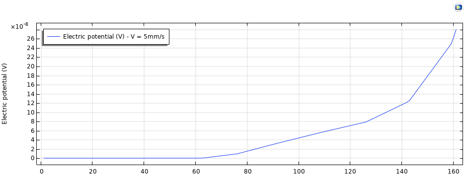
*Maximum voltage on the receiver at 5 mm/s, rising from about 62 µs.*

In the simulation, the signal starts to rise from about 62 µs for 5 mm/s. The reversed flow case behaves
differently: its signal departs from zero much earlier, at about 25 µs, and rises strongly after about
105 µs, reaching about ten times the voltage of the other cases. All the signals are below 4 µV.

## What the results can and cannot show

This is the most important part of the study. The chain from voltage to wave to voltage works, which
was the first goal, but **these results do not demonstrate a flow measurement**:

- **The expected effect is far too small to see here.** For $$L \approx 57$$ mm, $$\theta = 45°$$ and
  $$v = 5$$ mm/s, the transit-time equation gives $$\Delta t \approx 0.2$$ ns. The time step is 1 µs, 5000
  times larger. At these speeds, the flow is about 3 millionths of the speed of sound. So differences of
  tens of microseconds, or a tenfold change in voltage, between the cases cannot come from the flow.
- **The time step is coarse.** It gives only about two points per period at 450 kHz, which is close to
  the bare sampling limit. Wave propagation usually needs at least 10 to 20.
- **Coupling of the flow and the acoustics.** The standard pressure acoustics equation does not include
  flow. Capturing the effect needs a formulation with a background flow, such as a convected wave
  equation.
- **Tissue properties.** Static elastic moduli imply wave speeds well below the 1450 to 1600 m/s typical
  of soft tissue, so acoustic properties would be more suitable for these layers.
- **Other simplifications:** the model is 2D, without a mesh study, and the speeds are far below those
  in a real aorta, which reach the order of 1 m/s.

## Next steps

- Reduce the time step, and size the mesh from the wavelength of about 3.4 mm in blood.
- Use a convected wave model, and run each case with the wave travelling in both directions.
- Use acoustic properties for the tissue layers.
- Measure $$\Delta t$$ by cross-correlating the two signals, at realistic flow speeds.

## What I learned

- How to couple piezoelectric, structural, acoustic and fluid physics in COMSOL.
- How to size a transducer and a matching layer from first principles.
- How to include non-Newtonian behaviour and choose materials for a medical use.
- To compare simulation results with a simple estimate, because the model can run correctly and still
  be unable to resolve the effect of interest.
